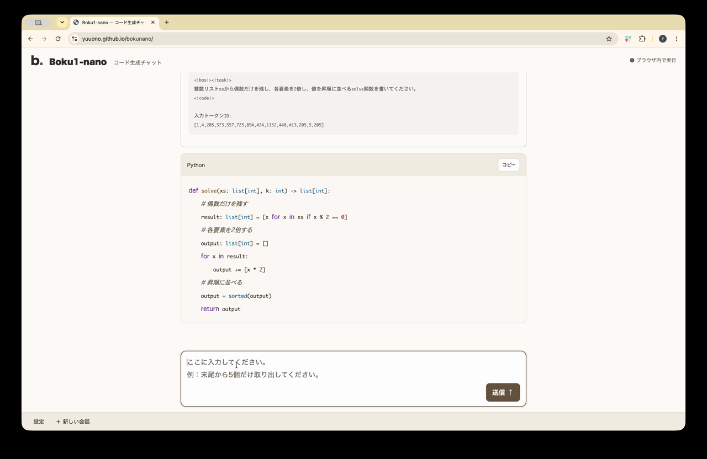

# Boku1-nano

## Demo

[デモはこちらです](https://yuuono.github.io/bokunano/)

日本語の指示からPythonコードを生成するデモ動画（約1分16秒）。画像をクリックすると動画を開けます。

[デモ動画を開く（MP4）](docs/report/media/demo.mp4)

Boku1-nanoは、CNLから`solve(xs, k)`形式のPythonコードを生成する小規模なDecoder-only Transformerです。トークナイザとモデルをランダム初期値から学習しています。ブラウザ版は、チャット内で指示を送り、Qwen3-0.6Bによる日本語の整理とBoku1-nanoのコード生成を続けて確認するベージュ基調のUIです。先頭には1〜4操作の文章例を表示し、入力した日本語をQwenで整理します。番号や箇条書きの形式差は吸収し、操作内容と順序を検査してCNLへ整形します。掲載例の操作列はQwenの出力検査にだけ使い、欠落・順序・数値が違えば理由を返して1回再試行します。2回とも失敗した場合はCNLを確定せず、アプリによる操作の補完は行いません。各回の実際のプロンプト・出力・検査結果を確認できます。検査通過後はBoku1-nanoのコード生成へ自動で進み、モデル間の切り替えを表示します。通常の新しい指示には前の操作を渡さず、「前の処理に追加」「kを5に変えて」など明示的な変更依頼だけ履歴を引き継ぎます。既定は5M・1エポック・既存BPEで、設定ボタンから1M・3エポックの2種類を含む10モデルと温度を選べます。

両モデルの温度を独立して調整でき、0はgreedy、正の値はsamplingです。24種類・最大4操作に対応し、4操作は学習範囲（最大3操作）を超える実験として扱います。参照インタプリタによる実行・比較は公開デモから外しています。実行方式は[説明資料](docs/procedures/browser_reference_interpreter.md)に記録しています。

- [課題仕様](boku1-nano.md)
- [全ドキュメント](docs/README.md)
- [3エポックモデル評価結果](docs/results/boku_nano_3epoch_evaluation_results.md)
- [1M同一構造のlooped transformer・1エポック比較](docs/results/boku_nano_looped_1m_1epoch_20261016.md)
- [1M looped transformer修正4候補・1エポック比較](docs/results/boku_nano_looped_revision_1m_1epoch_20261016.md)
- [中間層4回反復・3エポック・反復残差1.0対0.25](docs/results/boku_nano_middle4_1m_3epoch_20261018.md)
- [872問・組合せ汎化ベンチマーク（5モデル比較）](docs/results/composition_suite_872_v2_20261018.md)
