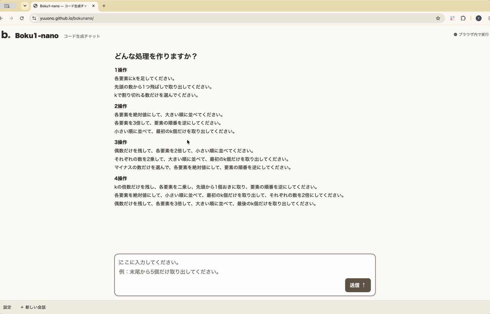
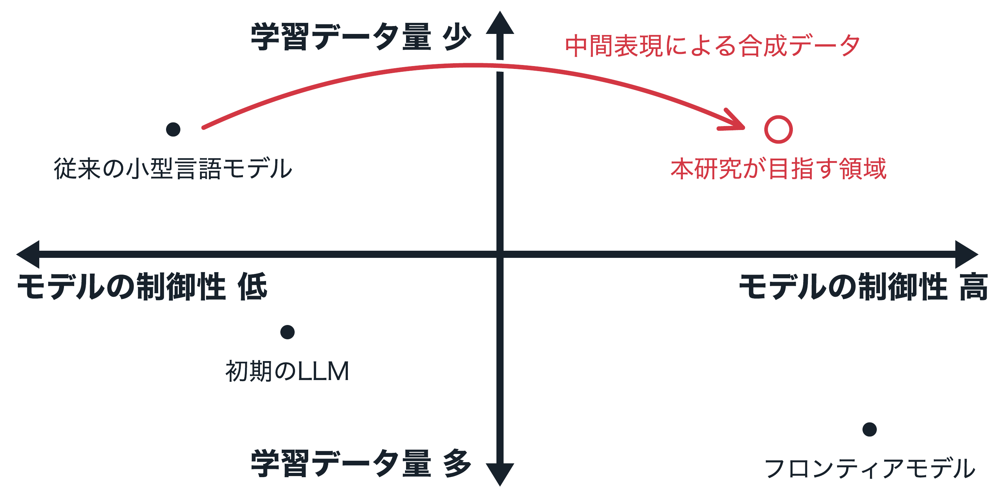
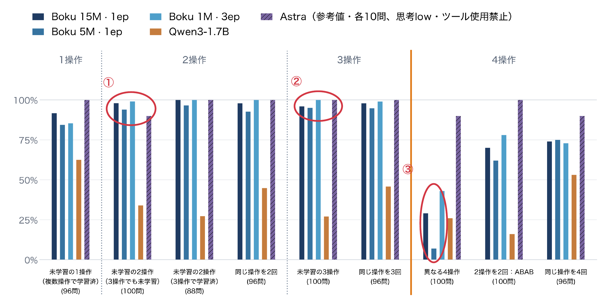

# Boku-nano

**限られた日本語指示からPython関数を生成する小型言語モデル**

自作した合成データでフルスクラッチ学習し、制限された日本語指示からのPython関数生成に<br>
特化させた小型言語モデルが、ChatGPT 6 Astraの精度を一部凌駕した

## デモ動画

日本語の指示からPythonコードを生成するデモ（約1分16秒・自動再生・ループ）。



[デモ動画をダウンロード（MP4・約20MB）](docs/report/media/demo.mp4?raw=true)

[ブラウザで試す](https://yuuono.github.io/bokunano/) · [発表資料（PDF）](docs/report/boku_nano_presentation.pdf) · [発表原稿（Markdown）](docs/report/boku_nano_presentation.md)

## 概要

| 項目 | 内容 |
| --- | --- |
| 目的 | 学部生が1人でフロンティアモデルに匹敵する小型モデルを作成する方法の提示 |
| 特徴 | 中間表現により生成した合成データの質で大規模計算に対抗 |
| 小さな計算規模 | 約1MパラメータのモデルをRTX 5090で約1分で訓練 |
| 訓練データの制御 | 文の形・操作の数・文の長さ・語彙の設計 |
| 応用への展開 | 関数で表せる処理を対象としたデータ合成・検証・モデル学習 |

## 背景：モデルの制御性と学習データ量

少量のデータでも、学ばせる処理や表現を設計することで、小型モデルの制御性を高めるという考え方



赤い矢印は、**中間表現による合成データで、限られた学習データのまま制御性を高める方向**を表す

## SLMの発展

### 分野① 自然言語そのもの（物語）

| 研究 | データの作り方 | 主な結果 |
| --- | --- | --- |
| [TinyStories](https://arxiv.org/abs/2305.07759) | GPT-3.5/4による短い物語の合成、3〜4歳児が分かる語彙への限定 | 1.25MのTransformerで一貫した文章生成 |
| [SimpleStories](https://arxiv.org/abs/2504.09184) | 平易な語彙と話題・文体・文法の指定、書き出しの変化による多様性の向上 | より少ないパラメータ数でLLM評価の得点向上 |
| [WRAP](https://arxiv.org/abs/2401.16380) | Web文書の4文体への言い換え、350M・1.3Bモデルの事前学習 | 同等性能まで約3倍高速化、perplexity 10%以上改善 |

文章の良さに対する人やLLMの評価を重視する分野であり、人の好みを用いた学習が**RLHF**、LLMによる採点が**LLM-as-a-Judge**

### 分野② code・math

| 研究 | データ・学習方法 | 主な結果 |
| --- | --- | --- |
| [phi-1：code](https://arxiv.org/abs/2306.11644) | 教科書品質の選別データとGPT-3.5の合成教材、約7Bトークンのデータを用いた1.3Bモデルの学習 | HumanEval 50.6% |
| [TinyGSM：math](https://arxiv.org/abs/2312.09241) | GPT-3.5による約1,230万件の算数問題とPython解答の合成、1.3Bモデルの学習 | 検証器との組み合わせでGSM8K 81.5% |
| [HRM-Text（2026）：math・言語](https://arxiv.org/abs/2605.20613) | 指示・回答ペアで1Bのスクラッチ学習、回答のみの損失計算、計60Bトークンの学習 | GSM8K 84.5%、MATH 56.2% |

テストや正解照合による正誤の検証が可能であり、その検証結果を報酬に用いる学習方法が**RLVR（検証可能な報酬による強化学習）**

## 意味ASTによる意味の固定と言い換えの生成

**日本語の指示文と正解のPythonコードに、共通の処理の定義である「意味AST」を使用**

例えば「偶数を残す → 各要素にkを加える」という処理の定義は、次のとおり

```json
{"sequence": [
    {"filter": ["even"]},
    {"map": ["add_k"]}
]}
```

この意味ASTを共通の生成元として、日本語の言い換えとPythonコードをそれぞれ作成

| 日本語の指示文 | 正解のPythonコード |
| --- | --- |
| Qwen3-4B-AWQによる各操作の日本語表現生成 | ASTの操作からPythonコードへの変換 |
| 承認済みの表現をASTの順に組み合わせ | 構文確認と参照インタプリタによる実行結果の照合 |

同じ意味を持つ日本語の例

- 「偶数だけを残し、各要素にkを加える」
- 「偶数を選び出して、各要素にkを足す」

対応するPythonコードの例

```python
def solve(xs, k):
    return [x + k for x in xs if x % 2 == 0]
```

**共通の中間表現によって、意味の対応を保った合成データの拡充が可能**

言い換えを活用する背景として、[WRAP（Maini et al., 2024）](https://arxiv.org/abs/2401.16380)によるWeb文書の言い換えを用いた事前学習の効率改善

## 独自ベンチマークによる評価結果

日本語指示からのコード生成について、Boku-nano・Qwen3-1.7B・ChatGPT 6 Astraを比較



| 注目点 | 結果 |
| --- | --- |
| ① 未学習の2操作 | Boku 1M・3 epochは99/100、Astra参考値は9/10 |
| ② 未学習の3操作 | Boku 1M・3 epochは100/100、学習済みの操作による新しい組み合わせへの対応 |
| ③ 異なる4操作 | Bokuは7〜43%、訓練範囲の最大3操作を超えると精度が低下 |

Boku・Qwenは全872問、Astraは各カテゴリ10問での参考比較であり、評価集合・実行条件は異なる

ブラウザデモの使い方と、実装・評価の資料を以下に掲載

## ブラウザデモの使い方

[デモはこちらです](https://yuuono.github.io/bokunano/)

Boku-nanoは、CNLから`solve(xs, k)`形式のPythonコードを生成する小規模なDecoder-only Transformerです。トークナイザとモデルをランダム初期値から学習しています。ブラウザ版は、チャット内で指示を送り、Qwen3-0.6Bによる日本語の整理とBoku-nanoのコード生成を続けて確認するベージュ基調のUIです。先頭には1〜4操作の文章例を表示し、入力した日本語をQwenで整理します。番号や箇条書きの形式差は吸収し、操作内容と順序を検査してCNLへ整形します。掲載例の操作列はQwenの出力検査にだけ使い、欠落・順序・数値が違えば理由を返して1回再試行します。2回とも失敗した場合はCNLを確定せず、アプリによる操作の補完は行いません。各回の実際のプロンプト・出力・検査結果を確認できます。検査通過後はBoku-nanoのコード生成へ自動で進み、モデル間の切り替えを表示します。通常の新しい指示には前の操作を渡さず、「前の処理に追加」「kを5に変えて」など明示的な変更依頼だけ履歴を引き継ぎます。既定は5M・1エポック・既存BPEで、設定ボタンから1M・3エポックの2種類を含む10モデルと温度を選べます。

両モデルの温度を独立して調整でき、0はgreedy、正の値はsamplingです。24種類・最大4操作に対応し、4操作は学習範囲（最大3操作）を超える実験として扱います。参照インタプリタによる実行・比較は公開デモから外しています。実行方式は[説明資料](docs/procedures/browser_reference_interpreter.md)に記録しています。

- [課題仕様](boku-nano.md)
- [全ドキュメント](docs/README.md)
- [3エポックモデル評価結果](docs/results/boku_nano_3epoch_evaluation_results.md)
- [1M同一構造のlooped transformer・1エポック比較](docs/results/boku_nano_looped_1m_1epoch_20261016.md)
- [1M looped transformer修正4候補・1エポック比較](docs/results/boku_nano_looped_revision_1m_1epoch_20261016.md)
- [中間層4回反復・3エポック・反復残差1.0対0.25](docs/results/boku_nano_middle4_1m_3epoch_20261018.md)
- [発表資料の872問・CUDAバッチ評価](docs/procedures/composition_872_cuda_evaluation.md)
