<!-- _class: cover -->

<!-- _paginate: false -->

# Boku-nano

## 限られた日本語指示から<br>Python関数を生成する小型言語モデル


<!--
小さなモデルをゼロから学習し、動作と表現への強さを確かめる

**基本比較は1 epoch学習。1Mの損失には3 epoch学習の結果も掲載。**


1 epochは、訓練データ全体を1回使う学習です。先行研究のモデルの学習回数を主張するものではありません。
根拠：../results/trained_model_inventory.md
-->


---


<!-- _class: overview-page -->

# 本発表の概要

> 制限された日本語指示からPython関数を生成する小型言語モデルをゼロから構築し<br>合成データのみの学習でChatgpt 6 Astraに匹敵する精度の達成　

<!-- 比較は本編の未学習2操作。Boku 1M・3 epochは99/100、Astraは同カテゴリから抽出した10問で9/10。評価集合・実行条件が異なる参考比較で、一般的な優位を意味しない。 -->

## 目的
**学部生が1人でフロンティアモデルに匹敵する小型モデルの作成方法が分かる**

## 特徴

**中間表現により生成した合成データの質で大規模計算に対抗**

## 利点
<!-- 利点は、質的なものだけではなく、量的なものをあると良いよね -->
- 約1Mのモデル・5090で1分で訓練可能
- 訓練データの制御性：文の形・操作の数（難しさ・文の長さ）・使う語彙の数の制御が可能
- 応用範囲：関数で書ける処理なら同じ方法でデータ合成からモデル学習まで全て可能


---


<!-- _class: quadrant-page -->

# 背景：モデルの制御性と学習データ量による位置づけ

<div class="map">
<div class="v-line"></div><div class="v-head"></div>
<p class="ax ax-top">学習データ量 少</p>
<p class="ax ax-bottom">学習データ量 多</p>
<div class="h-line"></div><div class="h-head"></div>
<p class="ax ax-left">モデルの制御性 低</p>
<p class="ax ax-right">モデルの制御性 高</p>
<p class="item slm"><span class="mk"><span class="dot"></span></span>SLM（小型言語モデル）</p>
<!-- <p class="item-detail">既存コーパスの一部・蒸留データ</p> -->
<svg class="flow-curve" viewBox="0 0 1156 540" aria-label="中間表現により左から右へ制御性が向上">
<path d="M246 132 Q548 -8 850 132" fill="none" stroke="#fff" stroke-width="13" stroke-linecap="round"/>
<path d="M246 132 Q548 -8 850 132" fill="none" stroke="#d33743" stroke-width="5" stroke-linecap="round"/>
<path d="M831 112 L850 132 L823 133" fill="none" stroke="#d33743" stroke-width="5" stroke-linecap="round" stroke-linejoin="round"/>
</svg>
<p class="flow-label">中間表現による合成データ</p>
<p class="item goal"><span class="mk"><span class="ring"></span></span>本研究が目指す領域</p>
<!-- <p class="item-detail">少量の合成データの設計・検証</p> -->
<p class="item early"><span class="mk"><span class="dot"></span></span>初期のLLM</p>
<!-- <p class="item-detail">Webコーパスの大量学習</p> -->
<p class="item frontier"><span class="mk"><span class="dot"></span></span>フロンティアモデル</p>
<!-- <p class="item-detail">大量データ・選別・合成</p> -->
<!-- <p class="item-detail">フィードバック学習</p> -->
<!-- <p class="map-note">概念的な配置（実測値との対応なし）</p> -->
</div>

<!--
【話す内容】
言語モデルを、横軸にモデルの制御性、縦軸に学習データ量をとって整理します。
図は上ほどデータ量が少なく、下ほど多い向きです。右下は、制御性が高くデータ量も多いフロンティアモデルです。大量のデータに加え、データの選別・合成・フィードバック学習で制御しています。
左下は、制御性が低くデータ量が多い従来のLLMです。Webコーパスをほぼそのまま学習し、規模で性能を伸ばしてきました。
左上は、制御性が低くデータ量が少ないSLMです。既存コーパスの一部や蒸留データで小さなモデルを学習しますが、容量が限られ、必要な能力を学びにくい制約があります。
右上の白抜きの点が、本研究の目指す位置です。SLMの点から赤い曲線矢印で示したとおり、限られたデータで制御性を高める方向を目指します。語彙・文型・難易度・件数を設計した合成データで、必要な能力を学ばせます。

【補足】
4象限は説明のための整理であり、個々のモデルの正確な分類ではない。「モデルの制御性」は、学習データの内容（語彙・文型・難易度・件数）をどの程度設計でき、モデルの振る舞いをどの程度決められるかを指す。
-->


---


<!-- _class: slm-page -->

# SLMの発展

<!-- SLMの先行研究の二つの分野：**完全な自然言語**と**code・math** -->

<div class="slm-columns">
<div class="slm-column">

## 分野①　自然言語そのもの（物語）

### [TinyStories](https://arxiv.org/abs/2305.07759)

GPT-3.5/4による短い物語の合成<br>3〜4歳児が分かる語彙のみの使用

1.25MのTransformerでも一貫した文章生成

### [SimpleStories](https://arxiv.org/abs/2504.09184)

平易な語彙のみの使用<br>話題・文体・文法・書き出しによるデータ多様性向上

より少ないパラメータでLLM評価の得点が向上

### [WRAP](https://arxiv.org/abs/2401.16380)

Webの文章の4文体への言い換えと350M・1.3Bの事前学習

同じ性能に約3倍速く到達／perplexityが10%以上改善

<div class="slm-eval"><strong>文章の良さに対する人やLLMの評価</strong><br>人の好みを用いた学習：<b>RLHF</b><br>LLMによる採点：<b>LLM-as-a-Judge</b></div>

</div>
<div class="slm-column domain">

## 分野②　code・math

### [phi-1](https://arxiv.org/abs/2306.11644)：code

教科書品質の選別データとGPT-3.5で合成した教科書・演習で1.3Bモデルの学習

約7Bトークンの学習でHumanEval 50.6%

### [TinyGSM](https://arxiv.org/abs/2312.09241)：math

GPT-3.5で合成した約1,230万件の算数問題とPython解答で1.3Bモデルの学習

検証器と組み合わせGSM8K 81.5%

<div class="slm-eval"><strong>テストや正解照合で正誤の検証</strong><br>検証結果を報酬とした学習<br><b>RLVR</b>（検証可能な報酬による強化学習）</div>

</div>
</div>

<!-- <p class="rl-scope">下段は評価・学習方法の対応（本研究ではRLHF・RLVRは未実施）</p> -->

<!-- > 合成データの**語彙・多様性・対象ドメイン**の設計が、小型モデルの性能を左右しうる -->

<!--
【話す内容】
SLMの先行研究には、完全な自然言語を扱う分野があります。そして、code・math・securityのような分野があります。
左は自然言語、特に物語の系統です。TinyStoriesは、3〜4歳の子どもが分かる言葉だけを使った短い物語をGPTに合成させ、1,000万パラメータ未満の小さなTransformerでも一貫した文章を生成できることを示しました。SimpleStoriesはその続きで、簡単な語彙を保ちながら文体や文法、書き出しを指定して多様性を高め、より少ないパラメータで高い評価を得たと報告しています。WRAPは、WebテキストのC4をWikipedia風やQA風など4つの文体に言い換えた合成データで350Mと1.3Bのモデルを事前学習し、同じ性能に約3倍速く到達し、perplexityが10%以上改善したと報告しています。言い換えで文体を制御する点で、物語の系統と同じ発想です。
右はmath・code・securityなど、対象ドメインを絞った系統です。phi-1は、教科書品質に選別したコードと合成した教科書・演習で1.3Bのモデルを学習し、HumanEvalで50.6%に達しました。TinyGSMは、合成した約1,230万件の算数問題で1.3Bのモデルを学習し、検証器と組み合わせてGSM8Kで81.5%に達しました。
どちらの系統でも、合成データの語彙・多様性・対象ドメインの設計が、小型モデルの性能を左右しています。

【補足】
LLM-as-a-Judgeは評価方法であり、RLHFそのものではない。列内のすべての先行研究がRLHF/RLVRを実施したという意味ではない。
参考：Ouyang et al. (2022), https://arxiv.org/abs/2203.02155；Zheng et al. (2023), https://arxiv.org/abs/2306.05685；Lambert et al. (2024), https://arxiv.org/abs/2411.15124。
- TinyStoriesの評価はGPT-4による採点。arXivのプレプリントで、査読付きの採録先は確認していない。
- SimpleStoriesの比較は、1.25M〜35Mのモデルの生成物をGPT-4o-miniが採点したもので、比較相手はTinyStories-33M。専用トークナイザの効果との交絡は切り分けられていない。
- phi-1はWebから選別した約6Bトークンと合成した約1Bトークンで学習し、さらに約180Mトークンの合成演習で微調整したモデル。HumanEval pass@1 50.6%、MBPP 55.5%。
- TinyGSMは生成モデル1.3Bと検証器1.3Bの組合せで81.5%。生成モデル単体の値ではない。
- securityの例は未記入。

【文献（見出しのリンク先）】
- Eldan, R. and Li, Y. (2023). TinyStories: How Small Can Language Models Be and Still Speak Coherent English? arXiv:2305.07759
- Finke, L. et al. (2025). Parameterized Synthetic Text Generation with SimpleStories. NeurIPS 2025 Datasets and Benchmarks Track. arXiv:2504.09184
- Maini, P. et al. (2024). Rephrasing the Web: A Recipe for Compute and Data-Efficient Language Modeling (WRAP). arXiv:2401.16380。言い換えは指示調整済みモデルで行い、4文体は易しい文・Wikipedia風・難しい文・QA風。速度と改善幅は論文の報告値で、本資料で再現していない。
- Gunasekar, S. et al. (2023). Textbooks Are All You Need. arXiv:2306.11644
- Liu, B. et al. (2023). TinyGSM: achieving >80% on GSM8k with small language models. arXiv:2312.09241
-->


---

<!-- _class: ast-training-pair ast-merged ast-paraphrase -->
# 意味ASTによる意味の固定と言い換えの生成

<div class="ast-source">

### 共通の処理の定義：意味AST

```json
{"sequence": [
    {"filter": ["even"]}, {"map": ["add_k"]}
]}
```

</div>

<div class="ast-outputs">
<div class="ast-output">

### 同じ意味を持つ日本語の言い換え

<div class="ast-method">

#### 生成の手順

**Qwen3-4B-AWQで各操作の日本語表現生成**
承認済みの表現をASTの順に組み合わせ
同じ処理を指す指示文生成

</div>
<div class="ast-example">

#### 生成例

「偶数だけを残し、各要素にkを加える」

「偶数を選び出して、各要素にkを足す」

</div>
</div>
<div class="ast-output">

### 検証済みのPythonコード

<div class="ast-method">

#### 生成の手順

**ASTの操作からPythonコードへの変換**<br>構文の確認と<br>参照インタプリタとの実行結果の照合

</div>
<div class="ast-example">

#### 生成例

```python
def solve(xs, k):
        return [x + k for x in xs
                        if x % 2 == 0]
```

</div>
</div>
</div>

<p class="paraphrase-take"><strong>共通の中間表現による意味の対応を保った合成データの拡充</strong><br>意味の保持を重視した言い換えによるデータ効率の改善：<a href="https://arxiv.org/abs/2605.17849">SynPro（Yu &amp; Xiong, 2026）</a> の報告</p>

<!--
日本語の言い換えは説明例。コードと同じfilter(even)→map(add_k)を表す。本研究で言い換えの有無だけを変えた実験はしていない。
Yu, Z. and Xiong, C. (2026). Generating Pretraining Tokens from Organic Data for Data-Bound Scaling (SynPro). COLM 2026. 初稿は2026-05-18。https://arxiv.org/abs/2605.17849
SynProは中心的な意味を保ち、語彙・構文などを変える言い換えを使用（§3.3）。400Mモデル・元データ0.8B tokensの条件で、形式変換を除く構成も単純反復に対して有効トークン数1.8倍（§5.2, Table 3, w/o Reformatting）。この構成も生成器のRL最適化を含む。全体の3.4–5.2倍は言い換え・形式変換・生成器更新を合わせた結果なので、言い換え単独の効果とはしない。有効トークン数は同じ性能に相当する一意な元データ量への換算であり、学習時間の短縮を表さない。https://arxiv.org/html/2605.17849v2
関連：Kim, K. et al. (2026). Data-efficient pre-training by scaling synthetic megadocs. COLM 2026. 初稿は2026-03-19。300Mモデル・元データ200M tokensで、元文書と言い換えを混ぜる方法は、1文書32言い換えの条件でデータ効率1.48倍と報告（§3）。1.80倍はmegadoc化を加えた結果。これも計算時間の短縮を意味しない。https://arxiv.org/html/2603.18534v1
いずれも英語テキストの事前学習の報告であり、DSLを使った意味対応の保証や、本研究の日本語からコードへの生成の効果を直接検証した研究ではない。共通ASTによる対応付けは本研究の設計として説明する。
-->

<!--
旧5ページの分岐図に、旧6ページの合成データ生成・検証の説明を統合。
意味ASTが共通の生成元であり、そこから日本語の指示文と正解のPythonコードの両方を作る。日本語をモデルでコードに翻訳して合成データを作るという図ではない。
説明用に同じ処理の例を示し、Pythonの型注釈は省略した。filter(even)を先に適用し、その結果にmap(add_k)を適用する。
日本語側では、Qwenで各単純操作の終止形・接続形の候補を生成し、検査・承認した表現を使う。意味ASTの操作順に表現を結合し、固定した外側文の{operations}へ挿入する。外側テンプレートへの挿入はルールベースで行う。
根拠：../policies/rule_generated_instruction_policy.md
生成したコードはPythonとして解析し、実行結果を独立に実装した参照インタプリタの期待値と比較する。合成データのコードは境界値9件とランダム32件の計41入力で検証。有限個の入力での検証であり、全入力に対する正しさの証明ではない。
意味ASTは合成データの生成・検証用であり、学習と推論の入力へASTそのものを加えるわけではない。
対象を24操作に限定し、合成データを自動生成・検証することで、小規模モデルの学習を目指す。実験のGPUはRTX 5090であり、計算資源が不要という意味ではない。
根拠：../specifications/atomic_semantic_asts.md
根拠：../results/final_train_dataset_results.md
根拠：../results/multi_operation_python_code_generation_results.md
根拠：../specifications/reference_interpreter.md
-->


---

<!-- _class: benchmark-figure -->

# 独自ベンチマークによる評価結果

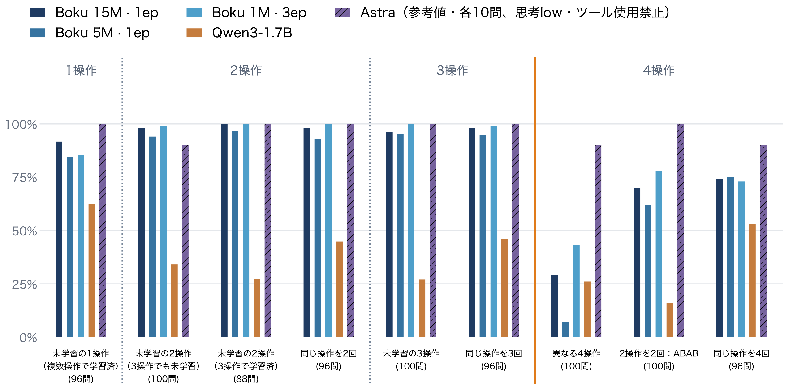

<!--
Boku・Qwenは条件A、greedy、全872問で各問題1生成・修復なし。Astraは独立チャット・low、各カテゴリ10問のみの参考値。
3操作と4操作の間のオレンジの実線は、訓練データの範囲（最大3操作）と未学習の長さ（4操作）の境目。他の点線は操作数の区切り。Astraの温度は未指定でありgreedyとは主張しない。訓練回数・生成上限・実行基盤などは一致しない。
図：figure/composition_benchmark_with_5m_no_title/plot.png（図内タイトルなし・棒の数値ラベルなし。タイトルはMarp側の見出し）
数値・実行条件・入力hash：figure/composition_benchmark_with_5m_no_title/values.json
作図：.venv/bin/python scripts/model/benchmark.py --models boku-15m-1epoch boku-5m-1epoch boku-1m-3epoch qwen3-1.7b --astra-reference --presentation --rows 1 --columns 9 --values no --title "" --output docs/report/figure/composition_benchmark_with_5m_no_title
-->


---


<!-- _class: benchmark-figure benchmark-focus -->
# 評価結果の注目点3か所

<div class="focus-chart">
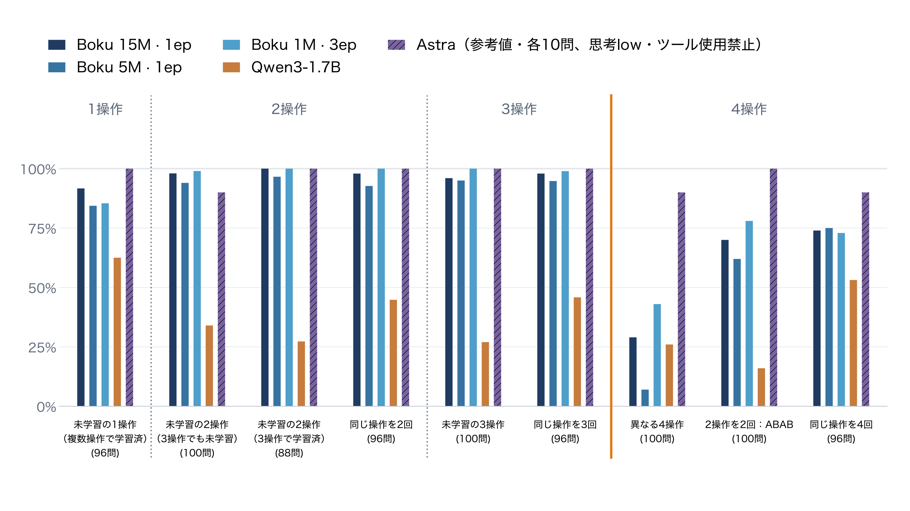
<svg class="focus-marks" viewBox="0 0 2880 1620" aria-hidden="true">
<g fill="none" stroke="#d33743" stroke-width="8"><ellipse cx="617" cy="575" rx="115" ry="78"/><ellipse cx="1498" cy="563" rx="112" ry="70"/><ellipse cx="2041" cy="1115" rx="63" ry="185"/></g>
<g fill="#d33743" font-family="sans-serif" font-size="50" font-weight="700"><text x="486" y="470">①</text><text x="1370" y="465">②</text><text x="1895" y="880">③</text></g>
</svg>
</div>
<div class="focus-captions"><div><b>① 未学習の2操作</b><br>1M・3 epoch：99%<br>Astra参考値：90%</div><div><b>② 未学習の3操作</b><br>1M・3 epoch：100%<br>学習済みの操作による新しい組み合わせ</div><div><b>③ 異なる4操作</b><br>Bokuは7〜43%<br>訓練範囲の3操作を超えると低下</div></div>
<!-- <p class="focus-note">Boku・Qwenは全872問、Astraは各カテゴリ10問の参考値（評価集合・実行条件の違いに留意）</p> -->

<!--
赤丸は元グラフの上にSVGとして重ね、棒・軸・数値を変更しない。1M3epochのcomposition_2op=99/100、composition_3op=100/100。Astraのcomposition_2op=9/10。general_4opはBoku15M29/100、5M7/100、1M3epoch43/100。
Boku・Qwenは条件A、greedy、全872問で各問題1生成・修復なし。Astraは独立チャット・low、各カテゴリ10問のみの参考値。
3操作と4操作の間のオレンジの実線は、訓練データの範囲（最大3操作）と未学習の長さ（4操作）の境目。他の点線は操作数の区切り。Astraの温度は未指定でありgreedyとは主張しない。訓練回数・生成上限・実行基盤などは一致しない。
図：figure/composition_benchmark_with_5m_no_title/plot.png（図内タイトルなし・棒の数値ラベルなし。タイトルはMarp側の見出し）
数値・実行条件・入力hash：figure/composition_benchmark_with_5m_no_title/values.json
作図：.venv/bin/python scripts/model/benchmark.py --models boku-15m-1epoch boku-5m-1epoch boku-1m-3epoch qwen3-1.7b --astra-reference --presentation --rows 1 --columns 9 --values no --title "" --output docs/report/figure/composition_benchmark_with_5m_no_title
-->


---

<!-- _class: agenda-page -->

# 発表の流れ

| | 章 | 内容 |
| :--- | :--- | :--- |
| ① | 全体フロー・意味AST | 合成データ生成の流れと24操作の共通定義 |
| ② | 合成データ | ASTの分割・日本語の言い換え・コード生成・検証 |
| ③ | 学習 | トークナイザ・参照範囲・コード部分の損失・モデル構成と学習結果 |
| ④ | 推論 | 次のトークンを選び出力を入力に加えてコード生成 |
| ⑤ | 評価 | ベンチマークの設計と結果・5モデルの失敗例 |

<!-- 以降のページ右上の「章名　n/m」：章内のページ番号（n）と総枚数（m） -->

<!--
【話す内容】
ここからの流れです。合成データの全体フローを先に示し、意味AST、分割、日本語の言い換え、コード生成・検証を一つの章で説明します。その後は学習、推論、評価の順です。評価では5モデルの失敗例を示し、区切りのページを挟んで考察に進みます。
各ページの右上に、その章の中で何枚目かを示しています。
-->


---


<!-- _header: '① 全体フロー・意味AST　1/2' -->
<!-- _class: synthetic-flow -->
# 合成データ生成の全体フロー

<p class="fv-lead">同じ<strong>意味AST</strong>から日本語の指示文と正解コードを別々に作って組にする</p>

<div class="fv-flow">
<div class="fv-box fv-side fv-pre"><span class="fv-no">1</span><p class="fv-title">意味AST</p><p class="fv-key">12,720<small>通り</small></p><p class="fv-sub">24操作・最大3操作</p></div>
<div class="fv-arrow"></div>
<div class="fv-box fv-side fv-pre"><span class="fv-no">2</span><p class="fv-title">AST単位で分割</p><p class="fv-key">約8：1：1</p><p class="fv-sub">訓練・検証・通常テスト</p></div>
<div class="fv-fork"><span class="fv-bar"></span><i></i><i></i></div>
<div class="fv-lanes">
<div class="fv-box fv-lane"><span class="fv-no">3</span><p class="fv-title">日本語の指示文</p><div class="fv-chain"><div class="fv-pill"><b>表現作成</b><span>Qwen3-4B-AWQ</span></div><div class="fv-to"></div><div class="fv-pill"><b>組み合わせ</b><span>ASTに沿って</span></div></div></div>
<div class="fv-box fv-lane"><span class="fv-no">4</span><p class="fv-title">正解のPythonコード</p><div class="fv-chain"><div class="fv-pill"><b>コード作成</b><span>ASTからルールで</span></div><div class="fv-to"></div><div class="fv-pill"><b>出力照合</b><span>参照インタプリタ</span></div></div></div>
</div>
<div class="fv-merge"><span class="fv-bar"></span><i></i></div>
<div class="fv-box fv-side fv-goal"><span class="fv-no">5</span><p class="fv-title">訓練データ</p><p class="fv-key">192,900<small>件</small></p><p class="fv-sub">指示と正解コードの組</p></div>
</div>

<!-- 原仕様：../../boku1-nano.md。実績では24操作の順序付き1〜3操作（重複なし）で12,720 AST。組合せ汎化670件を先に確保し、残り12,050件を訓練9,646・検証1,202・通常テスト1,202へ分割。日本語表現は各操作30候補を生成し、20件以上の承認を目標とした。操作別の最終承認数は12〜29件。訓練指示の一部96,390件はQwenによる全文言い換えで置換し、総数192,900件を維持。全文候補は一括承認であり、原子表現の個別人手確認と区別。根拠：../results/japanese_atomic_expression_expansion_history.md、../results/instruction_paraphrase_approval_results.md。Qwenは日本語の表現辞書作成に使用。合成データの正解コードはASTから生成する。先にASTを分割し、同一ASTの言い換え・等価コードを同じ集合にまとめる。コード生成時の照合は境界9件＋ランダム32件の41入力であり、全入力に対する証明ではない。生成コード全文の完全重複0件は、訓練・検証・通常テスト・組合せ汎化・反復汎化の5集合の候補277,440件について確認済み。SHA-256で候補を照合し、同一ハッシュでは全文を比較。最終訓練192,900件は重複のない候補の部分集合。意味上の重複や評価レコードでのコード再利用を否定する主張ではない。根拠：../results/evaluation_python_code_generation_results.md、../results/multi_operation_python_code_generation_results.md。根拠：../policies/ast_split_policy.md、../results/japanese_atomic_expression_generation_results.md、../results/rule_generated_instruction_results.md、../results/multi_operation_python_code_generation_results.md、../results/final_train_dataset_results.md。本文から外した補足：日本語の指示文はQwen3-4B-AWQで各操作30候補を生成し、人が意味を確認・承認した表現をルールで結合して作る。正解コードはASTからルールベースで等価なコードを生成し、構造・変数名を変える。検証は構文検査と、参照インタプリタとの出力照合（境界値9件＋ランダム32件の41入力）。参照インタプリタと出力が一致したコードだけを採用し、同じASTの指示文と組にする。訓練データ1件は日本語の指示と正解コードの組。 -->


---


<!-- _header: '① 全体フロー・意味AST　2/2' -->
<!-- _class: operation-scope -->

# 意味AST（DSL）：24操作から最大3操作の組み合わせ

<div class="operation-layout">
<div class="operation-tables">

## 基本操作

| 種類 | 操作数 | 例 |
| :--- | ---: | :--- |
| 条件に合う数の抽出 | 10 | 偶数・奇数・正の値・kより大きい値 |
| 要素ごとの値の変換 | 8 | kを加える・2倍・絶対値・二乗 |
| 順序の変更 | 3 | 昇順・降順・現在の順序の反転 |
| 一部の切り出し | 3 | 先頭k個・末尾k個・1個おき |

## 操作の組み合わせ

| 操作数 | 数え方 | 意味の種類 |
| :--- | ---: | ---: |
| 1操作 | 24 | 24 |
| 2操作 | 24 × 23 | 552 |
| 3操作 | 24 × 23 × 22 | 12,144 |
| 合計 | 24 ＋ 552 ＋ 12,144 | **12,720** |

</div>
<div class="operation-ast">

## 意味ASTの例

日本語：奇数だけを残し、各要素を2倍して降順に並べる

```json
{
    "sequence": [
        {"filter": ["odd"]},
        {"map": ["mul_const", 2]},
        {"order": "descending"}
    ]
}
```

</div>
</div>

<!--
【話す内容】
処理の意味を表す中間表現として、意味ASTを定義しました。基本操作は24種類で、条件で残す・一つずつ値を変える・順序を変える・一部を取り出すの4種類に分かれます。これを順序を区別して最大3つ組み合わせると、12,720通りの処理になります。右はその一例で、奇数だけを残し、2倍して、降順に並べる処理です。
意味ASTは合成データを作るための表現で、学習と推論でモデルに渡すのは日本語の指示だけです。

【補足】
同じ操作を繰り返さず、順序を区別して数えている。同じ操作の反復はテストで確かめる。
汎用のプログラミング全般を扱う実験ではない。
退避していた旧ページ「意味ASTは24種類、3操作まで組み合せで12,720通り」を移した。
根拠：../specifications/atomic_semantic_asts.md
-->


---


<!-- _header: '② 合成データ　1/4' -->
<!-- _class: split-design -->
# 意味AST単位での訓練・検証・テストの分割

<div class="split-order">意味ASTの分割　→　<strong>各集合の中で</strong>言い換え・コード変換</div>

訓練 **約80%** ／ 検証 **約10%** ／ 通常テスト **約10%**

| テスト | 変更点・確認対象 |
| :--- | :--- |
| **通常** | 同じ基本操作の範囲で訓練に含まれない意味ASTの評価 |
| **言い換え** | 既知の単独操作への訓練で使わなかった日本語表現の適用 |
| **組合せ汎化** | 例：別々に学んだ「偶数抽出」と「降順整列」の組み合わせ |
| **同じ操作の反復** | 同じ操作の2回・3回の連続適用（例：「各要素にkを加える」の2回適用） |
| **境界値** | 空リスト・要素1個・条件を満たす要素なし・全要素同値・負数など |

<div class="split-warning"><strong>生成後の分割では同じ問題の表記違いが訓練とテストに混入</strong><br>同じ意味ASTから作った言い換え・等価コードは同じ分割先に集約</div>

<!-- <div class="split-note">組合せ汎化用のASTを先に確保し、残りを約80：10：10に分割。言い換えは表現の汎化を測る別枠。<br>実際の評価には「同じ操作の反復」も追加し、計5種類のテストを使う。</div> -->

<!--
【話す内容】
訓練・検証・テストは、日本語文やコードを生成する前に、意味ASTの段階で分けます。意味ASTを先に分割し、各集合の中で言い換えとコード変換を行います。生成してから分けると、同じ問題の表記違いが訓練とテストの両方に入ってしまうためです。
テストは5種類です。訓練にない意味ASTを評価する通常テスト、既知の操作に未学習の日本語表現を使う言い換え、別々に学んだ操作を組み合わせる組合せ汎化、同じ操作の反復、そして空リストや負数などの境界値です。

【補足】
退避していた旧ページ「訓練・検証・テストは、意味ASTの段階で分ける」を移した。
根拠：../policies/ast_split_policy.md。compositional=670を先に確保し、残り12,050をtrain=9,646、val=1,202、normal=1,202へ分割。約80/10/10であり全12,720の一律分割ではない。
通常テストを「同じ操作の組み合わせで指示と定数だけ変更」とすると既存の意味AST分割と矛盾するため、訓練にないASTと記載。言い換えは訓練済み単独ASTと未学習表現の組による独立評価で、通常テストとの違いを明示。
境界値はnormalと同じASTで実行入力を変える。反復AST1,152件は別途生成。
固定5テストの指示件数はnormal=24,040、compositional=13,400、paraphrase=30、repetition=23,040、boundary=24,040。合計84,550であり一意な指示数ではない。生成コードを実行し、参照実装との一致等を確認する。
-->


---


<!-- _header: '② 合成データ　2/4' -->
<!-- _class: generation-page -->

# Qwen3-4B-AWQによる日本語表現の生成と組み合わせ

**表現辞書の作成**と**承認済み表現の組み合わせ**による二段階の指示文生成

<div class="generation-columns">
<div class="generation-stage">

## ① 表現辞書の作成：Qwen3-4B-AWQ

各操作30候補の生成と人による意味の確認・承認<br>各操作20件以上の承認が目標

### 保存済みプロンプト（要約）

<div class="generation-prompt">
意味ASTと厳守事項に従い、指定件数の表現を作る。<br>
操作・比較境界・入力順序を変えず、別の操作を加えない。<br>
終止形と接続形を同じ意味で作り、指定のJSONだけを返す。
</div>

### 例：「偶数を残す」の生成候補

<div class="generation-example">
「偶数だけを残す」／「偶数だけを残し」<br>
「偶数を選び出す」／「偶数を選び出して」
</div>

**人による意味確認と承認済み表現のみの辞書登録**

</div>
<div class="generation-stage">

## ② 指示文の作成：ルールベース

意味ASTに沿った承認済み表現の組み合わせ

### 例：偶数を残す → 各要素にkを加える

<div class="generation-example">

**選択する表現**

「偶数の要素を取り出す」<br class="compact-break">「各要素にkを加える」

**接続のルール**

操作1し、操作2する

</div>

**生成した日本語指示**

「偶数の要素を取り出し、各要素にkを加える」

</div>
</div>

<!-- <div class="generation-note">30件は候補数。承認後の採用数とは異なる。意味ASTを訓練・検証・テストに分けてから、表現を増やす。</div> -->

<!--
二段階のうち、第一段階に「Qwen3の候補生成」と「人による意味確認・承認」を含める。
プロンプトは原文の要約。原文：../../prompts/japanese_instruction_generation/atomic_expression_system.txt、atomic_expression_user.txt。userテンプレートの$countは「指定件数」と要約。意味AST・正準な意味・厳守事項・既存表現も渡す。
モデル名・候補数：../results/japanese_atomic_expression_generation_results.md、../../config/qwen_atomic_expression_generation.json。Qwen3-4B-AWQで24操作×30件を生成。各操作で20件以上の承認を得るための候補母数。
候補文・合成文は説明例。人による意味確認・承認は工程として示す。
アトミック操作は意味ASTの基本操作。「偶数を残す」は元の順序・重複を保持し、並べ替えを追加しない。
既存資料：../results/rule_generated_instruction_results.md、../results/replacement_resolved_train_instruction_results.md、../policies/ast_split_policy.md。
-->


---


<!-- _header: '② 合成データ　3/4' -->
<!-- _class: generation-page -->

# ルールベースで等価なPythonコード生成

同じ意味ASTでも異なる書き方のコード生成

<div class="generation-columns">
<div>

## 内包表記による一括抽出

```python
def solve(xs, k):
    # 条件に合う要素のリストを返す
    return [
        value
        for value in xs
        if value % 2 == 0]
```

</div>
<div>

## forループによる逐次抽出
```python
def solve(xs, k):
    result = []
    for value in xs:
        if value % 2 == 0:
            result = result + [value]
    return result
```
</div>
</div>

<div class="generation-result">共通の入力：<code>[3, 2, 4, 2]</code>　→　どちらの出力も <strong><code>[2, 4, 2]</code></strong></div>

| 変更箇所 | 変換例 |
| :--- | :--- |
| 処理の構造 | 内包表記 ↔ forループ ／ 直接return ↔ 一時変数を使う複数行 |
| 名前・補足 | 変数名の変更 ／ コメント・型注釈の有無 |
| 条件・並べ替え | 独立した条件の順序変更 ／ `reverse=True` ↔ 昇順ソート後の逆順（整数） |

**生成コードは完全重複なし／意味ASTの参照実装との結果一致の確認**

<!-- <div class="generation-note">生成器はCodexで実装してよい。変換ルールは人が確認し、意味を変えない範囲で適用する。</div> -->

<!--
コードは説明例。対象は整数リストを処理する単一関数で、クラス・再帰・非同期処理・外部アクセス・外部ライブラリは使わない。両例とも7行。右はappendを使わず、リストの連結で結果を作る。タスク共通のsolve(xs,k)形式に合わせるが、この操作ではkは使わない。順序・重複を保持し、xsを変更しない。
構造変換は意味ASTを固定して行う。生成器をCodexで実装できることと、学習用コードを毎回LLMに自由生成させることは区別する。
条件の交換は副作用や評価順依存がなく等価性が成立する場合に限る。reverse=Trueと昇順後の逆順はここでは整数リストの値によるソートが対象で、任意のキー付きソートの安定性まで同一とする主張ではない。
複数入力での一致は全入力に対する等価性の証明ではない。変換規則と参照実装による検査を併用。
根拠：../results/multi_operation_python_code_generation_results.md、../specifications/reference_interpreter.md。
-->


---


<!-- _header: '② 合成データ　4/4' -->
<!-- _class: default -->


<!--
41入力の一致は、あらゆる入力での正しさの証明ではありません。学習用の検査入力はモデル評価用と分離しています。
根拠：../results/multi_operation_python_code_generation_results.md、../specifications/reference_interpreter.md
-->


<!-- _header: '② 合成データ　4/4' -->
<!-- _class: dataset-counts -->

# 学習用の合成データ192,900件

1件は「日本語の指示」と「正解コード」の組 ／ 意味ASTごとに最大20組

<div class="dataset-columns"><div>

## 処理の長さ別の件数

| 処理の長さ | 件数 |
| :--- | ---: |
| 1操作 | 460 |
| 2操作 | 8,680 |
| 3操作 | 183,760 |
| 合計 | **192,900** |

**約95%が3操作**

9,640種類は各20組<br>残る6種類は計100組

</div><div>

## 言い換えが20件未満の6種類

| 操作 | 訓練用の言い換え |
| :--- | ---: |
| ゼロだけを残す | 11件 |
| kの倍数だけを残す | 16件 |
| 昇順に並べる | 17件 |
| 負の値だけを残す | 18件 |
| 各要素の符号を反転 | 19件 |
| 正の値だけを残す | 19件 |

各操作1件の評価用表現を除外<br>訓練用の表現数に合わせた採用

</div></div>

<!--
3操作の割合は95.2618%。データの偏りは文型依存の考察につながります。
根拠：../results/final_train_dataset_results.md
-->

<!-- --- -->
<!-- 1_class: compact -->

<!-- # 三つの大きさを、1 epochで比較する

**パラメータ**は、学習で調整するモデル内部の数値。

| 呼び名 | パラメータ数 | 今回の学習 |
| :--- | ---: | :--- |
| 1M | 約100万 | 合成データ全体を1回使う |
| 5M | 約500万 | 合成データ全体を1回使う |
| 15M | 約1,500万 | 合成データ全体を1回使う | -->

<!-- 合成データ全体を1回使う学習を、**1 epoch（1エポック）**と呼ぶ。 -->

<!-- 既存の学習済み重みを使わず、Transformerをゼロから学習する。 -->

<!--
正確には1,016,704、5,065,472、15,735,168パラメータ。共通の分割設定で学習した3モデルを本編に採用。Transformerは文章内の情報を参照しながら次の単位を予測するモデル。すべてDecoder-only、最大系列長256。
根拠：../results/trained_model_inventory.md
-->


---


<!-- _header: '③ 学習　1/9' -->
<!-- _class: bpe-page -->
# BPEトークナイザ：頻出する文字列のトークン化

バイト単位から開始し語彙が **2,048** になるまで**最も多く隣り合う組の結合**の反復

<div class="bpe-tokens">

`<|bos|>` `<|task|>` `⏎` `整数リストxsから` `偶数だけを残す` `solve関数を書` `いてください。` `⏎` `<|code|>` `⏎` `def␣solve` `(xs` `)` `:⏎␣␣␣␣` `return␣[` `v` `␣` `for␣` `v` `␣` `in␣` `xs␣if␣` `v` `␣` `%␣2` `␣` `==␣0` `]` `<|eos|>`

</div>

この1件は **29トークン**<br>「偶数だけを残す」が1トークンになるのは訓練データに頻出するため

| 設定 | 値 | 意味 |
| :--- | ---: | :--- |
| 語彙数 | 2,048 | 特殊トークン7個を含む結合を繰り返す際の語彙数の上限 |
| 最小頻度 `min_frequency` | 5 | 訓練データに5回以上現れる組だけの結合 |
| 最大piece長 `max_token_length` | 24 | 1トークンは最大24バイト（日本語なら8文字まで） |

<!--
【話す内容】
モデルに入れる前に、文字列をトークンのID列に変えます。BPEは、バイト単位から始めて、最も多く隣り合う組を1つにまとめる操作を、語彙が2,048になるまで繰り返す方法です。訓練データの日本語指示とPythonコードだけから学習しました。
上の例は、先ほどの訓練データ1件を実際にこのトークナイザで分割した結果です。日本語の指示は「偶数だけを残す」のように句の単位でまとまり、4トークンになります。コードは「def solve」「return [」のように細かく分かれ、18トークンです。訓練データに多く現れる文字列ほど長い1トークンになります。

【補足】
分割結果は data/tokenizers/bpe_2048/tokenizer.json で実際に符号化したもの。␣は空白、⏎は改行を表す。<|bos|><|task|><|code|><|eos|>は特殊トークン（7個を語彙に含む）。
設定：byte-level BPE、byte fallbackあり、min_frequency=5、max_token_length=24、normalizerなし、正規表現による事前分割なし。語彙は日本語とコードで共通。訓練データ192,900件の指示とコードだけから学習。
max_token_lengthは結合後のトークンの長さの上限で、byte-levelでは1バイト＝1記号なので24バイト。日本語はUTF-8で1文字3バイトのため8文字まで。例の「偶数だけを残す」は7文字＝21バイトで上限内。
min_frequencyは、結合候補の組が訓練コーパスに現れる回数の下限。2,048は特殊トークン7個（pad, bos, eos, unk, task, code, explanation）とバイト256個を含む語彙全体の数。
日本語とコードを別の語彙にしていないので、同じ系列として扱える。
根拠：../../config/tokenizer_bpe_2048.yaml、../results/bpe_tokenizer_training_results.md、../policies/tokenizer_training_policy.md
-->


---


<!-- _header: '③ 学習　2/9' -->
<!-- _class: causal-svg -->
<style scoped>
section { padding: 48px 62px 30px; font-size: 20px; line-height: 1.35; }
h1 { font-size: 38px; margin: 0 0 6px; color: #17212b; }
section > p { margin: 0 0 14px; font-size: 22px; }
.cs-cols { display: grid; grid-template-columns: minmax(0,1fr) minmax(0,1fr); gap: 20px; margin: 0 -22px; }
.cs-panel { background: #fff; border: 1.5px solid #c8d2db; border-radius: 10px; padding: 14px 16px 12px; height: 430px; box-sizing: border-box; display: flex; flex-direction: column; }
.cs-panel h2 { font-size: 21px; margin: 0 0 10px; color: #17212b; white-space: nowrap; }
.cs-cap { display: none; }
/* ① マスク表（○＝見える、×＝見えない） */
table.cs-mask { display: table; width: auto; margin: 2px auto 0; border-collapse: separate; border-spacing: 3px; font-size: 19px; font-family: "SFMono-Regular", Menlo, monospace; }
table.cs-mask th, table.cs-mask td { border: 0; padding: 0; width: 50px; height: 46px; text-align: center; vertical-align: middle; background: transparent; color: #17212b; font-weight: 400; }
table.cs-mask tr { background: transparent !important; }
table.cs-mask thead th { height: 30px; }
table.cs-mask tbody th { width: 56px; text-align: right; padding-right: 10px; }
table.cs-mask td.o { background: #eaf3fb; color: #245f8b; }
table.cs-mask td.x { background: #f3f5f7; color: #c0c8d0; }
table.cs-mask td.arw { width: 30px; color: #9aa5b1; }
table.cs-mask td.t, table.cs-mask th.t { width: 66px; }
table.cs-mask td.t span { display: block; margin: 0 4px; padding: 6px 0; border: 2px solid #245f8b; border-radius: 6px; background: #fff; color: #245f8b; font-size: 18px; }
table.cs-mask th.t { color: #245f8b; font-weight: 700; font-size: 14px; white-space: nowrap; font-family: "Hiragino Sans", sans-serif; }
.cs-foot { margin-top: auto; font-size: 18px; }
/* ② 生成ループ（トークン幅52px・間隔3px。幅を変えたらSVGのx座標も合わせる） */
.cs-gen { width: 558px; margin: 4px auto 0; }
.cs-row { display: grid; grid-template-columns: 36px 330px 22px 90px 22px 58px; align-items: center; height: 48px; }
.cs-step { visibility: hidden; } /* グリッドの1列目を保つため非表示は visibility で行う */
.cs-tok { display: flex; gap: 3px; }
.cs-tok span { width: 52px; height: 46px; box-sizing: border-box; display: flex; align-items: center; justify-content: center; background: #fff; border: 1.5px solid #9aa5b1; border-radius: 6px; font-size: 19px; font-family: "SFMono-Regular", Menlo, monospace; }
.cs-tok span.new1, .cs-tok span.new2, .cs-out { background: #eaf3fb; border: 2px solid #245f8b; color: #245f8b; }
.cs-arw { text-align: center; color: #9aa5b1; }
.cs-dec { height: 46px; display: flex; align-items: center; justify-content: center; background: #f3f5f7; border: 1.5px solid #9aa5b1; border-radius: 8px; color: #17212b; font-weight: 700; font-size: 18px; }
.cs-out { height: 46px; box-sizing: border-box; display: flex; align-items: center; justify-content: center; border-radius: 7px; font-weight: 700; font-size: 19px; font-family: "SFMono-Regular", Menlo, monospace; }
.cs-loop { display: block; height: 36px; }
.cs-note { display: none; }
/* まとめ */
.cs-take { margin-top: 14px; padding: 9px 18px; background: #f3f5f7; border-left: 6px solid #245f8b; font-size: 20px; }
.cs-take .sub { font-size: 16px; color: #555; }
.cs-small { display: none; }
</style>

# Decoder-onlyが自己回帰に向いている理由

学習・生成に共通の<strong>「今の位置までのトークンだけを見る」</strong>というルール（例は `[v for v in xs if` の部分）

<div class="cs-cols">

<div class="cs-panel">
<h2>① 学習時：未来のマスク　○ 参照可能　× 参照不可</h2>
<div class="cs-cap">行＝今処理中のトークン　列＝参照先</div>
<table class="cs-mask">
<thead><tr><th></th><th>[v</th><th>for</th><th>v</th><th>in</th><th>xs</th><th></th><th class="t">当てるトークン</th></tr></thead>
<tbody>
<tr><th>[v</th><td class="o">○</td><td class="x">×</td><td class="x">×</td><td class="x">×</td><td class="x">×</td><td class="arw">→</td><td class="t"><span>for</span></td></tr>
<tr><th>for</th><td class="o">○</td><td class="o">○</td><td class="x">×</td><td class="x">×</td><td class="x">×</td><td class="arw">→</td><td class="t"><span>v</span></td></tr>
<tr><th>v</th><td class="o">○</td><td class="o">○</td><td class="o">○</td><td class="x">×</td><td class="x">×</td><td class="arw">→</td><td class="t"><span>in</span></td></tr>
<tr><th>in</th><td class="o">○</td><td class="o">○</td><td class="o">○</td><td class="o">○</td><td class="x">×</td><td class="arw">→</td><td class="t"><span>xs</span></td></tr>
<tr><th>xs</th><td class="o">○</td><td class="o">○</td><td class="o">○</td><td class="o">○</td><td class="o">○</td><td class="arw">→</td><td class="t"><span>if</span></td></tr>
</tbody>
</table>
<div class="cs-foot">→ 1つの系列で<strong>5問ぶんの「次のトークン当て」</strong>の同時学習</div>
</div>

<div class="cs-panel">
<h2>② 生成時：末尾への出力追加と予測の反復</h2>
<div class="cs-cap">学習と同じ「今の位置まで」のルールで、そのまま続きを書ける</div>
<div class="cs-gen">
<div class="cs-row"><span class="cs-step">1回目</span><div class="cs-tok"><span>[v</span><span>for</span><span>v</span><span>in</span></div><span class="cs-arw">→</span><div class="cs-dec">Decoder</div><span class="cs-arw">→</span><div class="cs-out">xs</div></div>
<svg class="cs-loop" width="558" height="36" viewBox="0 0 558 40" preserveAspectRatio="none"><polyline points="529,0 529,14 282,14 282,32" fill="none" stroke="#245f8b" stroke-width="2.5"/><polygon points="282,40 276,30 288,30" fill="#245f8b"/></svg>
<div class="cs-row"><span class="cs-step">2回目</span><div class="cs-tok"><span>[v</span><span>for</span><span>v</span><span>in</span><span class="new1">xs</span></div><span class="cs-arw">→</span><div class="cs-dec">Decoder</div><span class="cs-arw">→</span><div class="cs-out">if</div></div>
<svg class="cs-loop" width="558" height="36" viewBox="0 0 558 40" preserveAspectRatio="none"><polyline points="529,0 529,14 337,14 337,32" fill="none" stroke="#245f8b" stroke-width="2.5"/><polygon points="337,40 331,30 343,30" fill="#245f8b"/></svg>
<div class="cs-row"><span class="cs-step">3回目</span><div class="cs-tok"><span>[v</span><span>for</span><span>v</span><span>in</span><span>xs</span><span class="new2">if</span></div><span class="cs-arw">→</span><div class="cs-dec">Decoder</div><span class="cs-arw">→</span><div class="cs-out">v</div></div>
</div>
<div class="cs-note">前の位置の結果は後ろに足しても<strong>変わらない → 使い回せる</strong>（KVキャッシュ）</div>
</div>

</div>

<div class="cs-take"><strong>学習時と生成時に共通の参照範囲</strong>による一貫した次トークン予測</div>

<!-- 例は訓練データ「整数リストxsから偶数だけを残すsolve関数」のコード部分 return [v for v in xs if v % 2 == 0] のうち [v〜if を、説明のため単語・記号単位のトークンとして示した。実際のBPE分割・実測出力ではない。参照範囲は「自分より前だけ」でなく現在位置を含む因果マスク。学習は正解prefix、生成は自身の出力prefixを使う点は異なる。図はAttentionの参照範囲を示し、各位置を損失対象にするかは前後ページのlabelsで別に決まる。補足の小さな文字（cs-cap・cs-step・cs-note：KVキャッシュの説明など）はCSSで非表示にしてあり、表示したいときは display: none を外す。 -->

---


<!-- _header: '③ 学習　3/9' -->
<!-- _class: code-explain causal-code -->
# 学習時のコード：未来の位置への参照制限

<div class="code-columns"><div>

```python
# ① 各位置の表現からQ・K・Vを作る
query, key, value = self.qkv_proj(
    hidden_states
).chunk(3, dim=-1)
# …（各テンソルをheadごとに並べ替える）

# ② Q・Kに位置情報を加える
query, key = self.rope(query, key)

# ③ 現在位置までのK・Vだけを参照する
attended = F.scaled_dot_product_attention(
    query,
    key,
    value,
    dropout_p=self.dropout if self.training else 0.0,
    is_causal=True,
)
```

<!-- <div class="code-source">boku_nano.py：CausalSelfAttention.forward（207–229行）</div> -->

</div><div>

## 例：日本語指示から「偶数抽出」のコードへ

```text
<|bos|><|task|>
整数リストxsから偶数だけを残すsolve関数を書いてください。
<|code|>
def solve(xs):
    return [v for v in xs if v % 2 == 0]
<|eos|>
```

| `return`の末尾位置を基準とした区分 | 参照範囲 |
| :--- | :--- |
| 日本語指示・区切り | ○ 参照可能 |
| `def solve(xs):` ～ `return` | ○ 現在位置まで参照可能 |
| 後続の `[v for …]` | × 未来の位置は参照不可 |

**正解コードの入力時も次に予測する答えは参照対象外**

`is_causal=True` で未来へのAttentionの重みを0に固定し指示とそこまでのコードから続きの予測

</div></div>

<!-- 指示は保存済みの偶数抽出例。コードは同じ課題の説明用正解例であり、モデル出力の引用ではない。実際にはBPEトークン列として入力し、表は読みやすい文字列のまとまりで示す。「returnの末尾位置」はreturnまでを表すprefixの最終トークン位置を意味する。is_causal=Trueは現在位置を含む因果マスク。Attentionの参照制限と指示部分の損失除外は別の処理。 -->


---


<!-- _header: '③ 学習　4/9' -->
<!-- _class: code-explain shifted-loss -->
# 一つ先の正解を使った次トークンの学習

<div class="code-columns"><div>

```python
# ① 最後以外の位置の予測を取り出す
shifted_logits = logits[:, :-1, :].contiguous()

# ② 正解を一つ先の位置にずらす
shifted_labels = labels[:, 1:].contiguous()

# ③ 正解トークンの確率から損失を計算
loss = F.cross_entropy(
    shifted_logits.view(
        -1, shifted_logits.size(-1)),
    shifted_labels.view(-1),
    ignore_index=-100,
)
```

<!-- <div class="code-source">boku_nano.py：BokuNanoForCausalLM.forward（501–509行）</div> -->

</div><div>

## 今の位置の出力と「次の正解」の比較

| 出力を使う位置 | 予測すべき正解 |
| :--- | :--- |
| コード直前 | 最初のコードtoken |
| 最初のコードtoken | 2番目のコードtoken |
| 最後のコードtoken | EOS（生成終了） |

$$
\mathcal{L}=-\frac{1}{|C|}\sum_{t\in C}\log P_\theta(x_t\mid x_{<t})
$$

$C$：コード開始後〜EOSの位置（指示・paddingは除外）

訓練時は**正解の続きの予測**<br>生成時は**自分が出したトークンの続きの予測**

</div></div>

<!-- cross_entropyはlogitsから計算する。明示的なsoftmaxを前置しない。損失の平均は当該バッチのignore_index以外のラベルに対するもの。 -->


---


<!-- _header: '③ 学習　5/9' -->
<!-- _class: loss-mask-page -->
# 日本語指示は条件として読みコード部分だけで損失計算

<p class="lm-intro">学習時は<strong>指示と正解コードを両方入力</strong>し次の正解トークン予測</p>
<div class="lm-grid">
<div class="lm-label">入力系列</div><div class="lm-prompt"><b>日本語の指示</b><br>偶数だけを残す<br>solve関数を書いてください</div><div class="lm-marker"><code>&lt;|code|&gt;</code></div><div class="lm-code"><b>正解のPythonコード</b><br><code>def solve(xs):</code><br><code>　return [v for v in xs if v % 2 == 0]</code></div><div class="lm-eos"><code>EOS</code></div>
<div class="lm-label">正解ラベル</div><div class="lm-ignore">−100</div><div class="lm-ignore">−100</div><div class="lm-target">各コードトークンのID</div><div class="lm-target">EOSのID</div>
<div class="lm-label">損失の対象</div><div class="lm-off">損失計算の対象外</div><div class="lm-off">対象外</div><div class="lm-on">損失の計算対象</div><div class="lm-on">計算対象</div>
</div>
<p class="lm-connection">日本語の指示を参照したコードの続きの予測　→</p>
<div class="lm-bottom"><div>

```python
labels[:] = IGNORE_INDEX  # -100
labels[target_start:] = token_ids[target_start:]
# target_start は <|code|> の直後
```

</div><div><strong>入力範囲と損失の計算対象は別</strong><br>指示文の予測は採点対象外<br>コード側の損失により<br>指示を処理する重みも学習</div></div>

<!-- 原20ページのloss対象を図示。文字列は説明用のまとまりで、実際のBPE分割ではない。BOS・task区切り・paddingは図で省略し、これらも-100。実装ではinput_idsとlabelsを1位置ずらしてcross entropyを計算するため、code marker位置から最初のコードトークン（改行を含む）を予測する項が最初の採点対象。code marker自体の予測は対象外。コード直後のEOSまで採点する。図の短縮コードは説明用の1系列の擬似コード。実装：../../scripts/model/train_boku_nano.py のtarget_start（423行）、collate_training_batch（496–513行）。損失：../../scripts/model/boku_nano.py のshifted labelsとcross_entropy。コード側の損失はattentionを介して参照した指示側の表現・共有パラメータにも依存するが、全tokenが同じ強さの勾配を得るとは主張しない。 -->


---


<!-- _header: '③ 学習　6/9' -->
<!-- _class: model-settings -->
# モデル構成とトークナイザー

<!-- 本編で比較する既存BPEの **1M・5M・15M**。Mは約100万パラメータを表す。 -->

| 項目 | 1M | 5M | 15M |
| :--- | ---: | ---: | ---: |
| **総パラメータ数** | **1,016,704** | **5,065,472** | **15,735,168** |
| 隠れ次元 `d_model` | 128 | 256 | 384 |
| 層数 `n_layers` | 3 | 5 | 8 |
| Attentionのhead数 | 4 | 4 | 6 |
| 1 headの次元 | 32 | 64 | 64 |
| FFNの中間次元 `d_ff` | 256 | 704 | 1,024 |
| この後に示す学習曲線 | 3 epoch | 1 epoch | 1 epoch |

<div class="shared-settings">
<div>
<h2>共通のトークナイザー</h2>
<p>BPE ／ 語彙数 2,048</p>
<p>最小頻度 5 ／ 最大piece長 24</p>
<p>最大系列長 256 token</p>
<p>埋め込み・出力層の重み共有なし</p>
</div>
<div>
<h2>共通の学習設定</h2>
<p>AdamW ／ β = (0.9, 0.95) ／ batch size 512</p>
<p>重み減衰 0.1（行列重み）／ dropout 0</p>
<p class="lr-schedule">5%の線形warmup → cosine減衰<br>学習率 3×10<sup>−4</sup> → 3×10<sup>−5</sup></p>
<p>勾配クリッピング 1.0 ／ bfloat16での計算</p>
</div>
</div>

<!--
モデル設定：../../data/models/boku_nano_1m_bpe_2048_minfreq5_maxlen24_3epoch/model_config.json、../../data/models/boku_nano_5m_bpe_2048_minfreq5_maxlen24_1epoch/model_config.json、../../data/models/boku_nano_15m_bpe_2048_minfreq5_maxlen24_1epoch/model_config.json。
パラメータ数：../results/trained_model_inventory.md。head_dim=d_model/n_heads。
BPE設定：../../config/tokenizer_bpe_2048.yaml。min_frequency=5、max_token_length=24、vocab_size=2048。
学習設定：各モデルディレクトリのtraining_config.yaml（training節）。AdamWのeps=1e-8、weight_decay=0.1は2次元以上のパラメータのみ、RMSNormなど1次元には0。batch_size=512、gradient_accumulation_steps=1、grad_clip_norm=1.0。学習率は全更新数の5%を線形warmupし、3e-4から3e-5までcosine減衰。1M・3epochは1,131更新・warmup57更新、5M・15Mの1epochは377更新・warmup19更新。実装：../../scripts/model/train_boku_nano.py のbuild_optimizerとbuild_scheduler。
後続の1epoch比較には同じ1M構造の1epochチェックポイントもある。構造が同じならepoch数を変えてもパラメータ数は変わらない。
-->


---


<!-- _header: '③ 学習　7/9' -->
<!-- _class: scientific loss-plot -->
# 1M：3 epochまでの損失の推移

3 epochの学習（訓練損失は20 stepごと／検証損失は各epoch終了時の実測値）

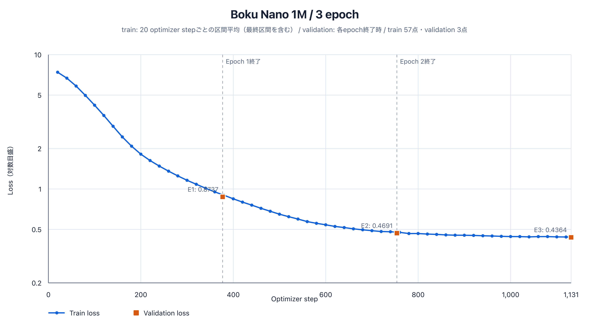

**val loss：1 epoch 0.8737 ／ 2 epoch 0.4691 ／ 3 epoch 0.4364**

<!-- 20 stepごとのvalidationは未記録。図は保存済みの3点を表示。 -->

<!--
3epoch設定の1回の訓練ログを使用。train loss 57点、validation loss 3点。最終stepは1131、epoch境界は377・754・1131。validationは24,040レコードのコード部分を評価。
1epoch専用runとは学習率スケジュールが異なるため、1epoch専用runの終了値1.3781と接続しない。
5M・15Mと同じ描画器・表示領域を使用。図内のタイトルと説明を除き、軸・凡例・線色・文字サイズを統一。3点のvalidation lossは実測値のみを表示。
使用図：figure/loss_1m_3epoch.svg
根拠：../../data/models/boku_nano_1m_bpe_2048_minfreq5_maxlen24_3epoch/training_metrics.jsonl
-->


---


<!-- _header: '③ 学習　8/9' -->
<!-- _class: scientific loss-plot -->
# 5M：損失の推移

1 epochの学習における訓練損失と検証データでの損失

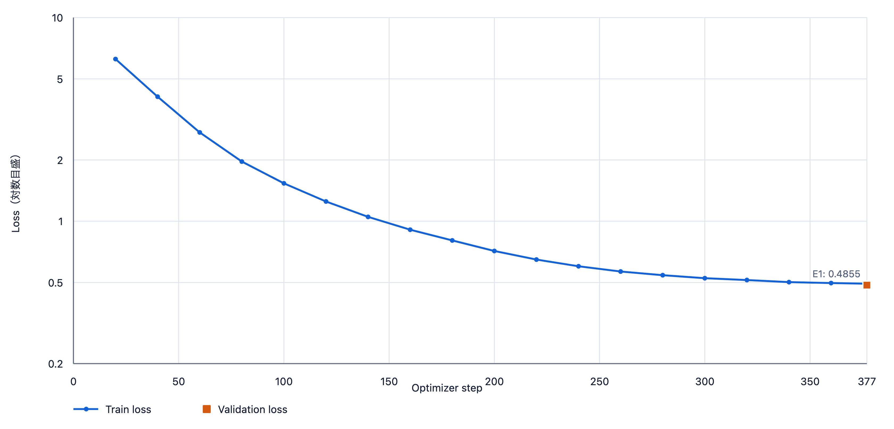

**学習終了時の val loss：0.4855**

<!-- val lossは終了時の1点。途中の検証値は保存されていない。 -->

<!--
保存された19点のtrain lossと、1点のvalidation lossをすべて使用。曲線はtrain lossだけであり、val lossの推移を補間していない。縦軸は保存済みの各モデルの図の対数目盛をそのまま使用する。モデルごとに範囲は異なる。最終stepは377。validationは24,040レコードのコード部分を評価。
使用図：../results/figures/training_loss_20step/boku_nano_5m_bpe_2048_minfreq5_maxlen24_1epoch.svg
根拠：../../data/models/boku_nano_5m_bpe_2048_minfreq5_maxlen24_1epoch/training_metrics.jsonl
-->


---


<!-- _header: '③ 学習　9/9' -->
<!-- _class: scientific loss-plot -->
# 15M：損失の推移

1 epochの学習における訓練損失と検証データでの損失

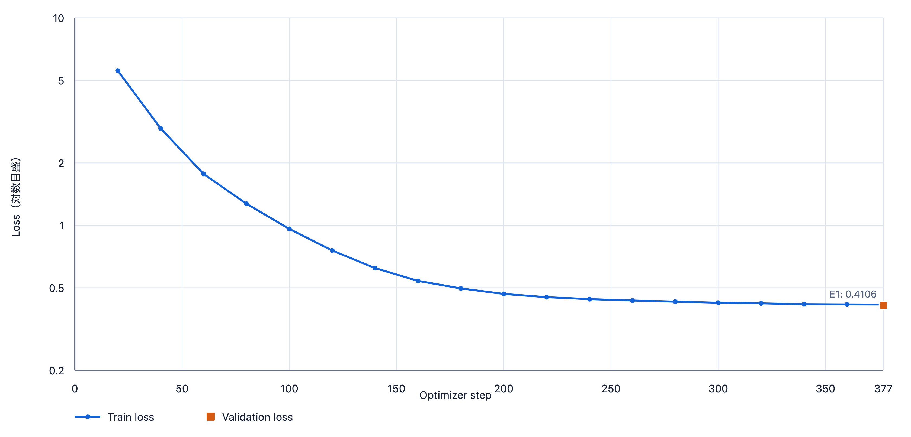

**学習終了時の val loss：0.4106**

<!-- val lossは終了時の1点。途中の検証値は保存されていない。 -->

<!--
保存された19点のtrain lossと、1点のvalidation lossをすべて使用。曲線はtrain lossだけであり、val lossの推移を補間していない。縦軸は保存済みの各モデルの図の対数目盛をそのまま使用する。モデルごとに範囲は異なる。最終stepは377。validationは24,040レコードのコード部分を評価。
使用図：../results/figures/training_loss_20step/boku_nano_15m_bpe_2048_minfreq5_maxlen24_1epoch.svg
根拠：../../data/models/boku_nano_15m_bpe_2048_minfreq5_maxlen24_1epoch/training_metrics.jsonl
-->


---


<!-- _header: '④ 推論　1/3' -->
<!-- _class: autoregressive ar-diagram -->
# 自己回帰：出力の追加と次トークン予測の反復

訓練データ1件は特殊トークンで区切った「指示＋コード」の1本の系列<br>直前までのトークンから次のトークン予測

<div class="ar-flow">
<div class="ar-flow-row">
<div class="ar-tokens">

`…` `if` `v` `%` `2`

</div>
<div class="ar-arrow">

→

</div>
<div class="ar-model">

**Decoder**

</div>
<div class="ar-arrow">

→

</div>
<div class="ar-output">

**==**

</div>
</div>
<div class="ar-feedback">

次の入力の末尾への `==` の追加

</div>
<div class="ar-flow-row">
<div class="ar-tokens ar-appended">

`…` `if` `v` `%` `2` `==`

</div>
<div class="ar-arrow">

→

</div>
<div class="ar-model">

**Decoder**

</div>
<div class="ar-arrow">

→

</div>
<div class="ar-output">

**0**

</div>
</div>
<div class="ar-feedback">

次の入力の末尾への `0` の追加

</div>
<div class="ar-flow-row">
<div class="ar-tokens ar-appended">

`…` `if` `v` `%` `2` `==` `0`

</div>
<div class="ar-arrow">

→

</div>
<div class="ar-model">

**Decoder**

</div>
<div class="ar-arrow">

→

</div>
<div class="ar-output">

**]**

</div>
</div>
</div>

> **学習時**：系列の途中までを入力し実際に続くトークンの予測<br>**生成時**：`<|eos|>` が出るまで予測の反復

<!--
図の「…」は <|bos|><|task|> から xs までのトークン。上段で「==」を生成し、その出力を次の入力の末尾へ加える。中段は同じモデルをもう一度使い、「0」を生成する。さらに出力を末尾へ加え、下段で「]」を生成する。別のモデルを直列に学習するという意味ではない。
説明のためトークンを単語や記号の単位で区切った。実際のBPEトークン分割とは異なり、実測出力でもない。
学習では正解系列の直前までから実際に続くトークンを予測し、正解トークンの確率を高めるように重みを更新する。causal maskにより未来の正解は見えない。学習時は各位置の予測を一括して計算できる。
生成時には自分で出したトークンを次の入力へ加える。候補は確率分布として予測され、次のトークンが一意に決まるわけではない。
Boku-nanoはDecoder-onlyであり、Encoder-Decoder構成のCross-Attentionは含まれない。
実装の根拠：../../scripts/model/boku_nano.py（causal attention、shifted labels、cross entropy）
実装の根拠：../../scripts/model/train_boku_nano.py（collate_training_batch）
訓練データの形式の根拠：../specifications/training_sequence_format.md（存在しない場合は train_boku_nano.py の特殊トークン定義）
-->

---


<!-- _header: '④ 推論　2/3' -->
<!-- _class: logit-overview -->
# 次のトークン候補への確率の割り当て

`… if v % 2 ==` の続きも候補のlogitを確率に変換し1つの候補の選択

<div class="lp-context">
<div class="lp-input">… v % 2 == <strong>？</strong></div>
<span>→</span><div class="lp-model">transformer</div><span>→</span>
<span>次のトークン候補に対するlogit</span>
</div>

<div class="lp-grid">
<div class="lp-panel lp-score">

## ① logit

logit：負の値も取る確率変換前のスコア

<div class="lp-row"><span>0</span><div class="lp-track"><span class="lp-bar" style="width:60%"></span></div><b>3.0</b></div>
<div class="lp-row"><span>1</span><div class="lp-track"><span class="lp-bar" style="width:40%"></span></div><b>2.0</b></div>
<div class="lp-row"><span>xs</span><div class="lp-track"><span class="lp-bar" style="width:20%"></span></div><b>1.0</b></div>
<div class="lp-row"><span>def</span><div class="lp-track"><span class="lp-bar" style="left:0;width:40%"></span></div><b>−2.0</b></div>

<!-- <p>縦線は0。説明用に4候補と仮定。</p> -->
</div>
<div class="lp-arrow"><small>softmax</small>→</div>
<div class="lp-panel">

## ② 合計1となる確率

<!-- <p>softmaxで変換。</p> -->

<div class="lp-row"><span>0</span><div class="lp-track"><span class="lp-bar" style="width:66.2272%"></span></div><b>66.2%</b></div>
<div class="lp-row"><span>1</span><div class="lp-track"><span class="lp-bar" style="width:24.3636%"></span></div><b>24.4%</b></div>
<div class="lp-row"><span>xs</span><div class="lp-track"><span class="lp-bar" style="width:8.9629%"></span></div><b>9.0%</b></div>
<div class="lp-row"><span>def</span><div class="lp-track"><span class="lp-bar" style="width:0.4462%"></span></div><b>0.4%</b></div>

<!-- <p>棒の長さは確率。順位は変わらない。</p> -->
</div>
<div class="lp-arrow"><small>選択</small>→</div>
<div class="lp-panel">

## ③ 最も確率が高い候補の選択

<!-- <p>今回のBoku評価で使う選び方。</p> -->

<div class="lp-pick"><strong>0</strong>　66.2%</div>
<div class="lp-next">↓ 入力の末尾に追加<br>… v % 2 == <strong>0</strong></div>

<!-- <p>新たな入力で、次のトークンを予測する。</p> -->
</div>
</div>

<div class="lp-summary">logitを<strong>softmax</strong>で確率に変換し最も確率の高い候補を次のトークンとして採用</div>

<!-- <div class="figure-reference">説明用のトークンと数値。実際は全語彙を対象に、BPEトークン単位で生成する。<br>参考：<a href="https://www.3blue1brown.com/lessons/gpt/">3Blue1Brown：Softmax</a>・<a href="https://www.youtube.com/watch?v=yMQPQuz5WpA">指定動画</a>。</div> -->

<!--
自己回帰の説明とPythonコードの間をつなぐ概念図。文字・棒グラフ・矢印をすべてMarkdown内のHTML/CSSで記述。画像ファイルは参照しない。
説明用に語彙を「0・1・xs・def」の4候補に限定し、ロジット[3,2,1,-2]をsoftmaxで変換。T=1の確率は約[66.2272,24.3636,8.9629,0.4462]%。表示は小数1桁に丸める。
実測出力やBokuの実際のトークン分割ではない。「上位3候補だけに絞る」処理でもない。
Boku評価では最大確率選択（greedy）。実装では順位が同じなのでロジットのargmaxを使い、確率への変換を省略できる。
https://www.3blue1brown.com/lessons/gpt/ （Unembedding / Softmax）
https://www.youtube.com/watch?v=yMQPQuz5WpA
-->
<!--
非表示：logit・softmax・生成ループの3ページ（① logit は Transformerの出力／② softmaxでlogitを合計1の確率へ変換／③ 選んだトークンを入力に加え、予測を繰り返す）。復元時はコメント記号を外し、[元ページ区切り] を --- に戻す。
[元ページ区切り]
&lt;!-- _header: '⑤ 学習：トークナイザ・Transformer・自己回帰・損失　4/15' --&gt;
&lt;!-- _class: ar-code decoder-logits --&gt;
<style scoped>
.residual-map .decoder-attention { display: block !important; font-size: 12px !important; line-height: 1.15 !important; padding: 2px !important; }
.decoder-output { width: 48%; box-sizing: border-box; margin: 0 auto; }
.residual-map .decoder-norm { display: block !important; font-size: 12px !important; line-height: 1.05 !important; padding: 1px 2px !important; }
.code-columns { grid-template-columns: 58% 42% !important; gap: 20px !important; }
pre { font-size: 15.5px !important; line-height: 1.2 !important; padding: 10px 12px !important; }
.code-source { font-size: 12px !important; margin-top: 6px !important; }
.decoder-flow { font-size: 15px !important; }
.decoder-input { font-size: 13px !important; }
.attn-equation { font-size: 15px; margin-top: 8px; }
.attn-equation .katex-display { margin: 4px 0; }
</style>

# ① logit は Transformerの出力

<div class="code-columns">
<div>

```python
h = self.token_embedding(input_ids)
for block in self.blocks:
    h0 = h
    # ① RMSNorm：二乗平均の平方根で割り、重みを掛ける
    x = h0 * torch.rsqrt(
        h0.square().mean(-1, keepdim=True)
        + block.attention_norm.eps
    ) * block.attention_norm.weight
    # ② Multi-Head Attention：QKVを作り、headごとに計算
    attn = block.attention
    # B：バッチ内の系列数、L：トークン数、D：埋め込み次元
    B, L, D = x.shape
    q, k, v = attn.qkv_proj(x).chunk(3, dim=-1)
    q, k, v = [
        t.view(B, L, attn.n_heads, attn.head_dim).transpose(1, 2)
        for t in (q, k, v)
    ]
    q, k = attn.rope(q, k)  # 位置情報
    a = F.scaled_dot_product_attention(
        q, k, v, is_causal=True)  # 未来を隠し、Vの重み付き和
    a = a.transpose(1, 2).contiguous().view(B, L, D)
    a = attn.out_proj(a)  # 線形変換でhead間の情報を混ぜる
    h1 = h0 + a
    # ③ 更新済みのh1を、RMSNorm→MLPと残差の両方へ
    m = block.ffn_norm(h1)  # ①と同じ計算・別の重み
    h2 = h1 + block.feed_forward(m)
    h = h2
h = self.final_norm(h)  # RMSNorm
logits = self.lm_head(h).float()
```


&lt;!-- **`lm_head` の出力がlogit** --&gt;

<div class="code-source">boku_nano.py：RMSNorm・CausalSelfAttention・TransformerBlock
&lt;!-- 図の左の青線はh0、右の青線はAttention残差加算後のh1を足す経路。 --&gt;
</div>

</div>
<div class="decoder-flow">
<div class="decoder-output">logits </div>
<div class="decoder-up"></div>
<div class="decoder-model">
<div class="decoder-name">Decoder型<br>Transformer</div>
<div class="decoder-node decoder-head">lm_head（線形層）</div>
<div class="decoder-up"></div>
<div class="decoder-node decoder-norm">final_norm</div>
<div class="decoder-up"></div>
<div class="decoder-block residual-map">
<div class="decoder-block-title">n_layers 回繰り返す</div>
<div class="decoder-node decoder-add" style="top:28px;height:30px">Add：h ＋ MLP の出力</div>
<div class="decoder-up" style="top:58px"></div>
<div class="decoder-node decoder-mlp" style="top:70px;height:28px">MLP / Feed-forward</div>
<div class="decoder-up" style="top:98px"></div>
<div class="decoder-node decoder-norm" style="top:110px;height:28px">Norm（RMSNorm）<br>MLPへの入力だけを正規化</div>
<div class="decoder-up" style="top:138px"></div>
<div class="decoder-node decoder-add" style="top:150px;height:30px">Add：h ＋ Attention の出力</div>
<div class="decoder-up" style="top:180px"></div>
<div class="decoder-node decoder-attention" style="top:192px;height:34px">Multi-Head Attention<br>各headの計算 → 結合 → out_proj（線形変換）</div>
<div class="decoder-up" style="top:226px"></div>
<div class="decoder-node decoder-norm" style="top:238px;height:28px">Norm（RMSNorm）<br>Attentionへの入力だけを正規化</div>
<div class="decoder-up" style="top:266px"></div>
<div class="skip-attn"></div>
<div class="skip-mlp"></div>
<div class="residual-dot" style="top:272px;background:#2877aa"></div>
<div class="residual-dot" style="top:144px;background:#2877aa"></div>
</div>
<div class="decoder-up"></div>
<div class="decoder-node decoder-embedding">h = token_embedding(input_ids)</div>
</div>
<div class="decoder-up"></div>
<div class="decoder-input">入力テキスト → Tokenizer → トークンID列</div>
</div>
</div>

&lt;!--
図はboku_nano_presentation_copy.mdの11ページからHTML/CSSを移植。下から上へ読む。
左コードは現行版を維持。図の最初の「正規化前のh」はh0、MLP側の「正規化前のh」はAttentionの残差加算後のh1を指す。
左の残差経路はh0からAttention後のAddへ、右はそのAdd後からMLP後のAddへ。AddとNormは別の箱。
型変換と推論時に無効なAttention dropoutは説明用コードでは省略。実装の処理順は変更していない。
--&gt;


&lt;!-- 非表示の詳細ページ（復元時はコメントを外し、ページ区切りを戻す）

［注記： _class: code-explain causal-code ］

# RMSNorm：各位置の特徴量の大きさを揃える

<div class="code-columns"><div>

```python
# block.attention_norm(h0) の中身
# self は RMSNorm のインスタンス
values = hidden_states.float()

# ① 各位置で、特徴次元の二乗平均を求める
mean_square = values.pow(2).mean(
    dim=-1, keepdim=True
)

# ② √(二乗平均 + ε) で割る
normalized = values * torch.rsqrt(
    mean_square + self.eps
)

# ③ 元の型へ戻し、学習する重みを掛ける
return (
    normalized.to(hidden_states.dtype)
    * self.weight
)
```

<div class="code-source">boku_nano.py：RMSNorm.forward（113–122行）。</div>

</div><div>

## 正規化するのは、1トークン内の特徴次元

$$
\operatorname{RMSNorm}(x)_i
=\frac{x_i}{\sqrt{\frac{1}{d}\sum_{j=1}^{d}x_j^2+\varepsilon}}\,w_i
$$

- `dim=-1`：埋め込みの特徴次元 $d$ に沿って平均する。
- `rsqrt`：平方根の逆数。掛けるとRMSで割ることになる。
- `weight`：特徴次元ごとの学習可能な重み。

平均値は引かない。ほかのトークンと混ぜる処理でもない。

**元の `h0` は残差経路に保持する。**<br>
正規化した値をAttentionへ渡し、その出力を `h0` に足して `h1` にする。

`ffn_norm(h1)` と `final_norm(h)` も同じ計算。ただし、重みはそれぞれ別に学習する。

</div></div>


【元の詳細ページ区切り】

［注記： _class: code-explain causal-code ］

# Multi-Head Attention：参照先の重みでVを混ぜる

<div class="code-columns"><div>

```python
# block.attention(a) の前半
# self は CausalSelfAttention
B, L, D = hidden_states.shape
H, d = self.n_heads, self.head_dim

# ① 線形変換でQ・K・Vを作る
q, k, v = self.qkv_proj(
    hidden_states
).chunk(3, dim=-1)

# ② headごとに分割： [B,L,D] → [B,H,L,d]
q = q.view(B, L, H, d).transpose(1, 2)
k = k.view(B, L, H, d).transpose(1, 2)
v = v.view(B, L, H, d).transpose(1, 2)

# ③ Q・Kに位置情報を加える
q, k = self.rope(q, k)
```

**QとKで「どの位置を見るか」を決め、Vから情報を取り出す。**

<div class="code-source">boku_nano.py：CausalSelfAttention.forward（201–236行）。</div>

</div><div>

```python
# ④ 各headで、未来を隠して重み付き和を取る
attended = F.scaled_dot_product_attention(
    q, k, v,
    dropout_p=self.dropout if self.training else 0.0,
    is_causal=True,
)

# ⑤ headを結合：[B,H,L,d] → [B,L,D]
attended = attended.transpose(1, 2).contiguous()
attended = attended.view(B, L, D)

# ⑥ 線形変換し、dropoutを適用する
return self.residual_dropout(
    self.out_proj(attended)
)
```

④の内部計算（dropoutを省いた表記）：

$$
A=\operatorname{softmax}\left(\frac{QK^\top}{\sqrt d}+M\right),\quad Z=AV
$$

$M$ は現在以前が $0$、未来が $-\infty$。未来の重みは $0$ になる。各headの $Z$ を結合して線形変換する。


</div></div>

［注記： 実装はPyTorchの融合Attention APIを利用。数式はその意味を示すもので、別実装の引用ではない。B=バッチ数、L=系列長、D=モデル次元、H=head数、d=head次元、D=H*d。dropoutは実装どおりコードに保持。 ］


非表示の詳細ページここまで --&gt;
[元ページ区切り]
&lt;!-- _header: '⑤ 学習：トークナイザ・Transformer・自己回帰・損失　5/15' --&gt;
&lt;!-- _class: ar-code --&gt;

# ② softmaxでlogitを合計1の確率へ変換

<div class="code-columns">
<div>

```python
# 入力の最後の位置にある、全候補の点数
# このページでは temperature=1.0 とする
logits = (
    model(input_ids).logits[:, -1, :]
    / temperature
)

# 候補を点数の高い順に並べる
sorted_logits, sorted_indices = torch.sort(
    logits, descending=True, dim=-1
)

# 点数を、合計1の確率分布に変換する
sorted_probabilities = torch.softmax(
    sorted_logits, dim=-1
)
```

<div class="code-source">evaluate_boku_nano_comparison.py：209–211行。</div>

</div>
<div>

## 指数に変換し、全候補の合計で割る

$$p_i = \frac{e^{z_i}}{\sum_{j=1}^{V} e^{z_j}}$$

$z_i$：候補 $i$ のlogit、$p_i$：各候補の選択確率<br>


| 候補 | logit $z_i$ | $e^{z_i}$ | 確率 $p_i$ |
| :--- | ---: | ---: | ---: |
| A | 2 | 7.389 | 66.5% |
| B | 1 | 2.718 | 24.5% |
| C | 0 | 1.000 | 9.0% |

$$p_A=\frac{7.389}{7.389+2.718+1}\approx0.665$$

&lt;!-- 点数0でも確率0ではない。$e^0=1$ だから。 --&gt;

</div>
</div>

&lt;!--
3候補の数値は説明用。実際は全語彙に対する分布。候補をソートしても各トークンの確率は変わらない。
temperature=1.0なので左の除算は点数を変えない。モデルの直接出力はロジット。
出典：../../scripts/model/evaluate_boku_nano_comparison.py sample_generate_equal_length、209–211行。
softmaxは最後の語彙次元dim=-1に適用する。表はsoftmaxで計算した確率。
--&gt;

[元ページ区切り]
&lt;!-- _header: '⑤ 学習：トークナイザ・Transformer・自己回帰・損失　6/15' --&gt;
&lt;!-- _class: ar-code code-explain generate-explain --&gt;

# ③ 選んだトークンを入力に加え、予測を繰り返す

<div class="code-columns">
<div>

```python
# 日本語指示を含む入力ID列をコピーする
current = prompt_ids.copy()
generated: list[int] = []

# 勾配を計算せず、次のトークンを順に生成
with torch.inference_mode():
    for _ in range(min(
        max_new_tokens,
        model.config.context_length - len(current)
    )):
        values = torch.tensor(
            [current], dtype=torch.long)
        # 最も確率が高いトークンを選ぶ
        token_id = int(torch.argmax(
            model(values).logits[0, -1]).item())
        # 終了トークンなら生成を止める
        if token_id == eos_token_id:
            break
        # 選んだIDを出力と次回の入力へ追加
        generated.append(token_id)
        current.append(token_id)
```

<div class="code-source">export_boku_nano_onnx.py：232–241行</div>

</div>
<div>

## コードと生成の流れを対応させる

<div class="flow-step">① <code>model(values).logits[0, -1]</code><br>最後の位置から、次の候補のlogitを得る。</div>
<div class="flow-arrow">↓</div>
<div class="flow-step">② <code>torch.argmax(...)</code><br>最も高い確率のトークンを選ぶ。</div>
<div class="flow-arrow">↓</div>
<div class="flow-step">③ <code>current.append(token_id)</code><br>選んだトークンを入力末尾に加える。</div>
<div class="flow-arrow">↓</div>

**伸びた入力で①に戻る。EOSなら終了する。**

指示 → 指示＋コード① → 指示＋コード①②

同じDecoderで、伸びた系列の続きを予測する。

</div>
</div>

&lt;!--
出典：../../scripts/model/export_boku_nano_onnx.py generate_with_pytorch、232–241行。
ONNXとの一致確認に使う実際のPyTorch推論ループ。通常のバッチ評価にも同じargmax方式がある：../../scripts/model/evaluate_boku_nano.py 488–490行。
currentは特殊トークンを含むプロンプトIDと生成済みID。毎回全入力を与える実装。KVキャッシュの説明ではない。
--&gt;

&lt;!--
非表示：温度の2ページ（④ 温度は、候補の確率の偏りを調整する／⑤ 温度を上げると…）。復元時はコメント記号を外し、[元ページ区切り] を --- に戻す。
[元ページ区切り]
&lt;!-- _header: '⑤ 学習：トークナイザ・Transformer・自己回帰・損失　7/17' --&gt;
&lt;!-- _class: ar-code --&gt;

# ④ 温度は、候補の確率の偏りを調整する

<div class="code-columns">
<div>

```python
# 全候補のロジットを温度Tで割る
logits = (
    model(input_ids).logits[:, -1, :]
    / temperature
)

# 候補のIDを保持して点数順に並べる
sorted_logits, sorted_indices = torch.sort(
    logits, descending=True, dim=-1
)

# 調整後の点数をsoftmaxで確率にする
sorted_probabilities = torch.softmax(
    sorted_logits, dim=-1
)
```

<div class="code-source">evaluate_boku_nano_comparison.py：209–211行。<br>確率に従って抽選する場合。<br>今回のBoku評価では、最も確率が高いトークンを選ぶ。<br>参考：<a href="https://aman.ai/primers/ai/token-sampling/#temperature">Aman AI：Temperature</a></div>

</div>
<div>

## 抽選する場合の分布を温度で調整する

$$p_i(T)=\frac{e^{z_i/T}}{\sum_{j=1}^{V}e^{z_j/T}},\quad T>0$$

$T$：生成時に指定する温度。$T=1$ が基準。
学習済みの重みは変えず、logitを $T$ で割る。

AとBのlogitが2と1なら、差は1となる。割った後の差は **$1/T$** になる。

| 温度 $T$ | Aのlogit $2/T$ | Bのlogit $1/T$ | 差 |
| ---: | ---: | ---: | ---: |
| 0.5 | 4 | 2 | 2 |
| 1 | 2 | 1 | 1 |
| 2 | 1 | 0.5 | 0.5 |

**$0<T<1$**：logitの差が広がり、高確率の候補に集中

**$T>1$**：logitの差が縮まり、分布が平らになる

</div>
</div>

&lt;!--
出典：../../scripts/model/evaluate_boku_nano_comparison.py 209–211行。正のtemperatureの検査は105–106行。
温度を変更しても学習済み重みは変わらない。softmaxに入力する相対的な点数差を調整する。
参考：https://aman.ai/primers/ai/token-sampling/#temperature （The Role of Temperature in Softmax）。Tが0に近づくと最大候補に集中（最大が一つの場合）、十分大きくなると有限語彙上の一様分布に近づく。T=0で除算しない。
数式と順位不変性は3Blue1Brown公式解説およびローカルPython実装でも照合。
--&gt;

[元ページ区切り]
&lt;!-- _header: '⑤ 学習：トークナイザ・Transformer・自己回帰・損失　8/17' --&gt;
&lt;!-- _class: ar-code temperature-example --&gt;

# ⑤ 温度を上げると、低い確率の候補も選ばれやすくなる

ここでは3候補 **A=2、B=1、C=0**のlogitを固定し、温度だけを変えて比べる。

<div class="temperature-panels">
<div class="temperature-panel">
<h2>T = 0.5：Aに集中</h2>
<p>割った後のlogit：[4, 2, 0]</p>
<div class="prob-bars">
<div class="prob-bar" style="height:86.7%"><span>86.7%</span></div>
<div class="prob-bar" style="height:11.7%"><span>11.7%</span></div>
<div class="prob-bar" style="height:1.6%"><span>1.6%</span></div>
</div>
<div class="prob-labels"><span>A</span><span>B</span><span>C</span></div>
</div>
<div class="temperature-panel">
<h2>T = 1：基準</h2>
<p>割った後のlogit：[2, 1, 0]</p>
<div class="prob-bars">
<div class="prob-bar" style="height:66.5%"><span>66.5%</span></div>
<div class="prob-bar" style="height:24.5%"><span>24.5%</span></div>
<div class="prob-bar" style="height:9.0%"><span>9.0%</span></div>
</div>
<div class="prob-labels"><span>A</span><span>B</span><span>C</span></div>
</div>
<div class="temperature-panel">
<h2>T = 2：B・Cも選びやすい</h2>
<p>割った後の点logit：[1, 0.5, 0]</p>
<div class="prob-bars">
<div class="prob-bar" style="height:50.6%"><span>50.6%</span></div>
<div class="prob-bar" style="height:30.7%"><span>30.7%</span></div>
<div class="prob-bar" style="height:18.6%"><span>18.6%</span></div>
</div>
<div class="prob-labels"><span>A</span><span>B</span><span>C</span></div>
</div>
</div>

## AはBの何倍選ばれやすいか（棒の高さは共通尺度：0〜100%）

$$\frac{p_A(T)}{p_B(T)}=e^{(z_A-z_B)/T}=e^{1/T}$$

$T=0.5$ なら約 **7.39倍**、$T=1$ なら約 **2.72倍**、$T=2$ なら約 **1.65倍**。

**確率に従って抽選する場合**は、温度を上げると出力のばらつきが増える。

**最も確率が高い候補を選ぶ場合**は、正の温度を変えても選ぶ候補は同じ。

<div class="code-source">参考：<a href="https://aman.ai/primers/ai/token-sampling/#temperature">Aman AI：Temperature</a>。温度は正解率の向上を保証しない。</div>

&lt;!--
参考：ユーザー提供の書籍画像 IMG_0947.jpg（p.124）、IMG_0948.jpg（p.125）。書名・著者は画像から未確認。説明の構成を参考にし、図は独自の3候補の数値からMarkdown/CSSで作成。
3候補の説明用の計算例。丸めにより合計100%にならない場合がある。
確率比ではsoftmaxの共通分母が相殺される。図はtemperatureだけを変えたsoftmaxの分布。
Pythonのsampling関数はT>0のみを受け付ける。T=0を渡して分岐する実装ではなく、greedyは別の実装。
出典：../../scripts/model/evaluate_boku_nano_comparison.py 105–106、209–211行、../../scripts/model/export_boku_nano_onnx.py 237行。
--&gt;

非表示：温度の2ページここまで
--&gt;

非表示：logit・softmax・生成ループの3ページここまで
-->


---


<!-- _header: '④ 推論　3/3' -->
<!-- _class: code-explain causal-code causal-generate -->
# 生成時のコード：最後の予測の選択と入力への追加

<div class="code-columns"><div>

```python
# …（生成ループ内）
# ① 最後の位置の候補の点数を得る
next_logits = model(input_ids).logits[
    :, -1, :
]

# ② 最も確率の高い候補のIDを選ぶ
next_ids = torch.argmax(
    next_logits, dim=-1
)
# …（EOS判定・出力保存）
appended = torch.tensor(
    append_values,
    dtype=torch.long, device=device
)
# ③ 次回の入力の末尾に追加する
input_ids = torch.cat(
    (input_ids, appended[:, None]), dim=1
)
```

<!-- <div class="code-source">evaluate_boku_nano.py（488–490・522–524行）</div> -->

</div><div>

## 「偶数抽出」のコードの続きの生成

```text
<|bos|><|task|>
整数リストxsから偶数だけを残すsolve関数を書いてください。
<|code|>
def solve(xs):
    return [
```

| 処理 | 上の入力から1トークン進む例 |
| :--- | :--- |
| ① 最後の位置の使用 | 入力末尾から続きの候補の予測 |
| ② 候補の選択 | 例：`v` のトークンIDの選択 |
| ③ 末尾に追加 | `return [` → `return [v` |
| 次のループ | 日本語指示と追加済みコード全体の入力 |

**正解の続きを渡す学習時と異なり生成時は自分が選んだトークンの追加**

`[:, -1, :]` は「全系列・最後の位置・全候補」
`<|eos|>` で終了 ／ それまでは上限まで予測の反復

</div></div>

<!-- 実際の評価処理では終了済みの系列にpaddingを追加する。入力は前ページの偶数抽出コードを途中まで生成した説明例。vを選ぶのは説明用の仮定で、実測出力ではない。手元のdata/tokenizers/bpe_2048/tokenizer.jsonでreturn [とvが別トークンになることを確認。コードブロック末尾の表示上の改行は入力に追加しない。毎回伸びた全系列をmodelに渡す実装であり、KVキャッシュは使用しない。 -->


---


<!-- _header: '⑤ 評価　1/11' -->
<!-- _class: test-summary -->
# モデル規模・学習回数による違い：五つのテスト別結果

各モデルの列は **合格数・pass@1（合格率）**<br>各問1本を生成し検査入力をすべて満たせば合格

| テスト | 1M・1 epoch | 1M・3 epoch | 5M・1 epoch | 15M・1 epoch |
| :--- | ---: | ---: | ---: | ---: |
| 通常（24,040問） | 446問（1.86%） | 23,950問（99.63%） | 23,261問（96.76%） | **24,003問（99.85%）** |
| 組合せ汎化（13,400問） | 103問（0.77%） | **13,311問（99.34%）** | 12,657問（94.46%） | 13,188問（98.42%） |
| 日本語の言い換え（30問） | 2問（6.67%） | **15問（50.00%）** | 8問（26.67%） | **15問（50.00%）** |
| 同じ操作の反復（23,040問） | 508問（2.20%） | 22,945問（99.59%） | 22,370問（97.09%） | **22,971問（99.70%）** |
| 境界値（24,040問） | 408問（1.70%） | 23,950問（99.63%） | 23,261問（96.76%） | **24,003問（99.85%）** |

**1Mは3 epochで大きく改善<br>一方言い換えは1M・3 epochと15M・1 epochでも50%**

<!-- <div class="result-note">毎回最も確率の高いトークンの選択 ／ 再生成なし ／ pass@1 ＝ 合格数 ÷ 評価件数<br>共通BPE・単一seed ／ 通常と境界値は同じ指示・異なる検査入力 ／ 次の872問の評価とは別</div> -->

<!--
各結果は保存済みのモデル別評価報告から取得。合格率は合格数/評価件数から小数点以下2桁に丸めた。
根拠：../results/model_reports/boku_nano_1m_bpe_2048_minfreq5_maxlen24_1epoch.md、../results/model_reports/boku_nano_1m_bpe_2048_minfreq5_maxlen24_3epoch.md、../results/model_reports/boku_nano_5m_bpe_2048_minfreq5_maxlen24_1epoch.md、../results/model_reports/boku_nano_15m_bpe_2048_minfreq5_maxlen24_1epoch.md。
-->


---


<!-- _header: '⑤ 評価　2/11' -->
<!-- _class: compact -->
# ベンチマークの役割と自分の研究での作り方

**モデルの能力と限界を観測し次に取り組む研究課題の明確化**
成功例だけで判断せず共通の基準で能力向上の定量的な確認

| 設計・評価の手順 | 自分の研究での検討点 |
| :--- | :--- |
| ① 測定する能力の選定 | 確認したい能力とその変化 |
| ② 課題と正解基準の作成 | 変更する条件・固定する条件・正誤の判定方法 |
| ③ 共通条件での測定・分析 | 成功・失敗の条件の分析と比較条件・作成手順の記録 |
| ④ 次の課題への接続 | 残る誤りの分析と高得点で差が見えない場合の評価の見直し |

## 一例：組み合わせ汎化の評価

**学習済みの操作を新しい組み合わせでも実行する能力の評価**
今回は既知の日本語表現を用いて構成を変更し生成コードの実行結果で正誤判定

<!--
組み合わせ汎化は、研究目的に合わせたベンチマーク設計の一例として紹介する。
評価872問と訓練192,900件の指示全文を照合した一致は0件。個々の表現・操作まで未知という意味ではない。Qwenの事前学習との重複は不明。
根拠：../results/composition_suite_20261008/report.md、../../data/benchmarks/composition_suite_20261008/questions.jsonl。
学生には、得点の比較に加え、測りたい能力・課題・採点基準・次の研究課題を自分で設計する考え方を伝える。
-->


---


<!-- _header: '⑤ 評価　3/11' -->
<!-- _class: benchmark-data -->

# データセットの構成：9種類・872問

| 操作数 | 問題の種類 | 問数 | 構成 |
| ---: | :--- | ---: | :--- |
| 1 | 複数操作で学んだ表現の1操作への適用 | 96 | 24操作 × 4表現 |
| 2 | 初めて組み合わせる2操作 | 100 | 5ペア × 両順序 × 10表現 |
| 2 | 同じ操作の2回反復 | 96 | 24操作 × 4表現 |
| 2 | 3操作で学んだ順序の2操作への適用 | 88 | 88種類の操作列 |
| 3 | 初めてのペアを含む3操作 | 100 | 100種類の操作列 |
| 3 | 同じ操作の3回反復 | 96 | 24操作 × 4表現 |
| 4 | 同じ操作の4回反復 | 96 | 24操作 × 4表現 |
| 4 | 異なる4操作の組み合わせ | 100 | 100種類の操作列 |
| 4 | 2操作の組の2回反復 | 100 | A・B・A・Bの100種類 |

各問題で1つのコード生成<br>正答率は**179通りの共通テスト入力ですべて合格した問題の割合**

<!--
関数契約・許可構文・入力非変更も採点条件。179入力は境界9、固定seedのランダム128、k関連40、操作順序確認2。任意入力での正しさの証明ではない。
根拠：../../data/benchmarks/composition_suite_20261008/protocol.json、../results/composition_suite_20261008/report.md
-->


---


<!-- _header: '⑤ 評価　4/11' -->
<!-- _class: astra-settings -->
# Astraの評価設定：思考low・ツール使用禁止

| 項目 | 設定 |
| :--- | :--- |
| モデル・推論設定 | `gpt-6-astra` ／ reasoning effort：**low** |
| 評価対象 | 872問から固定seedで抽出した各カテゴリ10問・計90問 |
| 会話・回答 | 1問ごとに独立チャット ／ 最初の回答1回の採点 ／ 修正・再生成なし |
| ツール | 使用禁止の指示 ／ **90問すべての実行記録で使用0件の確認** |

各問題の冒頭に与えた指示：

> ツールは一切使用せず、このメッセージだけから回答してください。ファイル閲覧、検索、コード実行、他のエージェントへの依頼は行わないでください。回答は一度だけ、指定されたコードのみを出力してください。

ツールの技術的な無効化ではなく**指示による禁止と記録確認**<br>採点は回答保存後 ／ Astraへの結果のフィードバックなし

<!--
上記の後にQwenと同じ共通のコード生成指示と各問題の日本語指示を続けた。AST・参照コード・テスト入力・過去の得点は渡していない。
温度は未指定。出力上限は製品既定で呼出側から制御していない。製品側の既定指示が残るため、Qwenとの完全に同一の実行条件ではない。
根拠：../../data/benchmarks/composition_suite_20261008/runs/astra-chat-low/sample90/config.json、chat_audit.json
抽出seed：20261009。各カテゴリで10種類の異なる意味ASTから各1表現。
-->


---


<!-- _header: '⑤ 評価　5/11' -->
<!-- _class: benchmark-figure benchmark-focus -->
# 評価結果の注目点3か所

<div class="focus-chart">

<svg class="focus-marks" viewBox="0 0 2880 1620" aria-hidden="true">
<g fill="none" stroke="#d33743" stroke-width="8"><ellipse cx="617" cy="575" rx="115" ry="78"/><ellipse cx="1498" cy="563" rx="112" ry="70"/><ellipse cx="2041" cy="1115" rx="63" ry="185"/></g>
<g fill="#d33743" font-family="sans-serif" font-size="50" font-weight="700"><text x="486" y="470">①</text><text x="1370" y="465">②</text><text x="1895" y="880">③</text></g>
</svg>
</div>
<div class="focus-captions"><div><b>① 未学習の2操作</b><br>1M・3 epoch：99%<br>Astra参考値：90%</div><div><b>② 未学習の3操作</b><br>1M・3 epoch：100%<br>学習済みの操作による新しい組み合わせ</div><div><b>③ 異なる4操作</b><br>Bokuは7〜43%<br>訓練範囲の3操作を超えると低下</div></div>
<!-- <p class="focus-note">Boku・Qwenは全872問／Astraは各カテゴリ10問の参考値（評価集合・実行条件の違いに留意）</p> -->

<!--
赤丸は元グラフの上にSVGとして重ね、棒・軸・数値を変更しない。1M3epochのcomposition_2op=99/100、composition_3op=100/100。Astraのcomposition_2op=9/10。general_4opはBoku15M29/100、5M7/100、1M3epoch43/100。
Boku・Qwenは条件A、greedy、全872問で各問題1生成・修復なし。Astraは独立チャット・low、各カテゴリ10問のみの参考値。
3操作と4操作の間のオレンジの実線は、訓練データの範囲（最大3操作）と未学習の長さ（4操作）の境目。他の点線は操作数の区切り。Astraの温度は未指定でありgreedyとは主張しない。訓練回数・生成上限・実行基盤などは一致しない。
図：figure/composition_benchmark_with_5m_no_title/plot.png（図内タイトルなし・棒の数値ラベルなし。タイトルはMarp側の見出し）
数値・実行条件・入力hash：figure/composition_benchmark_with_5m_no_title/values.json
作図：.venv/bin/python scripts/model/benchmark.py --models boku-15m-1epoch boku-5m-1epoch boku-1m-3epoch qwen3-1.7b --astra-reference --presentation --rows 1 --columns 9 --values no --title "" --output docs/report/figure/composition_benchmark_with_5m_no_title
-->


---


<!-- _header: '⑤ 評価　6/11' -->
<!-- _class: failure-summary -->
# 失敗例の一覧：5モデルの誤りと実行結果

| モデル | 確認された誤り | 正解 | 実際の出力 |
| :--- | :--- | :--- | :--- |
| ① Astra | 参照定義の降順に対する昇順整列 | [4, 2] | [2, 4] |
| ② Qwen3-1.7B | 3倍に対するk倍への置換 | [3] | [1] |
| ③ Boku 1M・3 epoch | 最後の「先頭k個」の欠落 | [100] | [100, 100] |
| ④ Boku 5M・1 epoch | 降順整列の欠落と切り出しの先行 | [0] | [] |
| ⑤ Boku 15M・1 epoch | 降順整列の欠落 | [66] | [28] |

<!-- <p class="failure-summary-note">各モデルの保存済み失敗入力に対する出力（詳細は次の5ページ）<br>Astraの指示「大小順」には解釈の余地 ／ Bokuの3条件は同じ指示・異なる検査入力での比較</p> -->
<p class="failure-summary-stat"><strong>Bokuの異なる4操作・100問の集計</strong>：合格／出力不一致は1M：43／57・5M：7／93・15M：29／71<br>3条件とも構文・実行エラーの判定は0件</p>

<!-- 根拠：../results/boku_four_operation_error_examples.md。条件A、各問題179入力。保存済みscored.jsonlのgeneral_4op全100問のreasonを再集計し、general4-001のコードを読んで操作列を確認。同じ操作4回・ABABのカテゴリとは区別する。 -->


---


<!-- _header: '⑤ 評価　7/11' -->
<!-- _class: failure-example failure-short -->
# 失敗例① Astra：参照定義と整列方向の不一致

<blockquote class="failure-instruction">整数リストxsから偶数を切りとって、値を大小順に並べるsolve関数を書いてください。</blockquote>
<p class="failure-expected">参照ASTの処理：<strong>偶数抽出 → 降順整列</strong></p>
<div class="failure-columns"><div>

## 実際に生成したコード

```python
def solve(xs: list[int], k: int) -> list[int]:
    return sorted([x for x in xs if x % 2 == 0])
```

<div class="failure-trace">

## コード内の処理

<p>偶数抽出後の <code>[4, 2]</code></p>
<p>↓ <code>sorted</code> の既定の昇順</p>
<p>出力 <code>[2, 4]</code></p>
</div>

</div><div class="failure-observation">

## 実行して分かった誤り

<p>偶数抽出後に昇順で整列<br>参照定義の降順との不一致</p>
<div class="failure-input"><b>検査入力</b><br><code>xs = [5, 4, 3, 2, 1]</code><br><code>k = 5</code></div>
<div class="failure-outputs"><div><span>正解</span><b>[4, 2]</b></div><div class="wrong"><span>実際の出力</span><b>[2, 4]</b></div></div>

</div></div>
<!-- <p class="failure-note">「大小順」の参照定義は降順 ／ 指示文の曖昧さを含む例でありモデル一般の推論能力の断定は対象外<br>問題ID：comp2v2-01-ab-08 ／ Astra（思考low） ／ A-chat</p> -->

<!-- 保存済みの生成コードを全文掲載。検査入力・期待値・出力はscored.jsonlの最初の失敗入力をそのまま使用。179入力中の1件。再実行で保存出力と一致を確認。個別例から全失敗の原因分布を主張しない。
question: ../../data/benchmarks/composition_suite_20261008/questions.jsonl:104
scored: ../../data/benchmarks/composition_suite_20261008/runs/astra-chat-low/sample90/scored.jsonl:11
raw: ../../data/benchmarks/composition_suite_20261008/runs/astra-chat-low/sample90/raw_inference.jsonl:12
tests: ../../data/benchmarks/composition_suite_20261008/test_cases.json
chart: ../../docs/report/figure/composition_benchmark_with_5m_no_title/values.json
-->


---


<!-- _header: '⑤ 評価　8/11' -->
<!-- _class: failure-example failure-short -->
# 失敗例② Qwen：3倍からk倍への置き換え

<blockquote class="failure-instruction">整数リストxsからすべてを三倍するsolve関数を書いてください。</blockquote>
<p class="failure-expected">参照ASTの処理：<strong>各要素の3倍</strong></p>
<div class="failure-columns"><div>

## 実際に生成したコード

```python
def solve(xs, k):
    result = list(xs)
    for i in range(len(result)):
        result[i] *= k
    return result
```

<div class="failure-trace">

## コード内の処理

<p>乗数に固定値3ではなく引数 <code>k</code></p>
<p><code>k = 1</code> の検査入力では1倍</p>
</div>

</div><div class="failure-observation">

## 実行して分かった誤り

<p>指定された3倍ではなく<br>引数kによる乗算</p>
<div class="failure-input"><b>検査入力</b><br><code>xs = [1]</code><br><code>k = 1</code></div>
<div class="failure-outputs"><div><span>正解</span><b>[3]</b></div><div class="wrong"><span>実際の出力</span><b>[1]</b></div></div>

</div></div>
<!-- <p class="failure-note">関数契約上の引数k（この指示での乗数としての利用なし）<br>問題ID：transfer1-000015-v4 ／ Qwen3-1.7B ／ A</p> -->

<!-- 保存済みの生成コードを全文掲載。検査入力・期待値・出力はscored.jsonlの最初の失敗入力をそのまま使用。179入力中の1件。再実行で保存出力と一致を確認。個別例から全失敗の原因分布を主張しない。
question: ../../data/benchmarks/composition_suite_20261008/questions.jsonl:60
scored: ../../data/benchmarks/composition_suite_20261008/runs/qwen3-1.7b/scored.jsonl:60
raw: ../../data/benchmarks/composition_suite_20261008/runs/qwen3-1.7b/raw_inference.jsonl:61
tests: ../../data/benchmarks/composition_suite_20261008/test_cases.json
chart: ../../docs/report/figure/composition_benchmark_with_5m_no_title/values.json
-->


---


<!-- _header: '⑤ 評価　9/11' -->
<!-- _class: failure-example -->
# 失敗例③ Boku 1M・3 epoch：最後の切り出しの欠落

<blockquote class="failure-instruction">整数リストxsと整数kを受け取り、絶対値を導き出して、偶数だけを切り出して、大きい順に並べて、頭k個を抜き出すsolve関数を書いてください。</blockquote>
<p class="failure-expected">参照ASTの処理：<strong>絶対値 → 偶数抽出 → 降順整列 → 先頭k個</strong></p>
<div class="failure-columns"><div>

## 実際に生成したコード

```python
def solve(xs: list[int], k: int) -> list[int]:
    result: list[int] = []
    for x in xs:
        result += [abs(x)]
    output: list[int] = []
    for x in result:
        if x % 2 == 0:
            output += [x]
    output = sorted(output, reverse=True)
    return output
```

</div><div class="failure-observation">

## 実行して分かった誤り

<p>最後の「先頭k個」の<br>切り出しの欠落</p>
<div class="failure-input"><b>検査入力</b><br><code>xs = [-100, 100]</code><br><code>k = 1</code></div>
<div class="failure-outputs"><div><span>正解</span><b>[100]</b></div><div class="wrong"><span>実際の出力</span><b>[100, 100]</b></div></div>

</div></div>
<!-- <p class="failure-note">Bokuの3条件は同じ指示の比較 ／ 入力例は各モデルの保存済み失敗ログ<br>問題ID：general4-001 ／ Boku Nano 1M・3 epoch ／ A</p> -->

<!-- 保存済みの生成コードを全文掲載。検査入力・期待値・出力はscored.jsonlの最初の失敗入力をそのまま使用。179入力中の1件。再実行で保存出力と一致を確認。個別例から全失敗の原因分布を主張しない。
question: ../../data/benchmarks/composition_suite_20261008/questions.jsonl:673
scored: ../../data/benchmarks/composition_suite_20261008/runs/boku-1m-3epoch/scored.jsonl:673
raw: ../../data/benchmarks/composition_suite_20261008/runs/boku-1m-3epoch/raw_inference.jsonl:674
tests: ../../data/benchmarks/composition_suite_20261008/test_cases.json
chart: ../../docs/report/figure/composition_benchmark_with_5m_no_title/values.json
-->


---


<!-- _header: '⑤ 評価　10/11' -->
<!-- _class: failure-example failure-tight -->
# 失敗例④ Boku 5M：操作の欠落と実行順序の変化

<blockquote class="failure-instruction">整数リストxsと整数kを受け取り、絶対値を導き出して、偶数だけを切り出して、大きい順に並べて、頭k個を抜き出すsolve関数を書いてください。</blockquote>
<p class="failure-expected">参照ASTの処理：<strong>絶対値 → 偶数抽出 → 降順整列 → 先頭k個</strong></p>
<div class="failure-columns"><div>

## 実際に生成したコード

```python
def solve(xs: list[int], k: int) -> list[int]:
    result: list[int] = []
    for x in xs:
        result += [abs(x)]
    output: list[int] = result[0:k]
    result = []
    for value in output:
        if value % 2 == 0:
            result += [value]
    return result
```

</div><div class="failure-observation">

## 実行して分かった誤り

<p>降順整列の欠落<br>偶数抽出より前での<br>「先頭k個」の切り出し</p>
<div class="failure-input"><b>検査入力</b><br><code>xs = [-5, -1, 0, 1, 5]</code><br><code>k = 2</code></div>
<div class="failure-outputs"><div><span>正解</span><b>[0]</b></div><div class="wrong"><span>実際の出力</span><b>[]</b></div></div>

</div></div>
<!-- <p class="failure-note">Bokuの3条件は同じ指示の比較 ／ 入力例は各モデルの保存済み失敗ログ<br>問題ID：general4-001 ／ Boku Nano 5M・1 epoch ／ A</p> -->

<!-- 保存済みの生成コードを全文掲載。検査入力・期待値・出力はscored.jsonlの最初の失敗入力をそのまま使用。179入力中の1件。再実行で保存出力と一致を確認。個別例から全失敗の原因分布を主張しない。
question: ../../data/benchmarks/composition_suite_20261008/questions.jsonl:673
scored: ../../data/benchmarks/composition_suite_20261008/runs/boku-5m-1epoch/scored.jsonl:673
raw: ../../data/benchmarks/composition_suite_20261008/runs/boku-5m-1epoch/raw_inference.jsonl:674
tests: ../../data/benchmarks/composition_suite_20261008/test_cases.json
chart: ../../docs/report/figure/composition_benchmark_with_5m_no_title/values.json
-->


---


<!-- _header: '⑤ 評価　11/11' -->
<!-- _class: failure-example -->
# 失敗例⑤ Boku 15M：降順整列の欠落

<blockquote class="failure-instruction">整数リストxsと整数kを受け取り、絶対値を導き出して、偶数だけを切り出して、大きい順に並べて、頭k個を抜き出すsolve関数を書いてください。</blockquote>
<p class="failure-expected">参照ASTの処理：<strong>絶対値 → 偶数抽出 → 降順整列 → 先頭k個</strong></p>
<div class="failure-columns"><div>

## 実際に生成したコード

```python
def solve(xs: list[int], k: int) -> list[int]:
    # 各要素の絶対値を取る
    result: list[int] = []
    for value in xs:
        result += [abs(value)]
    # 偶数だけを残す
    output: list[int] = [x for x in result if x % 2 == 0]
    # 先頭からk個を取る
    output = output[0:k]
    return output
```

</div><div class="failure-observation">

## 実行して分かった誤り

<p>降順整列の欠落<br>元の順序での「先頭k個」の出力</p>
<div class="failure-input"><b>検査入力</b><br><code>xs = [53, -28, 35, -66, -69, -14, -23]</code><br><code>k = 1</code></div>
<div class="failure-outputs"><div><span>正解</span><b>[66]</b></div><div class="wrong"><span>実際の出力</span><b>[28]</b></div></div>

</div></div>
<!-- <p class="failure-note">Bokuの3条件は同じ指示の比較 ／ 入力例は各モデルの保存済み失敗ログ<br>問題ID：general4-001 ／ Boku Nano 15M・1 epoch ／ A</p> -->

<!-- 保存済みの生成コードを全文掲載。検査入力・期待値・出力はscored.jsonlの最初の失敗入力をそのまま使用。179入力中の1件。再実行で保存出力と一致を確認。個別例から全失敗の原因分布を主張しない。
question: ../../data/benchmarks/composition_suite_20261008/questions.jsonl:673
scored: ../../data/benchmarks/composition_suite_20261008/runs/boku-15m-1epoch/scored.jsonl:673
raw: ../../data/benchmarks/composition_suite_20261008/runs/boku-15m-1epoch/raw_inference.jsonl:674
tests: ../../data/benchmarks/composition_suite_20261008/test_cases.json
chart: ../../docs/report/figure/composition_benchmark_with_5m_no_title/values.json
-->


---


<!-- _class: section-break -->
# 考察

できたことと残った誤りを次の学習につなげる


---


<!-- _header: '考察　1/2' -->
<!-- _class: default -->
# 今回の結果の意義と次の研究課題

**指示側の予測を損失に含めず<br>コード側だけを採点する学習によるコード生成の実現**

今回の課題における**組み合わせ汎化**の確認：学習済み操作の新しい構成での利用<br>1M・3 epoch：未学習の2操作 **99/100** ／ 未学習ペアを含む3操作 **100/100**

今後の課題：比較条件を揃えたより大きなモデルとの追加比較と<br>**評価設計・作成手順の明文化**

- 比較条件：訓練回数・プロンプト・生成上限などの記録と揃えられる条件の統一
- 評価設計：既知・未知の範囲と検出対象とする誤りの定義
- 作成手順：問題選定・訓練との照合・採点方法・再現手順の公開に向けた整理

<!--
小規模モデルの一般的優位を主張するものではなく、今回の限定した課題での結果と今後の研究方針。
-->


---


<!-- _header: '考察　2/2' -->
<!-- _class: default -->
<style scoped>
section { font-size: 23px; line-height: 1.45; }
h1 { font-size: 38px; margin-bottom: 20px; }
h2 { font-size: 27px; margin: 14px 0 10px; }
p { margin: 10px 0; }
table { font-size: 21px; margin: 14px 0; }
th, td { padding: 8px 12px; }
</style>

# 考察：問題単位の合否を次の訓練へ生かす方針

## 既知の表現でも4操作の組み合わせで残る課題

1M・3 epoch：未学習の2操作 **99 / 100** ／ 未学習ペアを含む3操作 **100 / 100**<br>学習済みの表現を用いた新しい2・3操作の構成への対応

異なる4操作では **43 / 100**<br>観察された操作の欠落・順序の誤りと要求された処理を最後まで揃える課題

## 問題単位の採点を訓練へ反映する方法

pass@1：コードの長さによらず**1問1件としての採点**<br>各問題の検査入力をすべて満たすかによる評価

**得点の比較に加え採点結果を訓練へ反映する方法の検討**

2・3操作での達成と4操作での不足を踏まえた<br>訓練データの構成・学習方法の見直し


<!--
ユーザーの指摘に合わせ、事前学習の損失と合格率を直接対応づける議論、指示側損失の比較案を削除。追加学習の候補はいずれも未実施の提案。
根拠：本編の条件Aの組み合わせ汎化ベンチマーク。1M・3 epochの2操作99/100、未学習ペアを含む3操作100/100、異なる4操作43/100。4操作すべてが不可能とは主張しない。操作欠落・順序違いは保存済み例に基づく観察で、全失敗の原因の分類ではない。
前の結果ページは個別の誤り、本ページは問題単位の実行判定を追加学習へ利用する研究案を示す。Appendixの介入・言い換え解析は再掲しない。
-->


---

<!-- _class: summary-page -->

# まとめ：二つの系統とその先にある学習方法

<div class="summary-columns">
<div class="summary-column">

## 自然言語（物語）系

<p class="summary-step"><a href="https://arxiv.org/abs/2305.07759">TinyStories</a>・<a href="https://arxiv.org/abs/2504.09184">SimpleStories</a><br>語彙・文体を限定した合成物語で学習</p>
<p class="summary-arrow">↓</p>
<p class="summary-step">文章の良さに対する人・LLMの評価<br><strong>LLM-as-a-Judge</strong>：LLMによる採点</p>
<p class="summary-arrow">↓</p>
<p class="summary-step"><strong>RLHF</strong>への接続：<br>人の好みを表す報酬モデルを用いた学習</p>

</div>
<div class="summary-column domain">

## math・code系

<p class="summary-step"><a href="https://arxiv.org/abs/2306.11644">phi-1</a>・<a href="https://arxiv.org/abs/2312.09241">TinyGSM</a><br>対象ドメインの合成・選別データで学習</p>
<p class="summary-arrow">↓</p>
<p class="summary-step">テスト・実行による評価<br>正誤の0・1判定</p>
<p class="summary-arrow">↓</p>
<p class="summary-step"><strong>RLVR</strong>への接続：<br>検証可能な報酬を用いた学習</p>

<p class="summary-goal"><strong>Boku-nano</strong>：参照インタプリタによる0・1判定<br>合成データの選別とベンチマークに利用</p>

</div>
</div>

> 本研究の成果：**制御した合成データ＋実行検証**による小型モデルの組合せ汎化

<!--
【話す内容】
最後に、背景で示した二つの系統をまとめます。
物語などの文章の良さは、人やLLMによる採点で評価できます。LLMによる評価をLLM-as-a-Judgeと呼び、人の好みを報酬モデルにして学習する方法がRLHFです。両者は同義ではありません。
math・code・security系は、テストや実行で正誤を0か1で判定できます。検証できる報酬で学習するRLVRの流れにつながります。
Boku-nanoは右の系統です。参照インタプリタによる検証を合成データの選別とベンチマークに使いました。

【補足】
RLHF：Reinforcement Learning from Human Feedback。RLVR：Reinforcement Learning with Verifiable Rewards。
本研究ではRLHF・RLVRのどちらも実施していない。接続の主張は方向性であり、実験結果ではない。
-->


---

<!-- _class: closing demo-video -->

# デモ：学習済みモデルのブラウザ実行

日本語入力 → Qwen3-0.6Bによる文型整形 → Boku-nano 15MによるPythonコード生成

<div class="demo-space" aria-label="デモ動画を配置するための空白"></div>

<p class="demo-site"><a href="https://yuuono.github.io/bokunano/">公開サイト：yuuono.github.io/bokunano</a></p>

<!--
デモの文型整形の効果は上記の実験評価値に含めていない。整形はQwen3-0.6B、生成はBoku Nano。自由な日本語をBoku Nano単体が扱うとは説明しない。公開UIは最大4操作まで受け付けるが、4操作は訓練範囲外。現行サイトはコード生成までを提供する。
根拠：../../web/index.html、../../web/app.js、../procedures/boku_nano_onnx_web_demo.md
-->


---

<!-- _class: default roomy-table -->
# Appendix：追加解析と補足資料

本編評価を補足する日本語表現への弱さとモデル内部の挙動の解析

| 内容 | 確かめること |
| :--- | :--- |
| A. 日本語表現への頑健性 | 言い換え・指示冒頭の変更による生成結果の変化 |
| B. Attentionの可視化と介入 | 参照先と指示情報のコード生成への寄与 |
| C. 追加解析のまとめと限界 | 結果から言える範囲と追加検証の必要な点 |
| D. 全体図 | データ生成・学習・評価・デモのつながり |


---

<!-- _class: compact -->

# 高い全体精度と未学習の言い換えへの弱さ

1M・3 epochと15M・1 epochの比較 ／ 各セルは合格数（合格率）

| テスト（評価件数） | 1M・3 epoch | 15M・1 epoch |
| :--- | ---: | ---: |
| 通常（24,040問） | 23,950（99.63%） | 24,003（99.85%） |
| 組合せ（13,400問） | 13,311（99.34%） | 13,188（98.42%） |
| 日本語の言い換え（30問） | **15（50.00%）** | **15（50.00%）** |
| 同じ操作の反復（23,040問） | 22,945（99.59%） | 22,971（99.70%） |
| 境界値（24,040問） | 23,950（99.63%） | 24,003（99.85%） |

**全体の合格率はどちらも約99.6%<br>未学習の言い換えの合格率は50%**

<!--
固定30表現の言い換えテストです。後の14操作の冒頭変更とは別の評価。
根拠：../results/model_reports/boku_nano_15m_bpe_2048_minfreq5_maxlen24_1epoch.md
-->


<!-- 1M・3 epochの追加根拠：../results/attention_3epoch/boku_nano_1m_bpe_2048_minfreq5_maxlen24_3epoch/analysis.json、../results/attention_3epoch/boku_nano_1m_bpe_2048_minfreq5_maxlen24_3epoch/prompt_prefix_comparison.json、../results/model_reports/boku_nano_1m_bpe_2048_minfreq5_maxlen24_3epoch.md。冒頭変更は2026-10-13に同じ14操作・33入力・seed=20260930・最大64新規tokenで評価。変更前の14生成コードが保存済み結果と一致することを確認。 -->

---

<!-- _class: sources roomy-copy -->

# 先行研究：日本語の書き方による正解率の変化

Gan and Mori（2023）：意味や指示の近い5種類のプロンプトの比較

**プロンプト**：モデルに渡す指示文や質問文

| 日本語の課題 | モデル | 正解率の範囲 |
| :--- | :--- | :--- |
| 2文の意味関係を分類するJNLI | GPT-4 | **25.44〜49.21%** |

意味の近い指示でも書き方によって性能が大きく変わる可能性

<!-- 出典：[Gan and Mori, PACLIC 2023, Table 3](https://aclanthology.org/2023.paclic-1.1/) -->

<!--
JNLIは含意・矛盾・中立の3分類。各課題1,000件のzero-shot評価。今回のコード生成と同じ実験ではありません。
Chengguang Gan and Tatsunori Mori. Sensitivity and Robustness of Large Language Models to Prompt Template in Japanese Text Classification Tasks. PACLIC 2023, pp. 1–11. https://aclanthology.org/2023.paclic-1.1/
-->


---

<!-- _class: sources -->

# 先行研究：言い換えによる回答傾向の変化

Takayama et al.（2026）：<br>日本語を含む「はい／いいえ」質問の評価

| 表現の変え方 | 日本語での観察 |
| :--- | :--- |
| 同意を求める「〜ですよね？」 | 道徳判断で「はい」が増える傾向 |
| 反対語への置き換え | 答えの反転を考慮しても一貫性が低下 |

**同じ判断を求める質問でも表現によって変わる回答傾向**

モデル評価における複数の言い回しを含めた検証の必要性

<!-- 出典：[Takayama et al., LREC 2026, Table 1](https://aclanthology.org/2026.lrec-1.225/) -->

<!--
日本語はJCommonsenseMoralityとWRIME。道徳判断の同意表現でYes割合は指示調整済みモデル群平均4.9ポイント、GPT-4o5.5ポイント増加。反対語では答えが反転することを考慮。一貫性と正解率は異なる指標です。
Junya Takayama, Masaya Ohagi, Tomoya Mizumoto, and Katsumasa Yoshikawa. Evaluating the Effect of Question Wording Variations on Answer Consistency in Large Language Models. LREC 2026, pp. 2874–2886. https://aclanthology.org/2026.lrec-1.225/
-->


---

<!-- _class: default roomy-copy -->

# 指示の冒頭だけを変えた比較

| 条件 | モデルに渡す指示 |
| :--- | :--- |
| 変更前 | **整数リストxsから偶数だけを残すsolve関数を書いてください。** |
| 変更後 | **整数リストxsに対して、偶数だけを残すsolve関数を書いてください。** |

後半の操作の指示をそろえ冒頭だけが異なる**14操作**の比較

同じモデル・同じ検査入力による追加学習なしでのコード検証

<!--
保存済み24操作から、kを使わず「整数リストxsから」で始まる14操作を抽出。残り10操作は「xsと整数kを受け取り、」も変更するため除外。「から」の変更には読点の追加も含みます。各指示33入力、greedy最大64 token。
根拠：../results/boku_nano_1epoch_attention_comparison.md、../results/boku_nano_1epoch_attention_comparison_legacy_taishite_prompt.md
-->


---

<!-- _class: result -->

# 5Mモデル：合格数12件から1件への低下

**5M・1 epoch：比較した14操作の合格数**

| 指示の冒頭 | 合格数を表す図 | 合格数・合格率 |
| :--- | :--- | :--- |
| 整数リストxsから | ■■■■■■■■■■■■□□ | **12 / 14・85.7%** |
| 整数リストxsに対して、 | ■□□□□□□□□□□□□□ | **1 / 14・7.1%** |

■は合格1件・□は不合格1件（左から合格数を並べた図）

1M・3 epochでも同じ14操作で **12 / 14 → 9 / 14** に低下

**冒頭の変更に伴う5Mモデルの合格数の大幅な低下**

<!--
図は合格数・不合格数の内訳で、各操作の並びではありません。合格は固定33ケースの検査をすべて通ること。24操作全体の22→1を「から」だけの変更として扱わず、14操作に限定。
根拠：../results/attention_1epoch/boku_nano_5m_bpe_2048_minfreq5_maxlen24_1epoch/analysis.json とlegacy_taishite_prompt/analysis.json
-->


<!-- 1M・3 epochの追加根拠：../results/attention_3epoch/boku_nano_1m_bpe_2048_minfreq5_maxlen24_3epoch/analysis.json、../results/attention_3epoch/boku_nano_1m_bpe_2048_minfreq5_maxlen24_3epoch/prompt_prefix_comparison.json、../results/model_reports/boku_nano_1m_bpe_2048_minfreq5_maxlen24_3epoch.md。冒頭変更は2026-10-13に同じ14操作・33入力・seed=20260930・最大64新規tokenで評価。変更前の14生成コードが保存済み結果と一致することを確認。 -->

---

<!-- _class: default roomy-table -->

# 失敗例：偶数抽出から別の処理への変化

変更後の指示：**整数リストxsに対して、偶数だけを残すsolve関数を書いてください。**

| | 指示どおり | 5M・1 epoch | 1M・3 epoch |
| :--- | :--- | :--- | :--- |
| 処理 | 偶数のみの抽出 | 順序反転後のk以上の抽出 | 正の数のみの抽出 |
| 同じ検査入力 | `xs = [0], k = 1` | `xs = [0], k = 1` | `xs = [0], k = 1` |
| 出力 | `[0]` | `[]` | `[]` |

両モデルとも正しい構文<br>**指示された処理と生成された処理の意味の不一致**

<!--
5Mモデルのatomic-000001の実際の生成コードと最初の不一致入力。変更前はvalue % 2 == 0で抽出し33ケース合格。変更後はlist(reversed(xs))の後にk <= xで抽出。評価器は全操作でsolve(xs, k)を要求するため、指示にkがなくても検査入力にはkがあります。
根拠：../results/attention_1epoch/boku_nano_5m_bpe_2048_minfreq5_maxlen24_1epoch/analysis.json とlegacy_taishite_prompt/analysis.json
-->


<!-- 1M・3 epochの追加根拠：../results/attention_3epoch/boku_nano_1m_bpe_2048_minfreq5_maxlen24_3epoch/analysis.json、../results/attention_3epoch/boku_nano_1m_bpe_2048_minfreq5_maxlen24_3epoch/prompt_prefix_comparison.json、../results/model_reports/boku_nano_1m_bpe_2048_minfreq5_maxlen24_3epoch.md。冒頭変更は2026-10-13に同じ14操作・33入力・seed=20260930・最大64新規tokenで評価。変更前の14生成コードが保存済み結果と一致することを確認。 -->

---

<!-- _class: default roomy-table -->

# 表現への頑健性に見られるモデル間の差

冒頭だけを変えた14操作の合格数と学習回数

| モデル | 「xsから」 | 「xsに対して、」 |
| :--- | ---: | ---: |
| 1M・3 epoch | 12 / 14 | 9 / 14 |
| 5M・1 epoch | **12 / 14** | **1 / 14** |
| 15M・1 epoch | 12 / 14 | 12 / 14 |

1M・3 epochでは3件の減少／15M・1 epochでは合格数の維持
**モデル・学習回数によって異なる変化の大きさ**

<!--
共通の分割設定。samplesをoperation_idで対応付け、指示が「整数リストxsから」で始まる14操作を集計。後半の文が同じと確認。合格数が同じでも生成コードの一致を主張しない。
根拠：../results/attention_1epoch/ 配下の5M・15Mのminfreq5_maxlen24_1epoch/analysis.jsonとlegacy_taishite_prompt/analysis.json
-->


<!-- 1M・3 epochの追加根拠：../results/attention_3epoch/boku_nano_1m_bpe_2048_minfreq5_maxlen24_3epoch/analysis.json、../results/attention_3epoch/boku_nano_1m_bpe_2048_minfreq5_maxlen24_3epoch/prompt_prefix_comparison.json、../results/model_reports/boku_nano_1m_bpe_2048_minfreq5_maxlen24_3epoch.md。冒頭変更は2026-10-13に同じ14操作・33入力・seed=20260930・最大64新規tokenで評価。変更前の14生成コードが保存済み結果と一致することを確認。 -->

---

<!-- _class: default roomy-table -->

# 訓練データの文型との結び付きの可能性

訓練データで「整数リストxsに対して、」と始まる指示は84件

| その文型で学習した処理 | 件数 |
| :--- | ---: |
| 1操作 | **0** |
| 2操作 | 1 |
| 3操作 | 83 |

この文型を複数の操作と結び付けて学習した可能性

**原因の確定に向けた合成データを変えた追加比較の必要性**

<!--
解釈は仮説です。頻度や操作数の偏り以外に、モデル規模も関係し得ます。失敗だけで原因を断定しません。
根拠：../results/boku_nano_1epoch_attention_comparison.md「新旧文型の比較」
-->


---

<!-- _class: compact roomy-table -->

# モデルが情報を読み取る仕組み

**アテンション**：次のコード生成時に情報の参照先を決める仕組み

| 参照できる情報 | 内容 |
| :--- | :--- |
| 日本語の指示 | 「偶数」「残す」など求める処理 |
| すでに生成したコード | 変数名・構文・処理の続き |
| 開始の印など | 入力の始まりや区切り |

参照割合だけでは確定できない各情報の必要性

**情報の受け渡しを止めた場合の生成結果の変化の検証**

<!--
図の読み方を説明した後の6ページは、同一の絶対値・降順の指示について、1M（1・3 epoch）・5M・15Mの全層・全ヘッドの生成中のattentionを表示する。Value ablationでは指示位置のKeyとattention weightを保ち、Valueだけを0にします。
根拠：../results/boku_nano_1epoch_attention_comparison.md
-->


---

<!-- _class: code-explain -->
# Attentionの可視化：Q・Kによる参照の強さの復元

<div class="code-columns"><div>

```python
# ① forward hookで各層のQ・Kを取得
# …（capture_qkv内でRoPEも適用）
# ② 生成する位置のQと、過去のKを比較
score = torch.einsum(
    "hd,htd->ht", query[:, -1], key
) / math.sqrt(key.size(-1))
weights = torch.softmax(score, dim=-1)
attention.append(weights)
# …（生成stepごとにrecordsへ保存）
# ③ 層・head・stepごとの行を色に変換
row = record["attention"][layer, head]
# …（positionは存在する参照位置）
fill = blue(float(row[position]), maximum)
```

<!-- <div class="code-source">analyze_boku_nano_attention.py：capture_qkv・generate（133–139行）・attention_grid（224–229行）</div> -->

</div><div>

<div class="annotated-attention">
<div></div><div class="att-top"><span>入力の指示<br>・区切り</span><span>生成済み<br>コード</span></div><div></div>
<div class="att-y">生成<br>ステップ<br>↓</div>
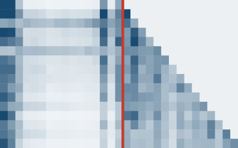
<div class="att-colors"><i style="background:#dce5ec"></i>弱い<br><br><i style="background:#214e71"></i>強い</div>
<div class="att-x">参照するトークン位置 →</div>
<div class="att-boundary">赤線：指示側と生成コード側の境界</div>
</div>

灰色の領域：その生成時点ではまだ存在しない位置

<!-- 15M・1 epochのL8・H5の例<br>色の上限：各モデルの98パーセンタイル<br>**モデル間での濃さの直接比較は不可** -->

</div></div>

<!-- モデル本体の高速attentionから重みを直接返さず、RoPE後のQ・Kから最終queryの重みを復元する。生成中の最後のqueryからは入力済みの全位置を参照できるので、この式には追加の未来マスクが不要。weights @ Vと実際のattention出力を別途照合している。図は保存済み15MのL8H5切り抜き。 -->


---

<!-- _class: scientific attention-result -->
# 1M・1 epoch：attention の可視化

同じ指示：**各要素を絶対値にして、降順に並べる**

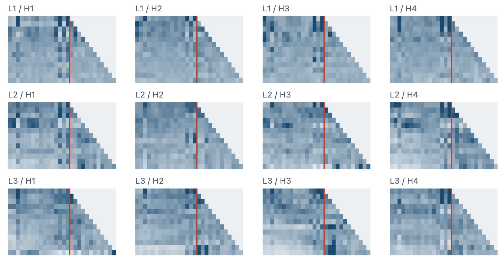

**生成結果：未定義の result の参照による実行失敗**

<!-- 色：各モデル内の相対的な強さ<br>モデル間での濃さの直接比較は不可 -->

<!--
入力全文：xsの各要素を絶対値にして降順に並べるsolve関数を書いてください。
3層×4head。全headを掲載。縦軸は13生成step。参照位置数・生成長はモデルによって異なる。
保存済みのattention_by_layer_head.svgをPNGへ出力し、掲載する層の領域をそのまま切り出して使用。セル・色・層とヘッドの並びを描き直していない。色の上限は元図のモデル別98パーセンタイル。
一つの指示での生成事例であり、固定5テストの合格率や24操作診断とは別。attentionの濃さだけで因果的寄与を断定しない。
生成コード：
def solve(xs: list[int], k: int) -> list[int]:
    # 現在の要素順を反転する
    output = list(reversed(result))
    # 昇順に並べる
    result = sorted(result)[::-1]
    return result

根拠：../results/attention_1epoch/boku_nano_1m_bpe_2048_minfreq5_maxlen24_1epoch/detail_analysis.json
元図：../results/attention_1epoch/boku_nano_1m_bpe_2048_minfreq5_maxlen24_1epoch/figures/attention_by_layer_head.svg
-->


---

<!-- _class: scientific attention-result -->
# 1M・3 epoch：attention の可視化

同じ指示：**各要素を絶対値にして、降順に並べる**


**生成結果：未定義の output の参照による実行失敗**

<!-- 3層・4 head・12生成step<br>色の濃さのモデル間での直接比較は不可 -->

<!--
保存済みSVGのviewBoxを48 62 618 320に設定し、他のページと同じくヘッド別ヒートマップ領域だけを切り抜いて掲載。セル・色・順序は変更していない。1 epochと同じ指示全文：xsの各要素を絶対値にして降順に並べるsolve関数を書いてください。
生成コードはoutput = [abs(value) for value in output]で未初期化変数を参照する。単一指示の事例であり、全体性能を表すものではない。
根拠：../results/attention_3epoch/boku_nano_1m_bpe_2048_minfreq5_maxlen24_3epoch/detail_analysis.json。
-->


---

<!-- _class: scientific attention-result -->
# 5M：attention の可視化（L1〜L3）

同じ指示：**各要素を絶対値にして、降順に並べる**

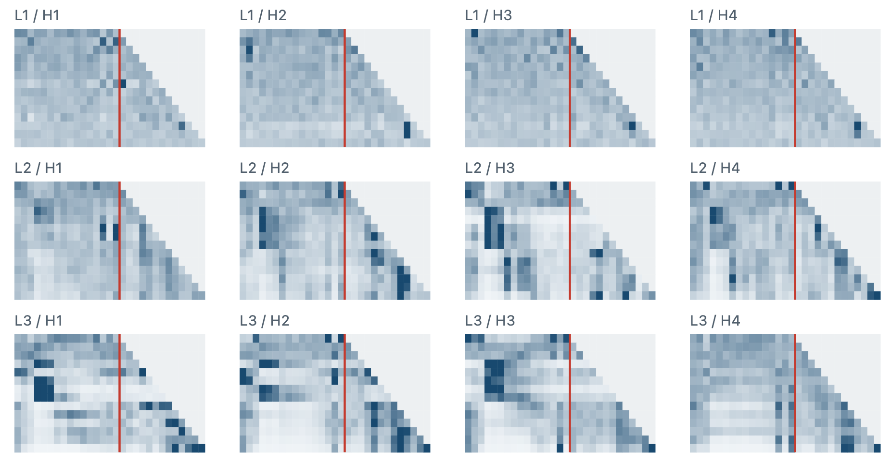

**生成結果：絶対値処理に加えた不要なk加算と降順整列の欠落**

<!-- 色：各モデル内の相対的な強さ<br>モデル間での濃さの直接比較は不可 -->

<!--
入力全文：xsの各要素を絶対値にして降順に並べるsolve関数を書いてください。
5層×4head。全headを掲載。縦軸は14生成step。参照位置数・生成長はモデルによって異なる。
保存済みのattention_by_layer_head.svgをPNGへ出力し、掲載する層の領域をそのまま切り出して使用。セル・色・層とヘッドの並びを描き直していない。色の上限は元図のモデル別98パーセンタイル。
一つの指示での生成事例であり、固定5テストの合格率や24操作診断とは別。attentionの濃さだけで因果的寄与を断定しない。
生成コード：
def solve(xs: list[int], k: int) -> list[int]:
    result: list[int] = []
    for value in xs:
        result += [value + k]
    output: list[int] = []
    for value in result:
        output += [abs(value)]
    return output

根拠：../results/attention_1epoch/boku_nano_5m_bpe_2048_minfreq5_maxlen24_1epoch/detail_analysis.json
元図：../results/attention_1epoch/boku_nano_5m_bpe_2048_minfreq5_maxlen24_1epoch/figures/attention_by_layer_head.svg
-->


---

<!-- _class: scientific attention-result -->
# 5M：attention の可視化（L4〜L5）

同じ指示：**各要素を絶対値にして、降順に並べる**

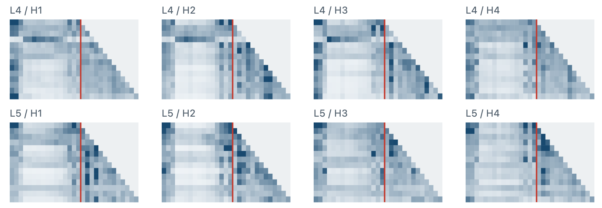

**生成結果：絶対値処理に加えた不要なk加算と降順整列の欠落**

<!-- 色：各モデル内の相対的な強さ<br>モデル間での濃さの直接比較は不可 -->

<!--
入力全文：xsの各要素を絶対値にして降順に並べるsolve関数を書いてください。
5層×4head。全headを掲載。縦軸は14生成step。参照位置数・生成長はモデルによって異なる。
保存済みのattention_by_layer_head.svgをPNGへ出力し、掲載する層の領域をそのまま切り出して使用。セル・色・層とヘッドの並びを描き直していない。色の上限は元図のモデル別98パーセンタイル。
一つの指示での生成事例であり、固定5テストの合格率や24操作診断とは別。attentionの濃さだけで因果的寄与を断定しない。
生成コード：
def solve(xs: list[int], k: int) -> list[int]:
    result: list[int] = []
    for value in xs:
        result += [value + k]
    output: list[int] = []
    for value in result:
        output += [abs(value)]
    return output

根拠：../results/attention_1epoch/boku_nano_5m_bpe_2048_minfreq5_maxlen24_1epoch/detail_analysis.json
元図：../results/attention_1epoch/boku_nano_5m_bpe_2048_minfreq5_maxlen24_1epoch/figures/attention_by_layer_head.svg
-->


---

<!-- _class: scientific attention-result -->
# 15M：attention の可視化（L1〜L4）

同じ指示：**各要素を絶対値にして、降順に並べる**

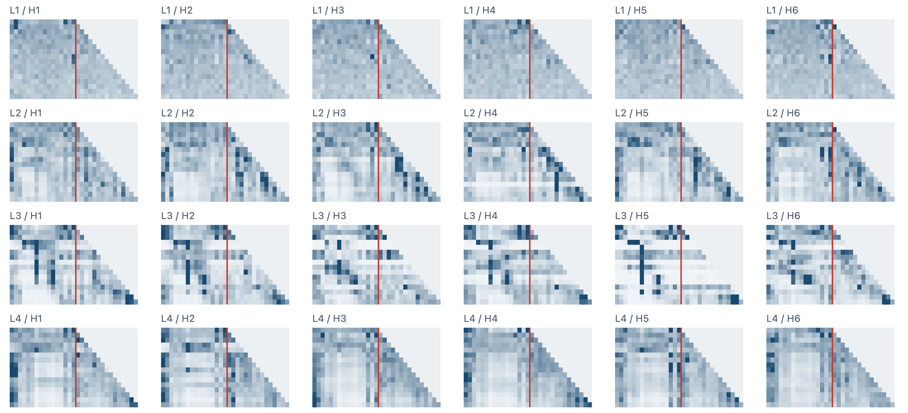

**生成結果：絶対値化と降順整列のコード生成**

<!-- 色：各モデル内の相対的な強さ<br>モデル間での濃さの直接比較は不可 -->

<!--
入力全文：xsの各要素を絶対値にして降順に並べるsolve関数を書いてください。
8層×6head。全headを掲載。縦軸は16生成step。参照位置数・生成長はモデルによって異なる。
保存済みのattention_by_layer_head.svgをPNGへ出力し、掲載する層の領域をそのまま切り出して使用。セル・色・層とヘッドの並びを描き直していない。色の上限は元図のモデル別98パーセンタイル。
一つの指示での生成事例であり、固定5テストの合格率や24操作診断とは別。attentionの濃さだけで因果的寄与を断定しない。
生成コード：
def solve(xs: list[int], k: int) -> list[int]:
    # 各要素の絶対値を取る
    result: list[int] = []
    for value in xs:
        result += [abs(value)]
    # 降順に並べる
    output: list[int] = sorted(result, reverse=True)
    return output

根拠：../results/attention_1epoch/boku_nano_15m_bpe_2048_minfreq5_maxlen24_1epoch/detail_analysis.json
元図：../results/attention_1epoch/boku_nano_15m_bpe_2048_minfreq5_maxlen24_1epoch/figures/attention_by_layer_head.svg
-->


---

<!-- _class: scientific attention-result -->
# 15M：attention の可視化（L5〜L8）

同じ指示：**各要素を絶対値にして、降順に並べる**

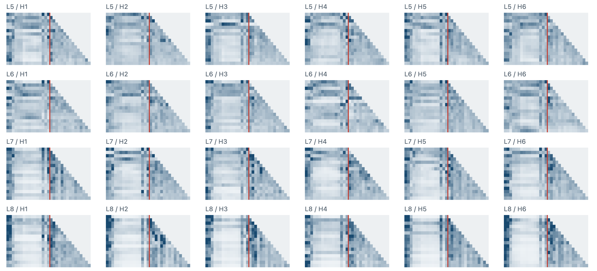

**生成結果：絶対値化と降順整列のコード生成**

<!-- 色：各モデル内の相対的な強さ<br>モデル間での濃さの直接比較は不可 -->

<!--
入力全文：xsの各要素を絶対値にして降順に並べるsolve関数を書いてください。
8層×6head。全headを掲載。縦軸は16生成step。参照位置数・生成長はモデルによって異なる。
保存済みのattention_by_layer_head.svgをPNGへ出力し、掲載する層の領域をそのまま切り出して使用。セル・色・層とヘッドの並びを描き直していない。色の上限は元図のモデル別98パーセンタイル。
一つの指示での生成事例であり、固定5テストの合格率や24操作診断とは別。attentionの濃さだけで因果的寄与を断定しない。
生成コード：
def solve(xs: list[int], k: int) -> list[int]:
    # 各要素の絶対値を取る
    result: list[int] = []
    for value in xs:
        result += [abs(value)]
    # 降順に並べる
    output: list[int] = sorted(result, reverse=True)
    return output

根拠：../results/attention_1epoch/boku_nano_15m_bpe_2048_minfreq5_maxlen24_1epoch/detail_analysis.json
元図：../results/attention_1epoch/boku_nano_15m_bpe_2048_minfreq5_maxlen24_1epoch/figures/attention_by_layer_head.svg
-->


---

<!-- _class: compact roomy-table ablation-table -->

# 指示情報の遮断による合格数の低下

学習時に準拠した文型による24操作の診断

| モデル | 通常の生成 | 指示の情報を止めた生成 |
| :--- | ---: | ---: |
| 1M・1 epoch | 3 / 24 | **0 / 24** |
| 1M・3 epoch | 19 / 24 | **0 / 24** |
| 5M・1 epoch | 22 / 24 | **0 / 24** |
| 15M・1 epoch | 22 / 24 | **2 / 24** |

**操作の選択に対する指示情報の寄与**

<!-- 24操作の内部診断<br>冒頭変更の14操作・固定5テストとは別の評価 -->

<!--
本編採用の4構成の実測値。全層で日本語指示位置のValueを0にした介入であり、指示自体を削除したものではない。各prompt33入力、greedy最大64 token。
根拠：../results/attention_1epoch/ 配下のminfreq5_maxlen24_1epoch/analysis.json
-->


<!-- 1M・3 epochの追加根拠：../results/attention_3epoch/boku_nano_1m_bpe_2048_minfreq5_maxlen24_3epoch/analysis.json、../results/attention_3epoch/boku_nano_1m_bpe_2048_minfreq5_maxlen24_3epoch/prompt_prefix_comparison.json、../results/model_reports/boku_nano_1m_bpe_2048_minfreq5_maxlen24_3epoch.md。冒頭変更は2026-10-13に同じ14操作・33入力・seed=20260930・最大64新規tokenで評価。変更前の14生成コードが保存済み結果と一致することを確認。 -->

---

<!-- _class: default roomy-table -->

# 表現を変えた場合の性能評価

| 調べること | 今回分かったこと |
| :--- | :--- |
| 決めた文型での動作 | 1M・3 epochでも高い全体合格率 |
| 未学習の言い換え | 1M・3 epochと15M・1 epochは15 / 30 |
| 指示の冒頭の変更 | 1M・3 epochは12→9 ／ 5M・1 epochは12→1（各14操作） |

**一種類のプロンプトでの精度に加え<br>表現を変えても性能を保てるかの評価の必要性**

<!--
先行研究は分類・二択質問、今回の実験は限定したコード生成。課題と指標が違うことに注意。
根拠：Appendix Aの各ページに記載した出典、Gan and Mori（2023）、Takayama et al.（2026）
-->


<!-- 1M・3 epochの追加根拠：../results/attention_3epoch/boku_nano_1m_bpe_2048_minfreq5_maxlen24_3epoch/analysis.json、../results/attention_3epoch/boku_nano_1m_bpe_2048_minfreq5_maxlen24_3epoch/prompt_prefix_comparison.json、../results/model_reports/boku_nano_1m_bpe_2048_minfreq5_maxlen24_3epoch.md。冒頭変更は2026-10-13に同じ14操作・33入力・seed=20260930・最大64新規tokenで評価。変更前の14生成コードが保存済み結果と一致することを確認。 -->

---

<!-- _class: default roomy-copy -->

# この結果が示す範囲

- 訓練：24操作から最大3操作を組み合わせるコード生成 ／ 追加評価：4操作までの評価
- 冒頭変更の比較：14操作に限定（日本語能力全体を対象としない測定）
- 学習：一つの乱数設定（繰り返し実験によるばらつきは未確認）

今後の課題：文型の偏りを減らした合成データによる表現への頑健性の再評価

<!--
乱数seedは学習20260925、内部診断20260930。追加実験は今後の提案です。
根拠：../results/trained_model_inventory.md、../results/boku_nano_1epoch_attention_comparison.md
-->


---

<!-- _class: overview-original -->
<!-- _paginate: false -->
<h1>Appendix D：Boku-nano 全体図</h1>

<div class="canvas">
<div class="sub">日本語の限定的な指示から solve(xs, k) を生成する小型Decoder-only Transformer<br>意味ASTを起点に共通の意味仕様で接続するデータ生成・学習・評価</div>

<div class="lane">
    <div class="lname"><span class="n">1</span><span class="t">意味</span></div>
    <div class="box rule">
        <b class="t">24の基本操作</b>
        抽出 10：偶数・奇数・&gt;k・≥k・&lt;k・≤k・kの倍数・正・負・ゼロ<br>
        変換 8：+k・−k・×k・2倍・3倍・符号反転・絶対値・二乗<br>
        並べ替え 3／切り出し 3
    </div>
    <div class="arrow">→</div>
    <div class="box rule">
        <b class="t">意味AST　12,720仕様</b>
        24操作からの順序付き1〜3操作の選択（重複なし）<br>
        24 ＋ 24×23 ＋ 24×23×22 ＝ 12,720<br>
        <span class="mono">{"sequence": [{"filter": ["even"]}, {"map": ["add_k"]}]}</span><br>
        <!-- <span class="note">※日本語・コード・期待値・splitの共通の根拠</span> -->
    </div>
    <div class="arrow">→</div>
    <div class="box rule span-c3c4">
        <b class="t">参照インタプリタ（期待値の計算）</b>
        意味ASTの入力リストへの適用と正しい出力の計算<br>
        operator・itertools・heapq・deque・while による生成solve関数の表現空間の外側での実装<br>
        → 正解コードの検証（2）とhidden test採点（4）に利用<br>
        <!-- <span class="note">※参照実装と生成コードが同じ式を書いて誤りを共有しないため</span> -->
    </div>
</div>

<div class="conn">
    <div></div>
    <div>↓ 意味ASTの分割</div>
    <div></div>
    <div class="dash" style="text-align:right">⇣ 期待値で検証（参照インタプリタ → 正解コード生成）</div>
</div>

<div class="lane alt">
    <div class="lname"><span class="n">2</span><span class="t">データ</span></div>
    <div class="box rule">
        <b class="t">意味ASTの分割</b>
        組合せ汎化用：全12,720のうち670<br>
        残り 12,050 のハッシュ順での分割<br>
        　train　9,646（1操作24は全部）<br>
        　validation　1,202<br>
        　通常テスト　1,202（境界値も流用）<br>
        別枠：同一操作の反復 1,152<br>
        　　　日本語言い換え 30指示
    </div>
    <div class="arrow">→</div>
    <div class="stack">
        <div class="box rule">
            <b class="t">正解コード生成（自作テンプレート）</b>
            style_specによるfor／内包表記・変数名・スライス表記などの変更<br>
            277,440候補から全条件の通過例のみ採用<br>
            構文・Safe-AST・signature・入力非破壊・41入力での参照インタプリタとの出力一致
        </div>
        <div class="box teacher">
            <b class="t">日本語指示生成</b>
            ルール：承認済み表現辞書（train 522件）を定型文へ連結<br>
            教師言い換え：Qwen3-4B-AWQ が意味と順序を保って言い換え<br>
            <!-- <span class="note">※Qwenは日本語だけを作りコードや重みは提供しない</span> -->
        </div>
    </div>
    <div class="arrow">→</div>
    <div class="stack">
        <div class="box data">
            <b class="t">評価JSONL　108,590件</b>
            validation 24,040<br>
            正式5テスト 84,550問<br>
            hidden入力はコード作成時と別の入力
        </div>
        <div class="box data">
            <b class="t">訓練JSONL　192,900件</b>
            1操作 460／2操作 8,680／3操作 183,760<br>
            ルール文 96,510＋言い換え 96,390<br>
            1意味ASTあたり原則20件
        </div>
    </div>
    <div class="arrow dot">┅</div>
    <div class="box data">
        <b class="t">1レコードの中身</b>
        instruction_ja（日本語指示）<br>
        semantic_ast（意味AST）<br>
        reference_code（正解コード）<br>
        style_spec・code_style<br>
        split・tests・verification<br>
        SHA-256・seed・生成器version<br>
        教師モデル由来かどうかの来歴
    </div>
</div>

<div class="conn">
    <div></div>
    <div>↓ train の指示とコード（訓練JSONLから）</div>
</div>

<div class="lane">
    <div class="lname"><span class="n">3</span><span class="t">学習</span></div>
    <div class="box rule">
        <b class="t">BPEトークナイザ</b>
        ByteLevel BPE・語彙 2,048<br>
        trainの日本語指示と正解コードだけから学習<br>
        （評価データの除外）<br>
        min_frequency 5・最大token長 24<br>
        unknown token 0件
    </div>
    <div class="arrow">→</div>
    <div class="box model">
        <b class="t">学習系列とloss</b>
        <span class="mono">&lt;|bos|&gt;&lt;|task|&gt; {instruction_ja}</span><br>
        <span class="mono">&lt;|code|&gt; {reference_code}&lt;|eos|&gt;</span><br>
        lossの対象はコードとEOSのみ（指示は条件としての参照のみ）<br>
        batch 512件・1エポック 377 step・AdamW・bf16
    </div>
    <div class="arrow">→</div>
    <div class="box model span-c3c4">
        <b class="t">Decoder-only Transformer（ランダム初期値から学習）</b>
        RoPE・RMSNorm・SwiGLU・通常のMulti-Head Attention・最大系列長 256<br>
        　1M　d=128・3層・4 head<br>
        　5M　d=256・5層・4 head<br>
        　15M　d=384・8層・6 head<br>
        3つの規模をそれぞれ1エポック学習（RTX 5090）
    </div>
</div>

<div class="conn">
    <div></div>
    <div>↓ 学習済みモデル</div>
    <div></div><div></div><div></div><div></div><div></div>
    <div style="padding-left:120px">↓</div>
</div>

<div class="lane alt">
    <div class="lname"><span class="n">4</span><span class="t">評価</span></div>
    <div class="box eval span-c1c2">
        <b class="t">hidden test評価（正式5テスト 84,550問）</b>
        greedy生成 → 構文 → Safe-AST → signature → 隔離実行<br>
        → hidden入力すべてで参照インタプリタと同じ出力なら合格<br>
        文字列一致ではなく実行結果による判定<br>
        　通常 24,040　　組合せ汎化 13,400　　日本語言い換え 30<br>
        　同一操作の反復 23,040　　境界値 24,040<br>
        <!-- <span class="note">※attention診断の24問（1操作）はこれとは別の解析用テスト</span> -->
    </div>
    <div class="arrow">→</div>
    <div class="box eval">
        <b class="t">主な結果（1エポック・正式5テスト合計）</b>
        15M　99.56%（84,180 / 84,550）<br>
        5M　96.46%（81,557 / 84,550）<br>
        1M　1.74%（1,467 / 84,550）<br>
        <!-- <span class="note">※弱点：未学習の言い換え（15Mでも30問中15問）</span> -->
    </div>
    <div></div>
    <div class="box eval">
        <b class="t">内部解析</b>
        Q・K・Vを取り出しattentionを計算<br>
        head別のattention配分・Value norm・<br>
        BOS sink・attention rollout<br>
        head／位置ablation：NLL差（nat）と<br>
        再生成コードの合格数で因果の確認
    </div>
</div>

<div class="conn"></div>

<div class="lane">
    <div class="lname"><span class="n">5</span><span class="t">デモ</span></div>
    <div class="demo" style="grid-column: 2 / 9;">
        <div class="box rule">
            <b class="t">自由な日本語</b>
            例：全部プラスにして大きい順に並べて
        </div>
        <div class="arrow">→</div>
        <div class="box teacher">
            <b class="t">Qwen3-0.6B（ブラウザ）</b>
            自由文からCNLへの翻訳のみ<br>
            追加学習なし・コード生成なし
        </div>
        <div class="arrow">→</div>
        <div class="box rule">
            <b class="t">JavaScript検査</b>
            24操作・最大3操作・<br>
            定型文法に合うか確認
        </div>
        <div class="arrow">→</div>
        <div class="box model">
            <b class="t">Boku1-nano ONNX</b>
            学習済みモデルを選んで<br>
            ブラウザ内でgreedy生成
        </div>
        <div class="arrow">→</div>
        <div class="box data">
            <b class="t">Pythonコード</b>
            <span class="mono">def solve(xs, k) -&gt; list[int]</span>
        </div>
    </div>
</div>

<div class="legend">
    <div><span class="k" style="background:#eaf2f8;border-color:#3d7591"></span>自作ルール・決定的な処理</div>
    <div><span class="k" style="background:#fbeee3;border-color:#c47a36"></span>Qwenを使う処理（日本語のみ）</div>
    <div><span class="k" style="background:#edf5eb;border-color:#4f8a4b"></span>データ・出力</div>
    <div><span class="k" style="background:#f0ebf8;border-color:#6b55a3"></span>学習・モデル</div>
    <div><span class="k" style="background:#fdf4dc;border-color:#a9821b"></span>評価・解析</div>
    <div style="color:#8a6d1f">⇣ 参照インタプリタによる検証</div>
</div>

</div>


---


<!-- _class: bibliography -->
# 参考文献

<div class="reference-columns">
<div>
<p><strong>Eldan & Li (2023)</strong><br><a href="https://arxiv.org/abs/2305.07759">TinyStories: How Small Can Language Models Be and Still Speak Coherent English?</a></p>
<p><strong>Finke et al. (2025)</strong><br><a href="https://proceedings.neurips.cc/paper_files/paper/2025/hash/34696303f5996d5c54e699c0b462ae48-Abstract-Datasets_and_Benchmarks_Track.html">Parameterized Synthetic Text Generation with SimpleStories</a></p>
<p><strong>Maini et al. (2024)</strong><br><a href="https://arxiv.org/abs/2401.16380">Rephrasing the Web: A Recipe for Compute and Data-Efficient Language Modeling</a></p>
<p><strong>Yu &amp; Xiong (2026), COLM</strong><br><a href="https://arxiv.org/abs/2605.17849">Generating Pretraining Tokens from Organic Data for Data-Bound Scaling (SynPro)</a></p>
<p><strong>Gunasekar et al. (2023)</strong><br><a href="https://arxiv.org/abs/2306.11644">Textbooks Are All You Need</a></p>
<p><strong>Liu et al. (2023)</strong><br><a href="https://arxiv.org/abs/2312.09241">TinyGSM: achieving &gt;80% on GSM8k with small language models</a></p>
</div>
<div>
<p><strong>Kim et al. (2026), COLM</strong><br><a href="https://arxiv.org/abs/2603.18534">Data-efficient pre-training by scaling synthetic megadocs</a></p>
<p><strong>Ouyang et al. (2022)</strong><br><a href="https://arxiv.org/abs/2203.02155">Training language models to follow instructions with human feedback</a></p>
<p><strong>Zheng et al. (2023)</strong><br><a href="https://arxiv.org/abs/2306.05685">Judging LLM-as-a-Judge with MT-Bench and Chatbot Arena</a></p>
<p><strong>Lambert et al. (2024)</strong><br><a href="https://arxiv.org/abs/2411.15124">Tulu 3: Pushing Frontiers in Open Language Model Post-Training</a></p>
<p><strong>Gan & Mori (2023)</strong><br><a href="https://aclanthology.org/2023.paclic-1.1/">Sensitivity and Robustness of Large Language Models to Prompt Template in Japanese Text Classification Tasks</a></p>
<p><strong>Takayama et al. (2026)</strong><br><a href="https://aclanthology.org/2026.lrec-1.225/">Evaluating the Effect of Question Wording Variations on Answer Consistency in Large Language Models</a></p>
</div>
</div>
