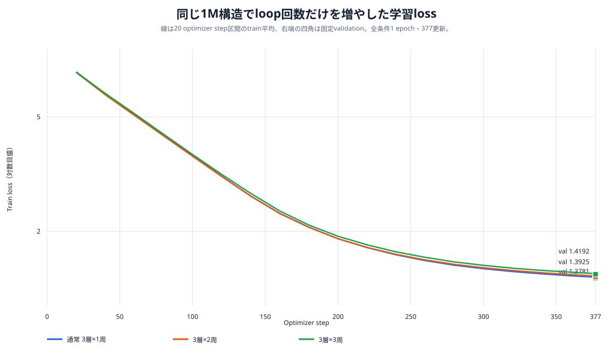
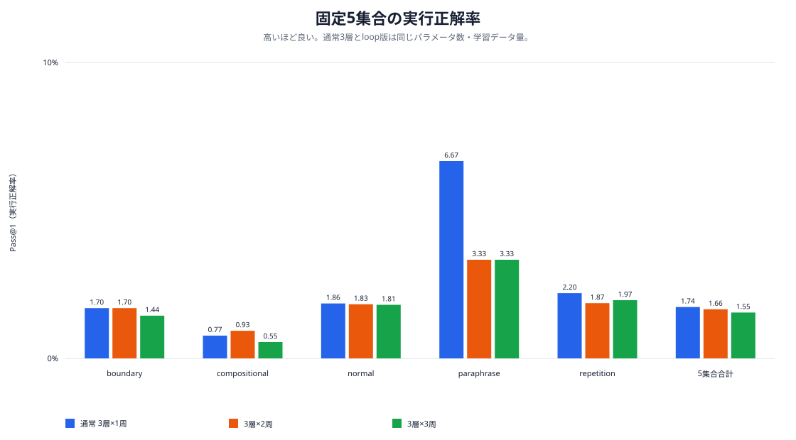
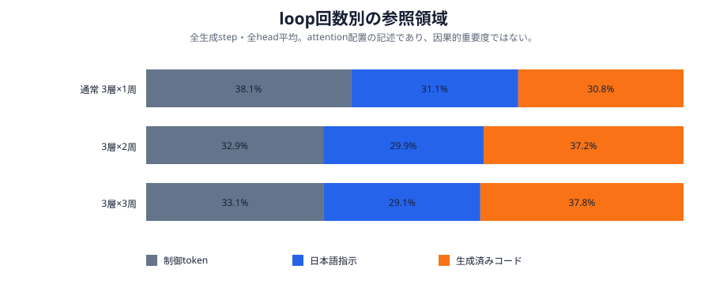
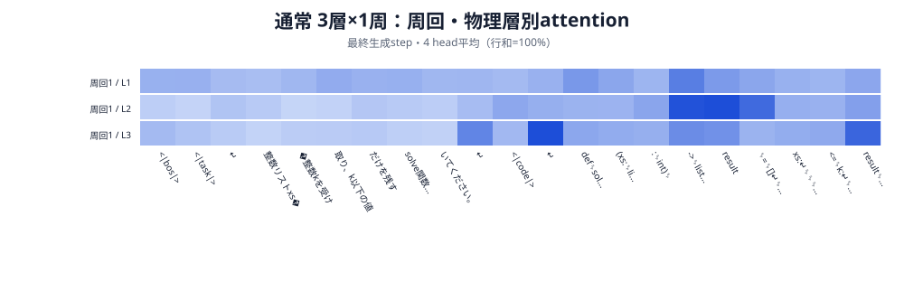
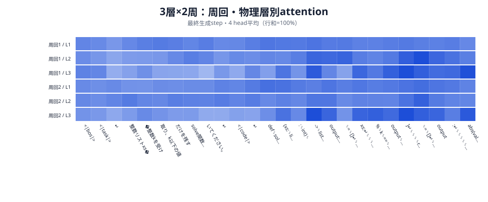
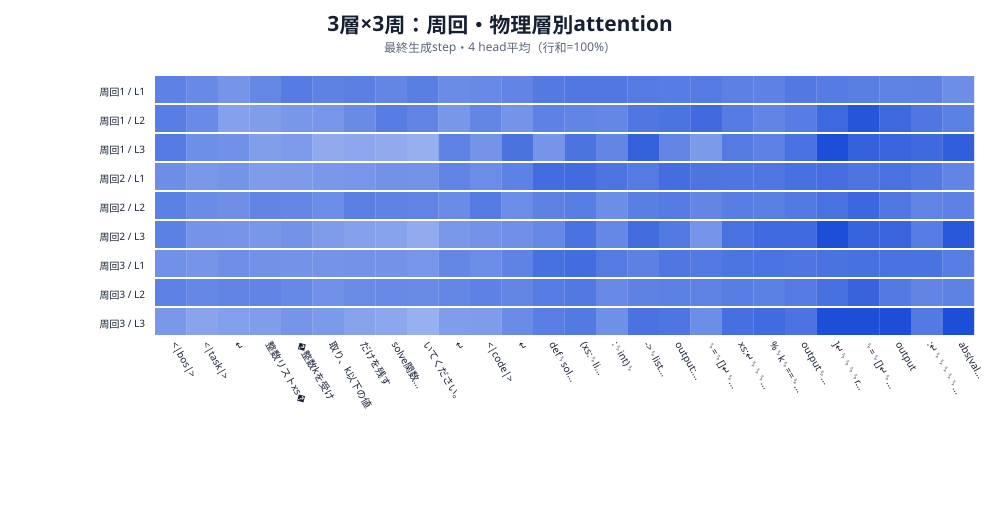

# 1M同一構造のLooped Transformer：1 epoch学習・評価・attention可視化

実行日: 2026-10-16

## 結論

既存1Mモデルの幅、3物理層、parameter数、初期値、訓練データ、optimizer、1 epochの377更新を維持し、同じ3層群を1周・2周・3周させて比較した。**今回の1 seedでは、loopによる性能向上は確認できなかった。**

- validation lossは通常版の`1.378111`が最小で、2周は`1.392492`、3周は`1.419190`だった。
- 固定5集合84,550件の実行正解率は、通常版`1.7351%`、2周`1.6606%`、3周`1.5494%`だった。
- 2周だけは組合せ集合で通常版を`0.1642`ポイント上回ったが、反復・言い換え・総合では低下した。単一集合の改善だけからloopが有効とは判断しない。
- attentionの固定promptでは、2周・3周は通常版より日本語指示へのattentionが薄く、生成済みコードへのattentionが増えた。両loop版はこのpromptで誤った処理を生成した。ただしattention比率だけから失敗原因や因果的重要度は断定できない。

## 比較条件

| variant | 物理層×周回 | block適用回数 | parameters | epoch / updates |
| --- | ---: | ---: | ---: | ---: |
| `u3` | 3×1 | 3 | 1,016,704 | 1 / 377 |
| `u3_r2` | 3×2 | 6 | 1,016,704 | 1 / 377 |
| `u3_r3` | 3×3 | 9 | 1,016,704 | 1 / 377 |

共通条件は幅128、FFN256、4 heads、語彙2,048、context 256、embedding/head非共有、入力再注入なし、seed `20260925`、訓練192,900件、実効batch 512、AdamW、CUDA bfloat16である。全条件を同じランダム初期値から学習した。1 epochで読む系列tokenは6,939,466、教師tokenは3,746,067で等しい。

これは**同じデータ提示量**の比較であり、同じ計算量の比較ではない。2周・3周はblock計算を通常版の2倍・3倍行う。学習済み通常モデルへ周回を後付けした実験でもない。

## Loss

| variant | 最終train loss（最終区間） | validation loss | validation perplexity |
| --- | ---: | ---: | ---: |
| `u3` | **1.386624** | **1.378111** | **3.967401** |
| `u3_r2` | 1.400589 | 1.392492 | 4.024868 |
| `u3_r3` | 1.426323 | 1.419190 | 4.133771 |



3条件のloss曲線は近いが、学習後半では通常版、2周、3周の順に低くなった。周回数の増加が、同じ377更新でのtoken予測を改善する傾向は見られない。

## 固定5集合の生成・実行評価

| 集合 | 件数 | `u3` | `u3_r2` | `u3_r3` |
| --- | ---: | ---: | ---: | ---: |
| boundary | 24,040 | **408 / 1.6972%** | **408 / 1.6972%** | 347 / 1.4434% |
| compositional | 13,400 | 103 / 0.7687% | **125 / 0.9328%** | 74 / 0.5522% |
| normal | 24,040 | **446 / 1.8552%** | 440 / 1.8303% | 435 / 1.8095% |
| paraphrase | 30 | **2 / 6.6667%** | 1 / 3.3333% | 1 / 3.3333% |
| repetition | 23,040 | **508 / 2.2049%** | 430 / 1.8663% | 453 / 1.9661% |
| **合計** | **84,550** | **1,467 / 1.7351%** | 1,404 / 1.6606% | 1,310 / 1.5494% |



2周の総合値は通常版より`0.0745`ポイント、3周は`0.1857`ポイント低い。2周は組合せ集合だけ改善したものの、改善22件に対して反復集合では78件減っている。3周は2周より反復集合で23件増えた一方、boundary・compositional・normalで減り、総合ではさらに低下した。

## Attention可視化

固定promptとして、通常版が正しいコードを生成できた次の学習時準拠文を使った。

> 整数リストxsと整数kを受け取り、k以下の値だけを残すsolve関数を書いてください。

各生成stepで、全周回・全物理層のQ/Kからcausal attentionを復元した。領域比率は全生成step・全実効層・全headの平均である。

| variant | 制御token | 日本語指示 | 生成済みコード | 生成結果 |
| --- | ---: | ---: | ---: | --- |
| `u3` | 38.12% | **31.12%** | 30.76% | `value <= k`を生成し正しい |
| `u3_r2` | 32.95% | 29.85% | 37.20% | `value % k == 0`と絶対値化を生成し誤り |
| `u3_r3` | 33.07% | 29.11% | **37.82%** | 2周と同じ誤った処理を生成 |



最終生成stepのhead平均attentionを、周回・物理層ごとに示す。

### 通常版：3層×1周



### 3層×2周



### 3層×3周



loop版では生成済みコードへのattentionが通常版より約6.4〜7.1ポイント高い。これは誤った中間コードを参照して処理を重ねた可能性と整合するが、観察上の関連に留まる。attention weightはValue、残差、FFN、後続周回を含む因果寄与ではない。周回ごとのhead ablationは今回実施していない。

## 判断

1. **1 epochでのloop採用は見送る。** validation lossと固定5集合の総合正解率がともに悪化した。
2. **計算追加の対価も得られていない。** parameter数は同じだが、block適用回数は2倍・3倍である。
3. **組合せ集合の2周改善は追試候補。** seedを増やして再現するか、通常版との差を統計的に確認するまでは構造効果と扱わない。
4. 次に試すなら、入力再注入`add`、周回別補助loss、残差初期化を実効深さで揃える比較を、それぞれ単独の変更として評価する。今回の結果から単純にepochだけ増やせば逆転すると予測はしない。

## 成果物と再現

- [比較manifest](../../data/models/looped_1m_1epoch_20261016/manifest.json)
- [固定評価比較](../../data/models/looped_1m_1epoch_20261016/comparison.json)
- [図の数値](figures/looped_1m_1epoch_20261016/values.json)
- [attention数値](figures/looped_1m_1epoch_20261016/attention_metrics.json)
- [loss・評価図生成スクリプト](../../scripts/model/plot_looped_1m_results.py)
- [周回別attention解析スクリプト](../../scripts/model/analyze_looped_attention.py)

```bash
uv run --group model-training --python 3.12.12 python \
  scripts/model/run_boku_nano_1m_looped_experiment.py \
  --output-root data/models/looped_1m_1epoch_20261016 \
  --run --evaluate

uv run --group model-training --python 3.12.12 python \
  scripts/model/plot_looped_1m_results.py \
  --run-directory data/models/looped_1m_1epoch_20261016 \
  --output-directory docs/results/figures/looped_1m_1epoch_20261016

uv run --group model-training --python 3.12.12 python \
  scripts/model/analyze_looped_attention.py \
  --run-directory data/models/looped_1m_1epoch_20261016 \
  --output-directory docs/results/figures/looped_1m_1epoch_20261016
```
