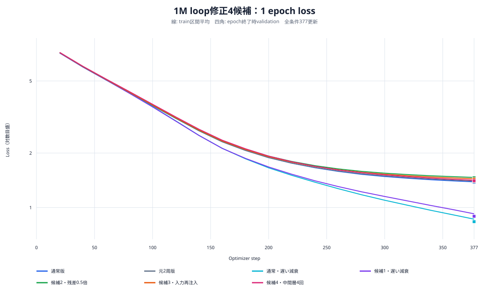
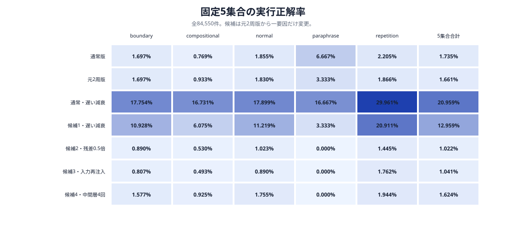
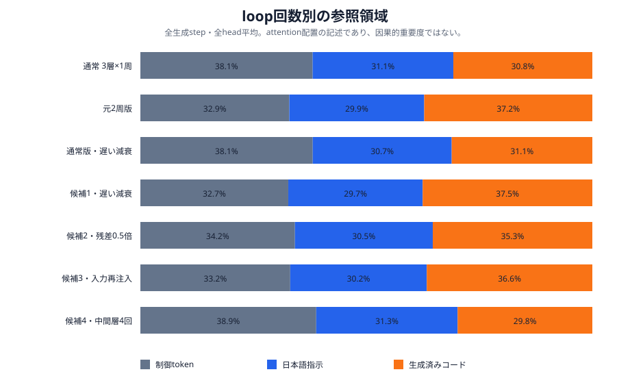

# 1M Looped Transformer修正4候補：1 epoch学習・評価・attention可視化

実行日: 2026-10-16

## 結論

1,016,704 parameters・3物理層・1 epoch・377更新を固定し、元2周版へ4つの修正を一つずつ適用した。通常版、元2周版、遅い減衰だけを適用した通常版も同じrunで再学習した。

**有効だったのは学習率の減衰を遅くする変更だけだった。ただし、同じ日程では通常版が2周版を8.0000ポイント上回ったため、改善の主因はloopではなく学習率日程である。** 残差0.5倍、入力embedding再注入、中間層4回反復は、元2周版の総合実行正解率を上回らなかった。

| 構成 | validation loss | 固定5集合 Pass@1 | 元2周版との差 | 対応する通常版との差 | 判断 |
| --- | ---: | ---: | ---: | ---: | --- |
| 通常版 `u3` | 1.378111 | 1,467 / 1.7351% | +0.0745 pt | 基準 | 対照 |
| 元2周版 `u3_r2` | 1.392492 | 1,404 / 1.6606% | 基準 | -0.0745 pt | 対照 |
| 通常・遅い減衰 `u3_slow` | **0.835739** | **17,721 / 20.9592%** | +19.2986 pt | +19.2241 pt（元日程比） | 全体最良 |
| 候補1・遅い減衰 `u3_r2_slow` | 0.894856 | 10,957 / 12.9592% | **+11.2986 pt** | **-8.0000 pt** | 日程は有効、loop優位なし |
| 候補2・残差0.5倍 `u3_r2_scaled` | 1.459582 | 864 / 1.0219% | -0.6387 pt | -0.7132 pt | 不採用 |
| 候補3・入力再注入 `u3_r2_add` | 1.434942 | 880 / 1.0408% | -0.6198 pt | -0.6943 pt | 不採用 |
| 候補4・中間層4回 `u3_middle4` | 1.407296 | 1,373 / 1.6239% | -0.0367 pt | -0.1112 pt | 改善なし |

## 比較条件

全構成で幅128、FFN256、4 heads、3物理層、語彙2,048、context 256、embedding/head非共有、seed `20260925`、訓練192,900件、実効batch 512、CUDA bfloat16を使用した。全モデルは同じ初期parameterから学習し、各候補は元2周版から一要因だけ変更した。

| variant | block適用順／変更 | 適用回数 | 学習率日程 |
| --- | --- | ---: | --- |
| `u3` | `B0 B1 B2` | 3 | cosine終端377 |
| `u3_r2` | `B0 B1 B2 B0 B1 B2` | 6 | cosine終端377 |
| `u3_slow` | `B0 B1 B2` | 3 | cosine終端1131、実学習377更新 |
| `u3_r2_slow` | 2周 | 6 | cosine終端1131、実学習377更新 |
| `u3_r2_scaled` | 2周、attention/FFN残差枝を各0.5倍 | 6 | cosine終端377 |
| `u3_r2_add` | 2周目開始時に入力embeddingを再注入 | 6 | cosine終端377 |
| `u3_middle4` | `B0 B1 B1 B1 B1 B2` | 6 | cosine終端377 |

遅い減衰の`1131`はscheduleの終端であり、実際に1131更新したという意味ではない。全モデルとも1 epoch・377更新で完了している。候補は同じデータ量とparameter数だが、通常版3回に対してloop候補は6回blockを適用するため、同じ計算量の比較ではない。

## Loss

| variant | 最終train loss | validation loss | validation perplexity |
| --- | ---: | ---: | ---: |
| `u3` | 1.386624 | 1.378111 | 3.967401 |
| `u3_r2` | 1.400589 | 1.392492 | 4.024868 |
| `u3_slow` | **0.862938** | **0.835739** | **2.306518** |
| `u3_r2_slow` | 0.923594 | 0.894856 | 2.446983 |
| `u3_r2_scaled` | 1.466638 | 1.459582 | 4.304158 |
| `u3_r2_add` | 1.442498 | 1.434942 | 4.199401 |
| `u3_middle4` | 1.416137 | 1.407296 | 4.084893 |



遅い減衰の2構成だけが明確に低いlossへ到達した。残り3候補は通常版・元2周版よりvalidation lossが高く、固定評価の悪化とも整合する。

## 固定5集合の生成・実行評価

| 構成 | boundary | compositional | normal | paraphrase | repetition | 合計 |
| --- | ---: | ---: | ---: | ---: | ---: | ---: |
| `u3` | 408 / 1.6972% | 103 / 0.7687% | 446 / 1.8552% | 2 / 6.6667% | 508 / 2.2049% | 1,467 / 1.7351% |
| `u3_r2` | 408 / 1.6972% | 125 / 0.9328% | 440 / 1.8303% | 1 / 3.3333% | 430 / 1.8663% | 1,404 / 1.6606% |
| `u3_slow` | **4,268 / 17.7537%** | **2,242 / 16.7313%** | **4,303 / 17.8993%** | **5 / 16.6667%** | **6,903 / 29.9609%** | **17,721 / 20.9592%** |
| `u3_r2_slow` | 2,627 / 10.9276% | 814 / 6.0746% | 2,697 / 11.2188% | 1 / 3.3333% | 4,818 / 20.9115% | 10,957 / 12.9592% |
| `u3_r2_scaled` | 214 / 0.8902% | 71 / 0.5299% | 246 / 1.0233% | 0 / 0.0000% | 333 / 1.4453% | 864 / 1.0219% |
| `u3_r2_add` | 194 / 0.8070% | 66 / 0.4925% | 214 / 0.8902% | 0 / 0.0000% | 406 / 1.7622% | 880 / 1.0408% |
| `u3_middle4` | 379 / 1.5765% | 124 / 0.9254% | 422 / 1.7554% | 0 / 0.0000% | 448 / 1.9444% | 1,373 / 1.6239% |



候補1は全ての大規模集合で元2周版を大きく上回ったが、同じ遅い減衰の通常版には全5集合で届かなかった。候補2・3は生成が長くなり、全5集合合計のtimeoutがそれぞれ245件、275件へ増えた。候補4は元2周版に最も近いが、総合で31件少なく、paraphraseは0/30だった。

## Attention可視化

前回と同じ固定promptを使用した。

> 整数リストxsと整数kを受け取り、k以下の値だけを残すsolve関数を書いてください。

各生成stepのQ/Kから、実際のblock適用順にattentionを復元した。中間層4回版は`前段L1 → 中間L2×4 → 後段L3`として表示する。

| variant | 制御token | 日本語指示 | 生成済みコード | 固定promptの生成 |
| --- | ---: | ---: | ---: | --- |
| `u3` | 38.12% | 31.12% | 30.76% | 正しい`value <= k` |
| `u3_r2` | 32.95% | 29.85% | 37.20% | 誤り |
| `u3_slow` | 38.14% | 30.75% | 31.11% | 正しい`k >= x` |
| `u3_r2_slow` | 32.72% | 29.74% | 37.54% | 誤り |
| `u3_r2_scaled` | 34.20% | 30.50% | 35.30% | 誤り |
| `u3_r2_add` | 33.15% | 30.22% | 36.63% | 誤り |
| `u3_middle4` | 38.91% | **31.29%** | 29.80% | 誤り |



周回・物理層別の最終生成step heatmap：

- [通常版](figures/looped_revision_1m_1epoch_20261016/u3_attention_heatmap.svg)
- [元2周版](figures/looped_revision_1m_1epoch_20261016/u3_r2_attention_heatmap.svg)
- [通常・遅い減衰](figures/looped_revision_1m_1epoch_20261016/u3_slow_attention_heatmap.svg)
- [候補1・遅い減衰](figures/looped_revision_1m_1epoch_20261016/u3_r2_slow_attention_heatmap.svg)
- [候補2・残差0.5倍](figures/looped_revision_1m_1epoch_20261016/u3_r2_scaled_attention_heatmap.svg)
- [候補3・入力再注入](figures/looped_revision_1m_1epoch_20261016/u3_r2_add_attention_heatmap.svg)
- [候補4・中間層4回](figures/looped_revision_1m_1epoch_20261016/u3_middle4_attention_heatmap.svg)

full-loopの4構成は、通常版2構成より生成済みコードへのattentionが約4.2〜6.8ポイント高い。中間層4回版は領域比率では通常版に近いが固定promptを誤答し、全件評価も改善しなかった。したがって、領域attentionの近さだけでは能力を説明できない。attentionは記述的観察であり、Value、残差、FFN、後続適用の因果寄与ではない。

## 採否

1. **候補1の学習率日程は採用候補。ただしモデル構造は通常3層を選ぶ。** 同じ遅い減衰で通常版が2周版を8ポイント上回り、計算量も少ない。
2. **候補2・残差0.5倍は不採用。** loss、全評価集合、timeoutの全てで改善がない。
3. **候補3・入力再注入は不採用。** 今回の単純加算ではlossと実行性能が悪化した。
4. **候補4・中間層4回は不採用。** 元2周版との差は小さいが正でなく、通常版にも届かない。
5. 次の優先実験はloop修正の組合せではなく、`u3_slow`を基準に複数seedで学習率日程の再現性を確認すること。1 epochの最終学習率がまだ高いため、schedule終端1131以外の値も通常版上で探索する。

## 成果物と再現

- [比較manifest](../../data/models/looped_revision_1m_1epoch_20261016/manifest.json)
- [固定評価比較](../../data/models/looped_revision_1m_1epoch_20261016/comparison.json)
- [図の数値](figures/looped_revision_1m_1epoch_20261016/values.json)
- [attention数値](figures/looped_revision_1m_1epoch_20261016/attention_metrics.json)
- [loss・評価図生成スクリプト](../../scripts/model/plot_looped_revision_results.py)
- [周回別attention解析スクリプト](../../scripts/model/analyze_looped_attention.py)

```bash
uv run --python 3.12.12 --group model-training python \
  scripts/model/run_boku_nano_looped_revision_experiment.py \
  --output-root data/models/looped_revision_1m_1epoch_20261016 \
  --device cuda --dtype bfloat16 --run --evaluate
```

評価の途中で独立3候補を並列化したため、各候補は保存済みJSONLから`--resume`して完了させた。全7モデルについて5集合の件数、`status=completed`、データarchive hash不変を検査し、同じ評価設定から`comparison.json`を再生成した。
