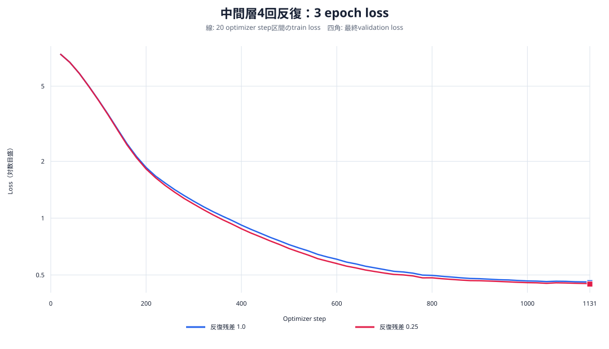
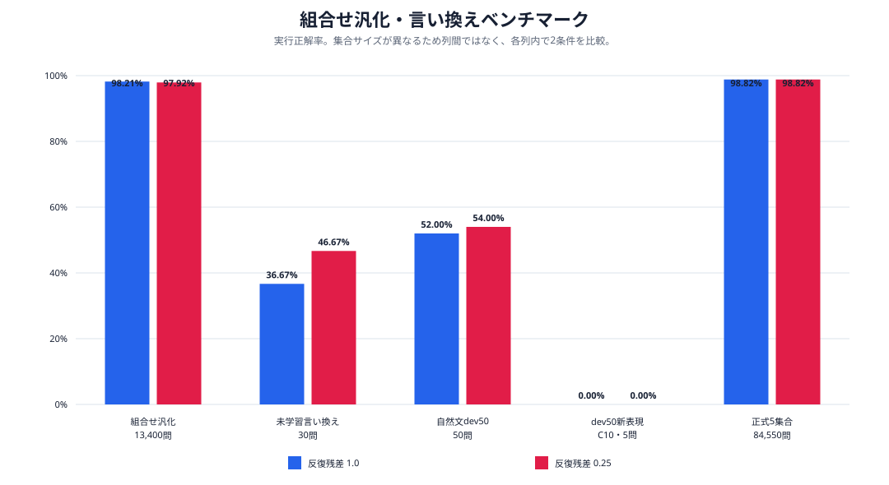
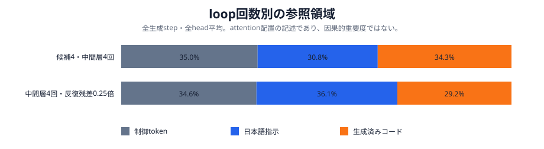

# 中間層4回反復：3 epoch・反復残差倍率1.0対0.25

実行日: 2026-10-18

## 結論

1,016,704 parameters、3物理層、同一seed、同一データで、`B0 → B1×4 → B2`を3 epoch（1,131更新）学習した。比較したのは、中間層`B1`を繰り返す箇所のattention枝とFFN枝を通常どおり1.0倍する条件と、各枝を0.25倍する条件である。先頭`B0`と末尾`B2`の残差枝は両条件とも1.0倍のままにした。

0.25倍はvalidation lossを`0.455559`から`0.447582`へ下げ、未学習言い換えを11/30から14/30、自然文dev50を26/50から27/50へ改善した。一方、組合せ汎化は13,160/13,400から13,121/13,400へ39件低下した。正式5集合の合計差はわずか6件で、0.25倍が劣る。したがって、今回の1 seedでは総合的な優位は確認できず、0.25倍は「言い換え寄り、3操作の組合せ汎化では不利」という結果になった。

| 条件 | validation loss | 組合せ汎化 | 未学習言い換え | 自然文dev50 | 正式5集合合計 |
| --- | ---: | ---: | ---: | ---: | ---: |
| 反復残差1.0 | 0.455559 | **13,160 / 13,400（98.2090%）** | 11 / 30（36.6667%） | 26 / 50（52.0%） | **83,556 / 84,550（98.8244%）** |
| 反復残差0.25 | **0.447582** | 13,121 / 13,400（97.9179%） | **14 / 30（46.6667%）** | **27 / 50（54.0%）** | 83,550 / 84,550（98.8173%） |

## 比較条件

両条件とも幅128、FFN 256、4 heads、3物理層、語彙2,048、context 256、embedding/head非共有、seed `20260925`、訓練192,900件、実効batch 512、CUDA bfloat16を使用した。block適用順は`B0 B1 B1 B1 B1 B2`で、学習可能parameter数とblock適用回数は同じである。

| variant | 反復部の残差枝倍率 | block適用回数 | epoch / 更新 |
| --- | ---: | ---: | ---: |
| `u3_middle4` | 1.0 | 6 | 3 / 1,131 |
| `u3_middle4_scaled025` | 0.25 | 6 | 3 / 1,131 |

## Loss

| variant | 最終train loss | validation loss | validation perplexity |
| --- | ---: | ---: | ---: |
| `u3_middle4` | 0.459057 | 0.455559 | 1.577054 |
| `u3_middle4_scaled025` | **0.450287** | **0.447582** | **1.564525** |



0.25倍は学習中盤以降、一貫してわずかに低いlossだった。ただしloss差は全評価軸の改善には直結しなかった。

## 正式5集合の生成・実行評価

| 条件 | boundary | compositional | normal | paraphrase | repetition | 合計 |
| --- | ---: | ---: | ---: | ---: | ---: | ---: |
| 反復残差1.0 | 23,771 / 24,040（98.8810%） | **13,160 / 13,400（98.2090%）** | 23,771 / 24,040（98.8810%） | 11 / 30（36.6667%） | 22,843 / 23,040（99.1450%） | **83,556 / 84,550（98.8244%）** |
| 反復残差0.25 | **23,773 / 24,040（98.8894%）** | 13,121 / 13,400（97.9179%） | **23,773 / 24,040（98.8894%）** | **14 / 30（46.6667%）** | **22,869 / 23,040（99.2578%）** | 83,550 / 84,550（98.8173%） |

### 組合せ汎化の操作数別内訳

| 条件 | 2操作 | 3操作 |
| --- | ---: | ---: |
| 反復残差1.0 | 197 / 200（98.5%） | **12,963 / 13,200（98.2045%）** |
| 反復残差0.25 | **199 / 200（99.5%）** | 12,922 / 13,200（97.8939%） |

0.25倍は2操作で2件改善したが、集合の大半を占める3操作で41件低下した。

### 自然文dev50と言い換え

固定dev50は、学習時準拠文型だけでなく自然な日本語、未学習の操作列、反復、4操作、新しい言い回しを10カテゴリ×5問で含む。倍率1.0は26/50、0.25は27/50だった。ただし新しい操作表現だけのC10は両条件とも0/5で、0.25倍による1問差を未学習表現の克服とは判断できない。



## Attention可視化

固定promptは次を用いた。

> 整数リストxsと整数kを受け取り、k以下の値だけを残すsolve関数を書いてください。

両モデルとも正しいコードをEOSまで生成した。各生成step、6回の実効block適用、4 headsを平均したattention領域比率は次のとおりである。

| 条件 | 制御token | 日本語指示 | 生成済みコード | 固定promptの生成 |
| --- | ---: | ---: | ---: | --- |
| 反復残差1.0 | 34.95% | 30.78% | 34.27% | 正しい`value <= k` |
| 反復残差0.25 | 34.65% | **36.11%** | 29.24% | 正しい`k >= x` |



0.25倍では、日本語指示への平均attentionが5.33ポイント高く、生成済みコードへのattentionが5.03ポイント低かった。この1 promptの記述的差であり、倍率変更の因果効果や全問題での傾向を示すものではない。

実際の適用順`前段L1 → 中間L2×4 → 後段L3`を行にした最終生成stepのheatmap：

- [反復残差1.0](figures/middle4_1m_3epoch_20261018/attention/u3_middle4_attention_heatmap.svg)
- [反復残差0.25](figures/middle4_1m_3epoch_20261018/attention/u3_middle4_scaled025_attention_heatmap.svg)

## 判断

1. 0.25倍はloss、未学習言い換え30問、反復、自然文dev50で小幅に良い。
2. 組合せ汎化の3操作で41件悪化し、正式5集合合計でも6件下回った。
3. 1 seedだけでは、0.25倍を採用する根拠は不足している。目的を言い換え性能へ限定する場合も、両条件ともdev50 C10が0/5なので複数seedで再確認する必要がある。

## 872問の組合せ汎化

9カテゴリ・872問の再構成版でも比較した。反復残差1.0は757/872（86.81%）、0.25は755/872（86.58%）だった。4操作では1.0が異なる4操作64/100、ABAB 72/100、同一操作4回75/96、0.25が57/100、74/100、68/96である。全カテゴリと既存3モデルを含む比較は[872問ベンチマーク報告](composition_suite_872_v2_20261018.md)に分離した。

## 成果物と再現

- [図の数値](figures/middle4_1m_3epoch_20261018/values.json)
- [attention数値](figures/middle4_1m_3epoch_20261018/attention/attention_metrics.json)
- [実験runner](../../scripts/model/run_boku_nano_middle4_3epoch_experiment.py)
- [dev50評価runner](../../scripts/model/evaluate_looped_dev50.py)
- [図生成スクリプト](../../scripts/model/plot_middle4_3epoch_results.py)
- [attention解析スクリプト](../../scripts/model/analyze_looped_attention.py)
- [872問ベンチマーク](../../scripts/model/benchmark.py)

```bash
uv run --python 3.12.12 python \
  scripts/model/run_boku_nano_middle4_3epoch_experiment.py \
  --output-root data/models/middle4_1m_3epoch_20261018 \
  --device cuda --dtype bfloat16 --run --evaluate
```

学習済みweight、84,550件の生成結果、dev50生出力は`data/models/middle4_1m_3epoch_20261018/`へローカル保存した。Gitには再現コード、集計値、図、レポートだけを含める。
