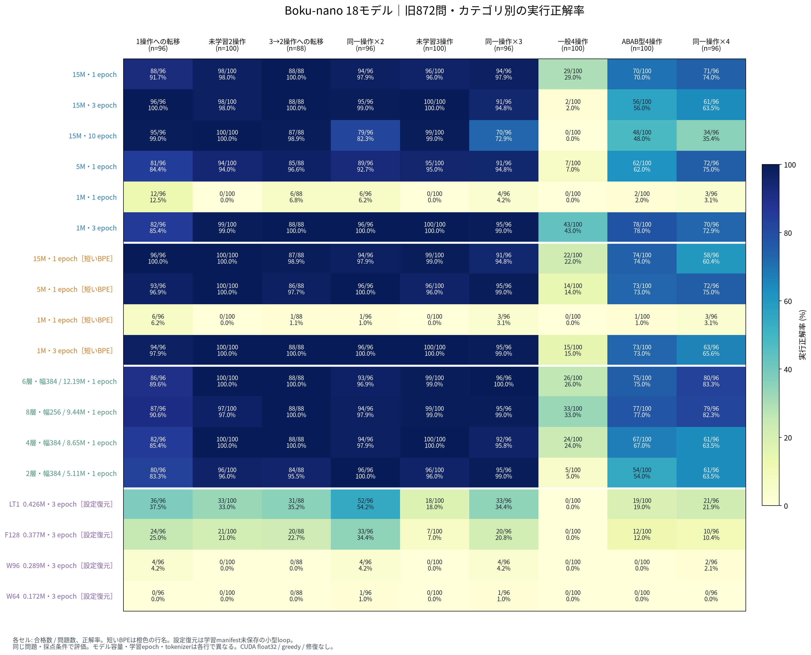

# 発表資料の固定872問：Boku-nano 18モデルのCUDA評価とONNX比較

実行日: 2026-10-25（JST）。実装の起点は`origin/main`の`14f1402`。**利用できる18種類の固有重みを、NVIDIA RTX 5090のPyTorch float32・バッチ上限32で全件評価した。通常3モデルは旧ONNX出力と、生成token列・終了理由・コード・合否が全872問で一致した。**

指定されたmiddle4の2モデルは、この環境にもGit配布物にも重みがなく、今回未評価である。以前の再構成版872問の値を代入していない。保存場所が分かれば、同じ条件で追加評価できる。学習済み重みを新たに訓練して置き換えることはしていない。

## 1. 結果と図

今回の最高得点は**標準BPEの1M・3 epoch、751/872（86.12%）**。次点は構造比較の幅256・8層・4 heads、749/872（85.89%）である。2問差だけから一般的な優劣や統計的有意差は主張しない。

- 全18モデル: [カテゴリ別図・SVG](../figures/composition872_cuda_20261025/category_heatmap.svg) / [PDF](../figures/composition872_cuda_20261025/category_heatmap.pdf)、[総合正解率・PNG](../figures/composition872_cuda_20261025/overall_pass_rate.png)
- 元ベンチマークと同じ9カテゴリでの棒グラフ: [通常・標準BPE](../figures/composition872_cuda_20261025/categories_standard.png) / [通常・短いBPE](../figures/composition872_cuda_20261025/categories_short.png) / [構造比較](../figures/composition872_cuda_20261025/categories_ablation.png) / [小型loop](../figures/composition872_cuda_20261025/categories_looped.png)
- 全カテゴリの数値: [Markdown表](../figures/composition872_cuda_20261025/summary.md) / [集計JSON・モデルhash・問題別合否](../figures/composition872_cuda_20261025/values.json)

| 系列・モデル | parameters | epoch | 合格 / 872 | 正解率 | 一般4操作 / 100 | ABAB / 100 |
|---|---:|---:|---:|---:|---:|---:|
| 通常・標準BPE 15M | 15,735,168 | 1 | 728 | 83.49% | 29 | 70 |
| 通常・標準BPE 15M | 15,735,168 | 3 | 687 | 78.78% | 2 | 56 |
| 通常・標準BPE 15M | 15,735,168 | 10 | 612 | 70.18% | 0 | 48 |
| 通常・標準BPE 5M | 5,065,472 | 1 | 676 | 77.52% | 7 | 62 |
| 通常・標準BPE 1M | 1,016,704 | 1 | 33 | 3.78% | 0 | 2 |
| **通常・標準BPE 1M** | **1,016,704** | **3** | **751** | **86.12%** | **43** | **78** |
| 通常・短いBPE 15M | 15,735,168 | 1 | 721 | 82.68% | 22 | 74 |
| 通常・短いBPE 5M | 5,065,472 | 1 | 725 | 83.14% | 14 | 73 |
| 通常・短いBPE 1M | 1,016,704 | 1 | 15 | 1.72% | 0 | 1 |
| 通常・短いBPE 1M | 1,016,704 | 3 | 724 | 83.03% | 15 | 73 |
| 構造比較・8層、幅256、4 heads | 9,441,536 | 1 | 749 | 85.89% | 33 | 77 |
| 構造比較・2層、幅384 | 5,113,728 | 1 | 667 | 76.49% | 5 | 54 |
| 構造比較・4層、幅384 | 8,654,208 | 1 | 708 | 81.19% | 24 | 67 |
| 構造比較・6層、幅384 | 12,194,688 | 1 | 743 | 85.21% | 26 | 75 |
| 小型loop LT1 ※ | 426,368 | 3 | 243 | 27.87% | 0 | 19 |
| 小型loop F128 ※ | 377,216 | 3 | 147 | 16.86% | 0 | 12 |
| 小型loop W96 ※ | 289,056 | 3 | 14 | 1.61% | 0 | 0 |
| 小型loop W64 ※ | 172,224 | 3 | 2 | 0.23% | 0 | 0 |

※ 小型loopは1物理層×3周・embedding/head共有。重みのhashは既存報告と一致するが、元学習manifest・model configが未収録のため、報告と当時のrunnerから評価用設定を復元した。元学習manifestを作ったり、実際に取得できたものとして扱ったりはしていない。各runの`recovery_manifest.json`に根拠・限界を保存した。

### 読み取れること

1. **単純に大きくする、長く学ぶだけでは、この構成汎化テストの成績は上がらない。** 標準15Mは1→3→10 epochで総合728→687→612件、一般4操作29→2→0件となった。一方、3 epoch版は未学習3操作100/100など高い指標も持つ。長い操作列への汎化と、短い既知形式への適合を別々に見る必要がある。「過学習が原因」との確定には、学習曲線・データ分布・誤答の追加分析が必要。
2. **1Mでは3 epochの効果が大きい。** 標準BPEは33→751件、短いBPEは15→724件。異なる訓練日程の保存済みモデル比較なので、更新数だけを変えた因果実験とは言わない。1 epochの学習率減衰を遅くする案は今回扱っていない。
3. **短いBPEの効果はモデル依存。** 5M・1 epochは標準676→短いBPE725件だが、15M・1 epochは728→721件、1M・3 epochは751→724件。tokenizer変更で訓練・推論token量も変わるため、共有構造だけの効果とは混ぜない。
4. **小型loopは通常1Mの代替水準に達していない。** LT1でも一般4操作0/100、ABAB19/100。ただし通常1層の同容量対照は今回の保存重みに存在せず、この結果だけで「loopしない方が良い」とは確定できない。

短いBPEの1M・1 epochでは71件が`timeout_or_process_exit`で、全件の子プロセス終了コードは`-9`だった。保存コードには、`for x in output:`の最中に`output += [x]`で同じリストへ追加し続ける例がある。これらはコード実行側の失敗であり、GPU推論のtimeoutではない。CPU並列数や時間制限を途中で変えて点数を調整していない。失敗分類の全件数は集計JSONに含めた。

## 2. 固定した評価条件

| 項目 | 実際に使った条件 |
|---|---|
| 質問 | 発表資料の旧872問、9カテゴリ。新規作成・再構成なし |
| 質問SHA-256 | `aa119fa2a9e8507136ad14a54b9d3d2e9043fd81af9e48251ef7f5c49c20f97f` |
| 検査入力 | 1問につき固定179入力をすべて検証 |
| 入力SHA-256 | `0090a38d255848a813876ce3b64a8029603aa14e4181b453a89801b41ac67fc2` |
| 採点 | 旧`score_composition_suite.score_one`を直接使用。関連6ファイルのhashを固定 |
| 生成 | greedy、履歴なし、修復なし、EOSまたはprompt＋生成256 token |
| 数値設定 | float32、autocastなし、TF32無効、SDPA math、KV cacheなし |
| バッチ | 同じprompt長ごとにまとめる、paddingなし、上限32 |
| コード実行 | CPU、4並列、各子プロセスCPU 2秒 / wall 5秒 |
| GPU・環境 | RTX 5090、Python 3.12.12、PyTorch 2.13.0+cu130、CUDA runtime 13.0 |
| ONNX補助診断 | ONNX Runtime 1.30.0、CPUExecutionProvider、旧版と同じ既定の最適化有効 |

通常・構造比較・小型loopの標準BPE hashは`6840a392e8fcae1083be06842774fa912a1797217c7033944ba2d87f1c227293`。短いBPE4モデルは各学習manifestが指定する`f09f3d7eccbca2ab1224c662064b71e572d64147147b8b559ebdb428eb035dbf`を使った。問題文・採点は同一だが、入力token列まで同一という意味ではない。

全18モデル×872問＝**15,696件**を新規生成・採点し、全runが`status=completed`。さらに通常3モデルでbatch1の2,616件を生成・採点した。全モデルの本評価は872/872がEOS終了で、context上限による打ち切りは0件だった。

## 3. ONNXとCUDAで結果は変わったか

### 3.1 全872問の生成・合否は一致した

| 発表資料と同じcheckpoint | 旧ONNX CPU | CUDA batch≤32 | CUDA batch1 | 旧ONNXとの生成差 / 合否差 | CUDA batch1との生成差 / 合否差 |
|---|---:|---:|---:|---:|---:|
| 15M・標準BPE・1 epoch | 728 / 872 | 728 / 872 | 728 / 872 | 0 / 0 | 0 / 0 |
| 5M・標準BPE・1 epoch | 676 / 872 | 676 / 872 | 676 / 872 | 0 / 0 | 0 / 0 |
| 1M・標準BPE・3 epoch | 751 / 872 | 751 / 872 | 751 / 872 | 0 / 0 | 0 / 0 |

照合は総得点だけでなく、同じ問題IDの`prompt_ids`、`output_ids`、`termination`、`raw_output`、問題別合否を対象にした。元safetensors、ONNX、tokenizer、質問、検査入力、採点器のhashを確認している。

**直接照合できたのは、同じ872問の旧ONNX生結果があるこの3モデルである。** 他のモデルにONNXファイルや別のdev50評価が存在しても、それを今回の872問の旧結果として扱わない。他15モデルはCUDAで新規評価したが、全件ONNX一致を検証したとは主張しない。

### 3.2 内部の数値は完全一致ではないが、首位は変わらなかった

各カテゴリのファイル順先頭1問について、生成開始・中間・EOS直前の3箇所を選んだ。3モデル×9カテゴリ×3箇所＝81 prefixへ**同じ入力token列**を与え、PyTorch CPU math、ONNX CPU、PyTorch CUDA mathでlogitsを比較した。

| 比較 | 81 prefix全体の最大絶対logit差 | 次tokenの首位一致 |
|---|---:|---:|
| PyTorch CPU vs ONNX CPU | 0.0000076294 | 81 / 81 |
| PyTorch CPU vs CUDA | 0.0000057220 | 81 / 81 |
| ONNX CPU vs CUDA | 0.0000076294 | 81 / 81 |

81箇所のlogitsはbit単位では一致しなかった。一方、首位と2位の差の最小値は約0.009979で、観測した数値差より十分大きい。**この代表箇所では数値差がargmaxを入れ替える大きさに達しておらず、greedyの次tokenが維持された**と説明できる。全生成位置のmarginを測定したわけではない。全872問の出力一致は別途、前節の保存列比較で確認している。[81 prefixの詳細JSON](backend_logits.json)

### 3.3 差が出た場合に疑う要因と、今回確認した範囲

| 要因 | 差が生じる仕組み | 今回の確認 |
|---|---|---|
| 浮動小数点の演算順序・実装 | GPU/CPU、GEMMのbatch形状、softmax等で丸め順序が異なり得る | 小さなlogit差は観測。batch32/1・ONNX/CUDAの生成と得点には影響なし |
| 低精度演算・attention backend | BF16/FP16、TF32、Flash等を使えば演算経路が変わる | 今回はFP32・TF32無効・math固定。他設定での一致は未検証 |
| ONNX変換と最適化 | 演算の分解、定数畳み込み、node融合等が計算経路を変える | 元ONNX hashを照合。代表診断で差は小さい。特定融合が差の原因とまでは分離していない |
| 生成制御・tokenizer | prompt、EOS扱い、最大長、padding、tokenizerの違いが別の生成条件を作る | 旧3モデルでは実promptまで一致。短いBPEは別条件として明記 |
| 問題集合・採点器 | 質問内容、実行入力、契約検査、timeoutが違えば同じコードでも点が変わる | 今回は旧hashへ固定。撤回された再構成版は使用していない |

PyTorchの公式文書も、batch化した演算と1件ずつの演算、CPUとGPUの間でbit単位の同一性を保証しないと説明している。[PyTorch 2.13 Numerical accuracy](https://github.com/pytorch/pytorch/blob/v2.13.0/docs/source/notes/numerical_accuracy.md) ONNX Runtimeでは定数畳み込みや融合などの最適化がある。[ONNX Runtime Graph optimizations](https://onnxruntime.ai/docs/performance/model-optimizations/graph-optimizations.html) これらは差が起こり得る一般的な理由であり、今回観測していない点差の原因を推定したものではない。

将来生成が分岐した場合は、**最初に異なるtokenの直前までprefixを揃え**、CUDA batch32→CUDA batch1→PyTorch CPU→ONNX CPUの順に比較する。保存列で省略されているEOSも考慮し、首位/2位のmarginと旧token・新tokenのlogitを記録する。分岐後の異なるprefix同士のlogitsを比較して、丸め誤差が原因と結論しない。

旧15Mの一般4操作29/100と、撤回された再構成版63/100の差は、今回のONNX/CUDA差ではない。今回CUDAでも29/100を再現した。質問・難度・生成上限・採点器が変わっていた経緯は[比較監査](../benchmark_872_comparison_audit_20261024/README.md)を参照。

## 4. バッチ化の実測時間

| モデル | CUDA batch≤32の推論秒 | CUDA batch1の推論秒 | 今回の比率 |
|---|---:|---:|---:|
| 15M・標準BPE・1 epoch | 2.420 | 26.772 | 11.06倍 |
| 5M・標準BPE・1 epoch | 1.143 | 15.446 | 13.51倍 |
| 1M・標準BPE・3 epoch | 0.739 | 9.811 | 13.28倍 |

同じGPU・同じ全872問の**モデル推論部分**の単回計測。重み読込、CPU採点、図生成は含まない。順序・初回実行の影響があり、反復計測の中央値や厳密な速度保証ではない。旧ONNXの別端末での時間と直接割り算した値でもない。

短いBPEは同じ15M・1 epochでも11.046秒だった。平均prompt長は標準16.19 tokenに対し34.98、平均生成長は16.76に対し60.03、同長バッチ数は42に対し47である。tokenizerを変えたモデル間の時間差を、モデル本体の演算速度だけの差として解釈しない。

## 5. 評価対象の範囲と欠損

| 対象 | 扱い |
|---|---|
| 通常10モデル | 全件評価。ONNXファイルを持つものもPyTorch CUDAで新規生成 |
| 構造比較4モデル | 全件評価。`existing`の重みは通常15M・1 epochと同一なので重複計上しない |
| 小型loop4モデル | 重みhashと報告を照合して設定復元、strict load、parameter数・共有embedding・有限値を検証後に全件評価 |
| middle4・3 epoch / middle4残差0.25・3 epoch | **未評価。重み・model config・元学習manifestが未収録** |
| その他の1M full-loop / revision系列 | 報告・集計はあるが該当重みが未収録。今回の図へ旧値を転記しない |

middle4に必要な元の配置は`data/models/middle4_1m_3epoch_20261018/{u3_middle4,u3_middle4_scaled025}_seed20260925/model/`。別の保存先でも、[実行手順](../../procedures/composition_872_cuda_evaluation.md)の`--model`で指定できる。

## 6. 保存・再現・検証

生結果は以下の4run。全件完了・872件のID/AST/カテゴリ・合計・raw/scored/summaryのhashを検証してから図を作成した。

- `data/evaluations/composition872_cuda_20261025_baselines/`：通常3、旧ONNX比較、batch1比較。
- `data/evaluations/composition872_cuda_20261025_standard_extra/`：追加通常3＋構造比較4。
- `data/evaluations/composition872_cuda_20261025_short_bpe/`：短いBPE4。
- `data/evaluations/composition872_cuda_20261025_small_loops/`：復元設定を使ったloop4。

**生結果のZIPも保存した。** [全167ファイルのアーカイブ](../../../data/archives/composition872_cuda_20261025_results.zip)（2,051,752 bytes）には上記run、復元記録、batch1比較、81 prefix診断を含む。モデル重みは含めない。ZIP内の全ファイルを元ファイルとbytesで照合した。[アーカイブmanifestとファイルhash](archive_manifest.json)

ZIP SHA-256: `51edfa5974c2cc5112f9af9ad7db3ab479e551005e223a6ef36766668f6ab667`

実行コマンドは[今回の再現手順](reproduction.md)に保存した。短いBPEの明示指定と復元設定の読み込みだけを評価器に追加し、固定問題・採点器・モデルforward・greedy生成処理は変更していない。通常3実行後に復元manifest対応を追加したため、使用した評価器の2版も同じbytesで保存した：[通常3実行版](evidence/evaluator_baselines.py.txt)、[追加15モデル実行版](evidence/evaluator_all_models.py.txt)。各runのhashで使用版を識別できる。

今回追加したtokenizer指定・復元記録の検証を含む**25単体テストが通過**。全18モデルのCUDA本評価、3モデルの全件batch1比較、81 prefixのbackend診断も完了した。訓練は実行していない。再構成版の得点は今回の集計に一切使用していない。
