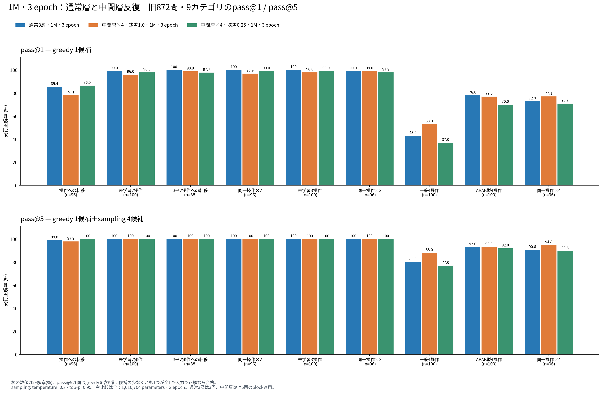
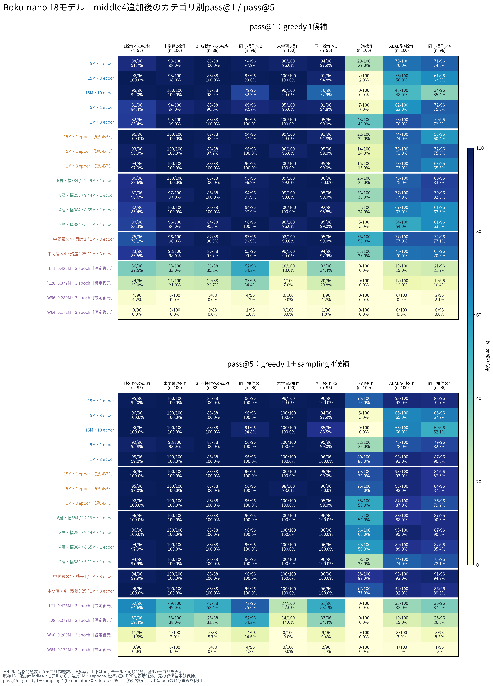

# 1M・3 epochのLooped Transformer 2モデルを追加したカテゴリ別評価

2026-10-25（JST）。`origin/main`を`2cefb4a`へ更新し、追加された2モデルをNVIDIA RTX 5090のPyTorch CUDAバッチ推論で評価した。**両モデルの全872問についてpass@1とpass@5を取得し、通常1M・3 epochとの9カテゴリ比較へ追加した。**

今回新規に実行したのはmiddle4の2モデルだけ。既存の検証済み結果を統合し、ユーザー指定により1M・1 epochの標準BPE/短いBPEは再評価せず、新しい比較図からも外した。保存済み20モデルのうち、新しい図には18モデルを表示する。

## 通常1M・3 epochとのカテゴリ別比較

全3モデルは1,016,704 parameters、標準BPE、3 epoch。通常版は各層1回、loop版は中間層を4回使う。図は**上段pass@1、下段pass@5**、縦軸はカテゴリ別の正解率。棒上にも正解率を表示した。

[SVG](../figures/composition872_pass5_cuda_20261025_with_middle4/categories_1m_3epoch.svg) / [PDF](../figures/composition872_pass5_cuda_20261025_with_middle4/categories_1m_3epoch.pdf)

| カテゴリ（問題数） | 通常 @1 | 通常 @5 | loop 1.0 @1 | loop 1.0 @5 | loop 0.25 @1 | loop 0.25 @5 |
|---|---:|---:|---:|---:|---:|---:|
| 1操作への転移（96） | 85.42% | 98.96% | 78.12% | 97.92% | 86.46% | 100.00% |
| 未学習2操作（100） | 99.00% | 100.00% | 96.00% | 100.00% | 98.00% | 100.00% |
| 3→2操作への転移（88） | 100.00% | 100.00% | 98.86% | 100.00% | 97.73% | 100.00% |
| 同一操作×2（96） | 100.00% | 100.00% | 96.88% | 100.00% | 98.96% | 100.00% |
| 未学習3操作（100） | 100.00% | 100.00% | 98.00% | 100.00% | 99.00% | 100.00% |
| 同一操作×3（96） | 98.96% | 100.00% | 98.96% | 100.00% | 97.92% | 100.00% |
| 一般4操作（100） | 43.00% | 80.00% | 53.00% | 88.00% | 37.00% | 77.00% |
| ABAB型4操作（100） | 78.00% | 93.00% | 77.00% | 93.00% | 70.00% | 92.00% |
| 同一操作×4（96） | 72.92% | 90.62% | 77.08% | 94.79% | 70.83% | 89.58% |

`@1`はpass@1、`@5`はpass@5。loop 1.0/0.25は反復部分の残差倍率を表す。

## 今回分かったこと

- **残差1.0のloop版は、一般4操作で通常版を上回った。** pass@1は43%→53%、pass@5は80%→88%。同一操作×4も、通常版72.92% / 90.62%に対し、loop版77.08% / 94.79%だった。
- **全カテゴリで上回ったわけではない。** 1操作への転移は、通常版85.42% / 98.96%に対しloop版78.12% / 97.92%。ABABのpass@5はどちらも93%。総合は通常751/872→835/872、loop残差1.0は748/872→846/872で、greedyでは3問下回り、5候補では11問上回った。
- **残差0.25は、今回の構成汎化ベンチマークでは一律の改善にならなかった。** 1操作への転移はpass@5で96/96に達した一方、一般4操作のpass@5は77%、ABABは92%、同一操作×4は89.58%だった。

これは固定問題集合と単一sampling seedの実測比較であり、統計的有意差や他の問題集合での優位を示すものではない。loop版は通常版と重み数が同じでも、1 tokenあたりのblock適用回数が3回から6回へ増える。

## 全モデルへの追加

- [全カテゴリの数値表](../figures/composition872_pass5_cuda_20261025_with_middle4/summary.md) / [集計JSON・問題別合否・出典hash](../figures/composition872_pass5_cuda_20261025_with_middle4/values.json)
- [通常・標準BPE](../figures/composition872_pass5_cuda_20261025_with_middle4/categories_standard.png) / [通常・短いBPE](../figures/composition872_pass5_cuda_20261025_with_middle4/categories_short.png) / [構造比較](../figures/composition872_pass5_cuda_20261025_with_middle4/categories_ablation.png) / [小型loop](../figures/composition872_pass5_cuda_20261025_with_middle4/categories_looped.png)
- [全18モデル図・SVG](../figures/composition872_pass5_cuda_20261025_with_middle4/category_heatmaps_pass1_pass5.svg) / [PDF](../figures/composition872_pass5_cuda_20261025_with_middle4/category_heatmaps_pass1_pass5.pdf)

新しい18モデルは通常標準5、短いBPE3、構造比較4、小型loop4、今回の1M middle4系2。通常1M・3 epochと今回のloop版を主図で直接比較し、0.172–0.426Mの小型loopとは区別した。

## 評価条件と来歴

| 項目 | 条件 |
|---|---|
| 問題 | 発表資料の固定872問・9カテゴリ |
| 採点 | 旧採点器、固定179入力を全通過した候補だけ合格 |
| pass@1 | greedy 1候補 |
| pass@5 | 同じgreedy 1候補＋sampling 4候補のうち1つ以上が合格 |
| sampling | temperature 0.8、top-p 0.95、seed 2026092607 |
| 数値設定 | PyTorch FP32、TF32無効、SDPA math、autocastなし、KV cacheなし |
| 長さ | EOSまたはpromptを含む256 token |
| バッチ | 同長prompt、greedy最大32問、sampling最大8問×4候補 |
| コード実行 | CPU 4並列、候補ごとにCPU 2秒 / wall 5秒 |
| 環境 | RTX 5090、Python 3.12.12、PyTorch 2.13.0+cu130、CUDA runtime 13.0 |

元の学習完了manifest、モデル設定、重みhashを照合した。2モデルともseed 20260925、3 epoch・1,131更新完了。幅128・FFN256・4 heads・3物理層・embedding非共有で、適用順は`B0 → B1 → B1 → B1 → B1 → B2`。先頭/末尾の残差倍率は1.0のまま、反復部分のみ1.0と0.25を比較する。**この2モデルは「設定復元」ではない。** 新たな訓練も行っていない。

pass@5は前報と同じgreedyを含む5候補の実測成功率。5候補すべてを同一分布から抽選した推定値とは区別する。今回の2モデルについては同じ872問のONNX評価を実行しておらず、ONNXとの一致は未確認。前報の通常3モデルに関する一致結果を、この2モデルへ拡張して解釈しない。

## 保存・再現

今回、2モデル×872問×5候補＝**8,720候補**を新規生成・採点した（greedy 1,744候補、追加sampling 6,976候補）。全件の候補ID・カテゴリ・AST・合否・生成コード・token列を保存し、問題別合否から集計を再計算して検証した。

- greedy run：`data/evaluations/composition872_cuda_20261025_middle4/`
- pass@5 run：`data/evaluations/composition872_pass5_cuda_20261025_middle4/`
- [再現手順](reproduction.md)
- 既存結果：[前回の18モデル評価](../composition872_pass5_cuda_20261025/README.md)
- [追加2モデルの生結果ZIP](../../../data/archives/composition872_middle4_cuda_20261025_results.zip)：118ファイル、1,436,401 bytes。元ファイルとbytes単位で照合した。[アーカイブmanifest](archive_manifest.json)
- [検証記録](verification.json)：候補数・終了理由・失敗分類を保存。評価・5候補集計の25テストと、新規の統合表示6テスト、計31テストが通過した。

ZIP SHA-256：`7780528fb0f5ffe700cca2c67e777c3e9dbccb560414aed03b37a4f4ade56fcc`

既存結果の復元には[前回の生結果ZIP](../../../data/archives/composition872_pass5_cuda_20261025_results.zip)を併用する。今回追加された重み・元学習manifest・構造設定は`2cefb4a`に収録されている。
