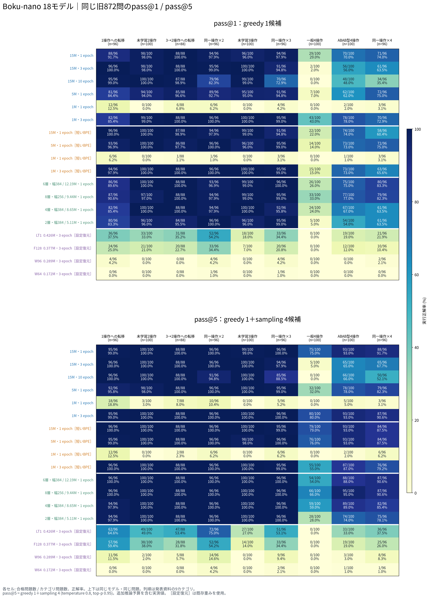
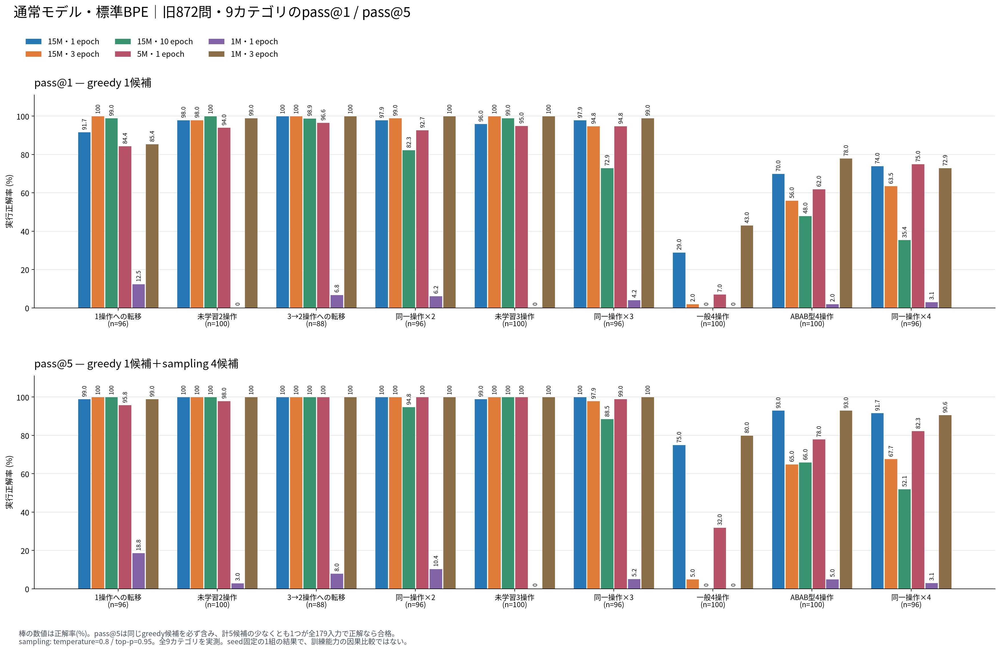
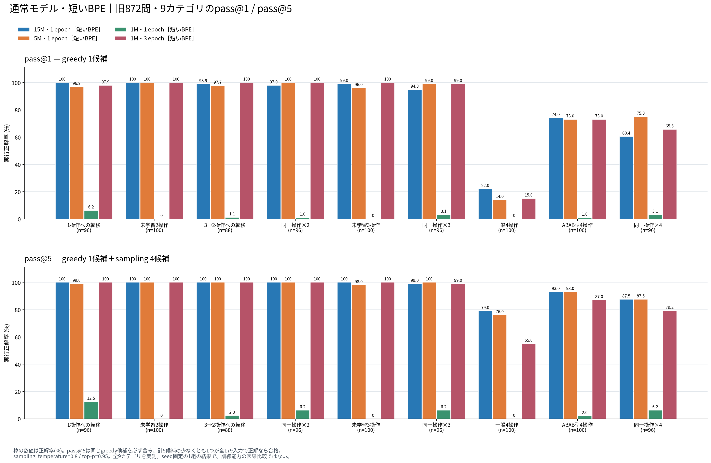
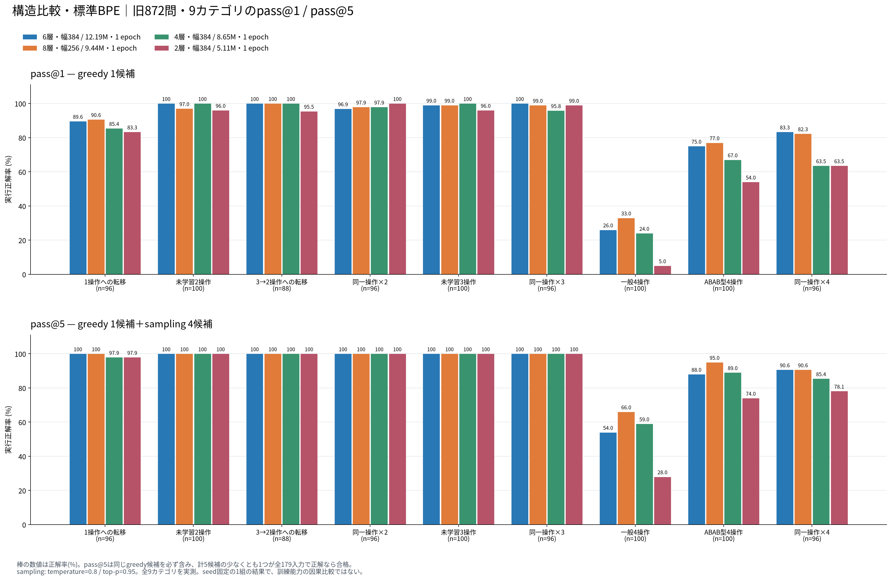
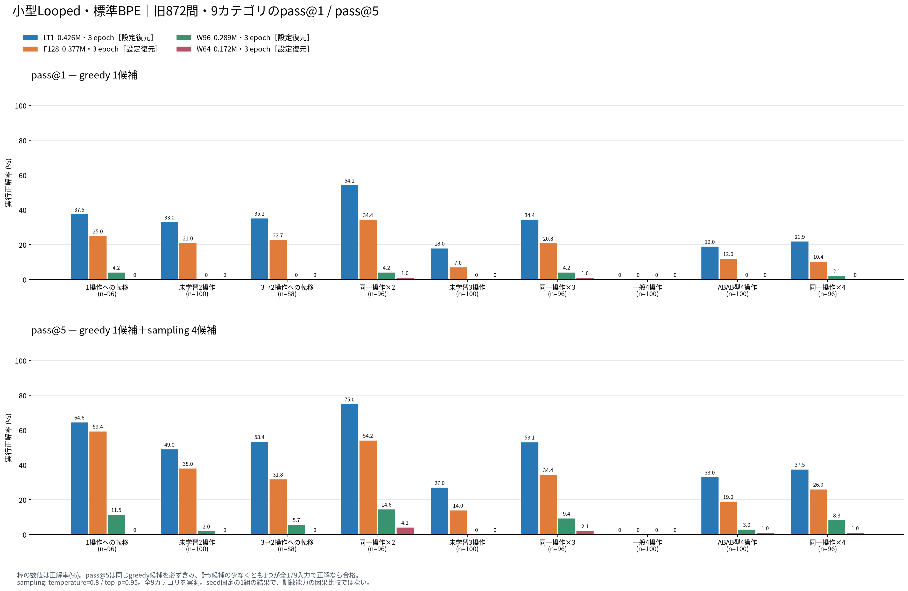

# 固定872問：カテゴリ別pass@1とpass@5

> **後続の追加評価**：`2cefb4a`でmiddle4の元重み・設定・学習manifestを取得し、[1M・3 epochの2モデルを含む比較](../composition872_middle4_cuda_20261025/README.md)を作成しました。新しい図では1M・1 epochを除外しています。以下は追加前の評価記録です。

対象はBoku-nanoの保存済み18モデル。発表資料と同じ9カテゴリ・全872問を使い、各問の179検査入力をすべて通過した場合に正解とする。**カテゴリ別の正解率をpass@1とpass@5の2つで示す。**

2026-10-25（JST）、NVIDIA RTX 5090で全件完了。追加62,784候補を生成・採点した。Python 3.12.12、PyTorch 2.13.0+cu130、CUDA runtime 13.0を使用。

## 全18モデルのカテゴリ別結果

上段がpass@1、下段がpass@5。モデルの行順・カテゴリの列順・色の目盛りを揃えた。セルには合格問題数/問題数と正解率を表示する。

[拡大用SVG](../figures/composition872_pass5_cuda_20261025/category_heatmaps_pass1_pass5.svg) / [PDF](../figures/composition872_pass5_cuda_20261025/category_heatmaps_pass1_pass5.pdf) / [全カテゴリの数値表](../figures/composition872_pass5_cuda_20261025/summary.md) / [集計JSON・問題別合否](../figures/composition872_pass5_cuda_20261025/values.json)

## ベンチマーク形式のカテゴリ別棒グラフ

各図の上段がpass@1、下段がpass@5。横軸は同じ9カテゴリ、縦軸は正解率0–100%。モデルの色も上下で共通にした。

### 通常モデル・標準BPE

[SVG](../figures/composition872_pass5_cuda_20261025/categories_standard.svg) / [PDF](../figures/composition872_pass5_cuda_20261025/categories_standard.pdf)

### 通常モデル・短いBPE

[SVG](../figures/composition872_pass5_cuda_20261025/categories_short.svg) / [PDF](../figures/composition872_pass5_cuda_20261025/categories_short.pdf)

### 構造比較

[SVG](../figures/composition872_pass5_cuda_20261025/categories_ablation.svg) / [PDF](../figures/composition872_pass5_cuda_20261025/categories_ablation.pdf)

### 小型loop

[SVG](../figures/composition872_pass5_cuda_20261025/categories_looped.svg) / [PDF](../figures/composition872_pass5_cuda_20261025/categories_looped.pdf)

## カテゴリ別に読み取れること

- **候補を増やした効果はカテゴリで異なる。** 標準BPEの15M・1 epochでは、一般4操作は29%→75%、ABAB型4操作は70%→93%。未学習2操作は98%→100%、3→2操作への転移は100%→100%だった。矢印はpass@1→pass@5を表す。
- **標準BPEの1M・3 epochも、一般4操作に改善余地があった。** 同カテゴリは43%→80%、ABAB型4操作は78%→93%。同じ重みから追加候補を生成した効果として読む。
- **15Mの長期学習版は一般4操作で低い値が続いた。** 1・3・10 epochの同カテゴリpass@5は75%・5%・0%。今回のsampling追加だけでは長期学習版の弱さは解消しなかった。学習日程やデータ分布の因果効果まで、この評価だけで確定することはできない。
- **小型loop LT1では、反復や転移の一部で改善が見られる。** 同一操作×2は54.17%→75.00%、1操作への転移は37.50%→64.58%、ABAB型4操作は19%→33%。一般4操作は0%→0%で、今回の5候補では正解に到達しなかった。

pass@5は、検査によって正解を判定できる条件での「候補集合に正解が含まれる割合」を表す。実利用でどの候補を採用するかという選択方法の性能は、この評価には含めていない。

## 指標と評価条件

- **pass@1**：greedyで生成した1候補が正解だった問題の割合。
- **pass@5**：greedy 1候補とsampling 4候補の、計5候補のうち1候補以上が正解だった問題の割合。
- sampling：temperature=0.8、top-p=0.95、seed=2026092607。候補が重複しても引き直さない。テスト結果による修復・追加指示は使わない。
- NVIDIA CUDAのPyTorch FP32、TF32無効、SDPA math。promptを含む最大256 token。samplingは同長promptを8問×4候補、最大32候補ずつ処理する。
- 元の872問・179入力・旧採点器を固定。CPU採点は4並列、各子プロセスCPU 2秒 / wall 5秒。

これは[既存の評価方針](../../policies/boku_nano_model_evaluation_policy.md)の「greedy 1＋sampling 4」を全872問へ適用したもの。5候補すべてを同じsampling分布から抽選する一般的な[pass@k推定](https://arxiv.org/pdf/2107.03374)とは条件が異なる。単一seedで実測した成功率であり、繰り返し実験による期待値や統計的有意差を表さない。

pass@1は[同日完了したCUDA評価](../composition872_cuda_20261025/README.md)の候補・採点結果をhash照合して再利用する。pass@5の追加4候補は新しくCUDAで生成する。過去の430問・BF16・別採点器のpass@5を転記しない。

## カテゴリ

| 表示順 | カテゴリ | 問題数 |
|---:|---|---:|
| 1 | 1操作への転移 | 96 |
| 2 | 未学習2操作 | 100 |
| 3 | 3→2操作への転移 | 88 |
| 4 | 同一操作×2 | 96 |
| 5 | 未学習3操作 | 100 |
| 6 | 同一操作×3 | 96 |
| 7 | 一般4操作 | 100 |
| 8 | ABAB型4操作 | 100 |
| 9 | 同一操作×4 | 96 |

分母は各カテゴリの問題数。全体値を併記する場合は合格問題数/872とし、件数の違うカテゴリの率を単純平均しない。

## 比較範囲

通常・標準BPE 6モデル、通常・短いBPE 4モデル、構造比較4モデル、小型loop 4モデルを対象とする。短いBPEのモデルは学習時の専用tokenizerを使う。小型loop 4モデルは前報と同じ評価用復元設定を使い、元学習manifestが取得できているとは扱わない。

図中の**「設定復元」**は、保存されていた学習済み重みを読み込むために、欠けていた構造設定ファイルを当時の報告・設定・実行スクリプトから作り直したという意味。層数、幅、head数、loop回数、embedding共有などを補った。重み本体は変更せず、報告に記載されたhashとの一致、読み込み、parameter数を確認した。再訓練や重みの推定は行っていない。元の学習設定・完了記録が欠けている点を示すため、この注記を付けている。

**1Mのloopモデルも訓練済みという記録がある。** [2026-10-18の報告](../boku_nano_middle4_1m_3epoch_20261018.md)の`u3_middle4`と`u3_middle4_scaled025`は、ともに1,016,704 parameters・3 epochで、中間層を4回使う2条件。今回の小型loop 4モデル（0.172–0.426M）とは別系列である。下記の重み欠損により今回の図には含めていない。

2026-10-25のユーザー指定により、**今後は1M・1 epochの追加実験・再評価を行わない**。本報告の既存実測値は履歴として保持する。

middle4の2モデルは重み未収録のため対象外。今回のpass@5はPyTorch CUDAでの評価であり、旧ONNXのgreedyとの一致確認から、samplingによるpass@5もONNXで同じになるとは主張しない。

実行条件と再開方法は[再現手順](reproduction.md)、greedyのONNX比較とモデルの来歴は[前報](../composition872_cuda_20261025/README.md)を参照。

## 保存・検証

全18モデル×872問×5候補＝**78,480候補**を保存した。内訳は前回のCUDA greedy 15,696候補と、新規sampling 62,784候補。各モデルの全872問・候補1〜5・カテゴリ・AST・元greedy合否との一致を検証し、18モデルすべてで`status=completed`を確認した。

候補別の合否から問題別pass@1/pass@5とカテゴリ別正解率を再計算し、記録済み集計と照合した。全モデル・全カテゴリでpass@5 ≥ pass@1。新規8件と元評価器・設定復元の25件、計**33単体テストが通過**した。[検証記録](verification.json)にはモデル別の終了理由・採点失敗分類も保存した。

- 実測run：`data/evaluations/composition872_pass5_cuda_20261025/`
- [候補別生結果・設定・実行ソースのZIP](../../../data/archives/composition872_pass5_cuda_20261025_results.zip)：869ファイル、11,338,758 bytes。元greedy run、復元設定、tokenizerを含む。モデル重みは含まない。
- [アーカイブmanifest](archive_manifest.json)：ZIP内の全ファイルを元ファイルとbytes単位で照合済み。
- ZIP SHA-256：`dea39c303c2072141c513bdee9b04fecbb0b3e113364b20c0a326773885cc742`
