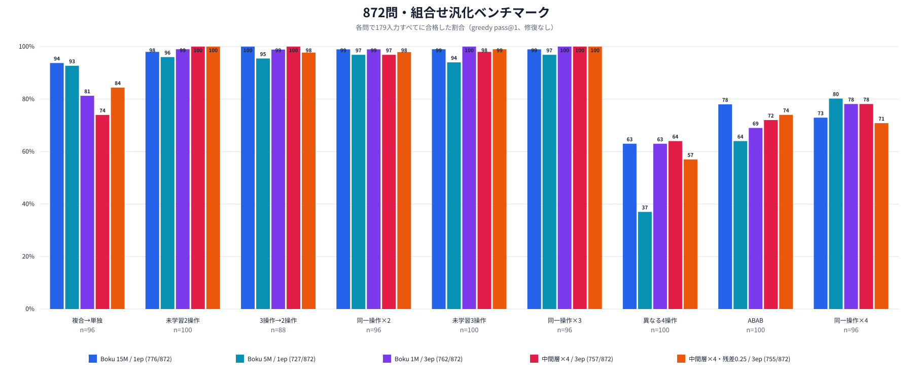

# 872問・組合せ汎化ベンチマーク（再構成版）

実行日: 2026-10-18

## 結論

9カテゴリ・872問を、全モデル共通の179入力、greedy pass@1、生成後の修復なしで評価した。今回の中間層4回・3 epochは、残差倍率1.0が757/872（86.81%）、0.25が755/872（86.58%）で、全体では1.0が2問上回った。

4操作だけを見ると、倍率1.0は異なる4操作64/100、ABAB 72/100、同一操作4回75/96。倍率0.25は57/100、74/100、68/96だった。0.25はABABで2問改善したが、異なる4操作で7問、同一操作4回で7問低下した。

| モデル | 合計 | 異なる4操作 | ABAB | 同一操作×4 |
| --- | ---: | ---: | ---: | ---: |
| Boku 15M / 1ep | **776/872（88.99%）** | 63/100 | **78/100** | 70/96 |
| Boku 5M / 1ep | 727/872（83.37%） | 37/100 | 64/100 | **77/96** |
| Boku 1M / 3ep | 762/872（87.39%） | 63/100 | 69/100 | 75/96 |
| 中間層×4 / 3ep | 757/872（86.81%） | **64/100** | 72/100 | 75/96 |
| 中間層×4・残差0.25 / 3ep | 755/872（86.58%） | 57/100 | 74/100 | 68/96 |



## 9カテゴリの結果

| カテゴリ | 15M / 1ep | 5M / 1ep | 1M / 3ep | 中間層×4 | 中間層×4・0.25 |
| --- | ---: | ---: | ---: | ---: | ---: |
| 複合→単独 | 90/96 | 89/96 | 78/96 | 71/96 | **81/96** |
| 未学習2操作 | 98/100 | 96/100 | 99/100 | **100/100** | **100/100** |
| 3操作→2操作 | 88/88 | 84/88 | 87/88 | **88/88** | 86/88 |
| 同一操作×2 | 95/96 | 93/96 | 95/96 | 93/96 | 94/96 |
| 未学習3操作 | 99/100 | 94/100 | **100/100** | 98/100 | 99/100 |
| 同一操作×3 | 95/96 | 93/96 | **96/96** | **96/96** | **96/96** |
| 異なる4操作 | 63/100 | 37/100 | 63/100 | **64/100** | 57/100 |
| ABAB | **78/100** | 64/100 | 69/100 | 72/100 | 74/100 |
| 同一操作×4 | 70/96 | **77/96** | 75/96 | 75/96 | 68/96 |

## データと比較上の注意

旧図に記録された2026-10-08版は、質問ファイルのSHA-256だけが残り、質問本体と採点済みJSONLがcheckoutに含まれていなかった。旧集計値へ別問題の新しい値を混ぜず、保存済み評価アーカイブ、承認済み表現辞書、意味ASTから9カテゴリの同じ件数を決定的に再構成し、比較する5モデルをすべて再評価した。

- 質問は872件、全文重複0件、訓練指示との全文一致0件。
- 質問SHA-256: `f8941b0bdfcea0461727eaaa049bc984ec40a500593dd5cb9147bcf0dfa45ace`
- 共通179入力SHA-256: `0090a38d255848a813876ce3b64a8029603aa14e4181b453a89801b41ac67fc2`（旧版と一致）。
- 旧質問SHA-256 `aa119fa2...`とは異なるため、旧図の数値と直接の差分比較はしない。

## 再現

[`benchmark.py`](../../scripts/model/benchmark.py)はデータ構築、評価、作図を一つの入口で実行できる。

```bash
.venv/bin/python scripts/model/benchmark.py all \
  --models boku-15m-1epoch boku-5m-1epoch boku-1m-3epoch \
  middle4-1m-3epoch middle4-scaled025-1m-3epoch \
  --device cpu --dtype float32
```

- [固定質問・protocol](../../data/benchmarks/composition_suite_872_v2_20261018/protocol.json)
- [図の数値](figures/composition_suite_872_v2_20261018/values.json)
- [全カテゴリ集計](figures/composition_suite_872_v2_20261018/summary.md)

生成コードと問題別採点は`data/models/composition_suite_872_v2_20261018/`へローカル保存し、Gitには固定問題、再現コード、集計値、図だけを含める。
