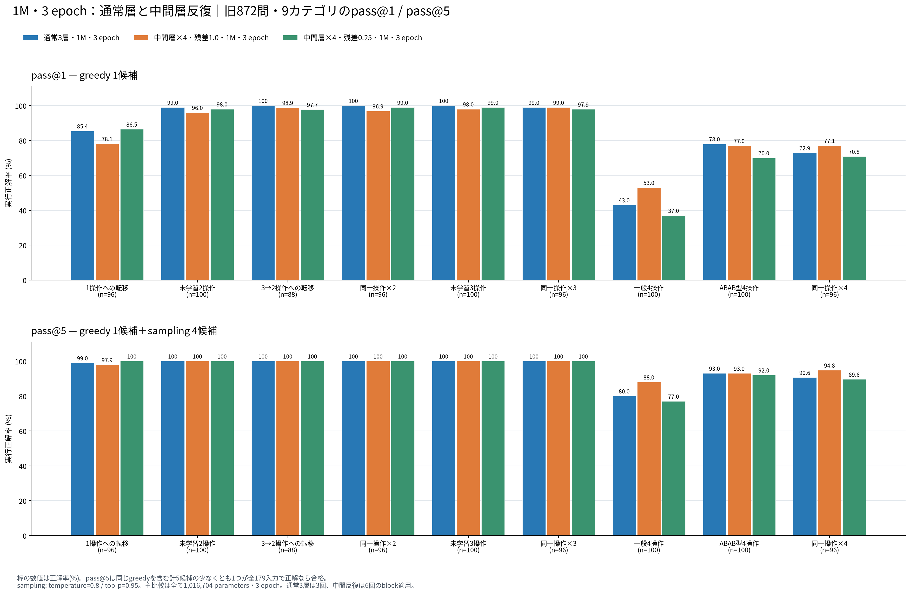

# middle4追加後：旧872問のカテゴリ別pass@1 / pass@5

作成日時: 2026-10-25T20:11:28.168064+09:00。入力20モデル、表示18モデル。

既存greedy/pass@5を再生成せず、別runのmiddle4 2モデルを統合した。通常1M・1epochの標準BPEと短いBPEは新図から除外し、元結果を保持した。

pass@1は既存greedy 1候補。pass@5は同じgreedyとtemperature=0.8、top-p=0.95のsampling 4候補を合わせた実測成功率。計5候補の少なくとも1つが179入力・契約検査を全て通れば合格。同一分布のiid pass@k推定量とは異なり、追加推論予算を含む。

sampling seed: `2026092607`。

## 主比較：通常1M・3epochとmiddle4

| モデル | pass@1 | pass@5 | block適用数 |
|---|---:|---:|---:|
| 1M・3 epoch | 751/872 (86.12%) | 835/872 (95.76%) | 3 |
| 中間層×4・残差1 / 1M・3 epoch | 748/872 (85.78%) | 846/872 (97.02%) | 6 |
| 中間層×4・残差0.25 / 1M・3 epoch | 730/872 (83.72%) | 831/872 (95.30%) | 6 |

全3モデルは1,016,704 parameters・3 epoch。中間反復は圧縮モデルではなく、追加のblock計算を行う。

## 表示対象の全モデル

| モデル | 系列 | parameters | epoch | pass@1 | pass@5 |
|---|---|---:|---:|---:|---:|
| boku-15m-1epoch | 通常モデル・標準BPE | 15,735,168 | 1 | 728/872 (83.49%) | 830/872 (95.18%) |
| boku-15m-3epoch | 通常モデル・標準BPE | 15,735,168 | 3 | 687/872 (78.78%) | 709/872 (81.31%) |
| boku-15m-10epoch | 通常モデル・標準BPE | 15,735,168 | 10 | 612/872 (70.18%) | 676/872 (77.52%) |
| boku-5m-1epoch | 通常モデル・標準BPE | 5,065,472 | 1 | 676/872 (77.52%) | 758/872 (86.93%) |
| boku-1m-3epoch | 通常モデル・標準BPE | 1,016,704 | 3 | 751/872 (86.12%) | 835/872 (95.76%) |
| boku-15m-short-1epoch | 通常モデル・短いBPE | 15,735,168 | 1 | 721/872 (82.68%) | 831/872 (95.30%) |
| boku-5m-short-1epoch | 通常モデル・短いBPE | 5,065,472 | 1 | 725/872 (83.14%) | 826/872 (94.72%) |
| boku-1m-short-3epoch | 通常モデル・短いBPE | 1,016,704 | 3 | 724/872 (83.03%) | 793/872 (90.94%) |
| ablation-layers6 | 構造比較・標準BPE | 12,194,688 | 1 | 743/872 (85.21%) | 805/872 (92.32%) |
| ablation-heads4-dim64 | 構造比較・標準BPE | 9,441,536 | 1 | 749/872 (85.89%) | 824/872 (94.50%) |
| ablation-layers4 | 構造比較・標準BPE | 8,654,208 | 1 | 708/872 (81.19%) | 804/872 (92.20%) |
| ablation-layers2 | 構造比較・標準BPE | 5,113,728 | 1 | 667/872 (76.49%) | 751/872 (86.12%) |
| middle4-1m-3epoch | 1M・中間層反復 | 1,016,704 | 3 | 748/872 (85.78%) | 846/872 (97.02%) |
| middle4-scaled025-1m-3epoch | 1M・中間層反復 | 1,016,704 | 3 | 730/872 (83.72%) | 831/872 (95.30%) |
| loop-lt1-3epoch | 小型Looped・標準BPE | 426,368 | 3 | 243/872 (27.87%) | 377/872 (43.23%) |
| loop-f128-3epoch | 小型Looped・標準BPE | 377,216 | 3 | 147/872 (16.86%) | 266/872 (30.50%) |
| loop-w96-3epoch | 小型Looped・標準BPE | 289,056 | 3 | 14/872 (1.61%) | 52/872 (5.96%) |
| loop-w64-3epoch | 小型Looped・標準BPE | 172,224 | 3 | 2/872 (0.23%) | 8/872 (0.92%) |

## カテゴリ別pass@1

| モデル | 1操作への転移 | 未学習2操作 | 3→2操作への転移 | 同一操作×2 | 未学習3操作 | 同一操作×3 | 一般4操作 | ABAB型4操作 | 同一操作×4 |
|---|---:|---:|---:|---:|---:|---:|---:|---:|---:|
| boku-15m-1epoch | 88/96 (91.67%) | 98/100 (98.00%) | 88/88 (100.00%) | 94/96 (97.92%) | 96/100 (96.00%) | 94/96 (97.92%) | 29/100 (29.00%) | 70/100 (70.00%) | 71/96 (73.96%) |
| boku-15m-3epoch | 96/96 (100.00%) | 98/100 (98.00%) | 88/88 (100.00%) | 95/96 (98.96%) | 100/100 (100.00%) | 91/96 (94.79%) | 2/100 (2.00%) | 56/100 (56.00%) | 61/96 (63.54%) |
| boku-15m-10epoch | 95/96 (98.96%) | 100/100 (100.00%) | 87/88 (98.86%) | 79/96 (82.29%) | 99/100 (99.00%) | 70/96 (72.92%) | 0/100 (0.00%) | 48/100 (48.00%) | 34/96 (35.42%) |
| boku-5m-1epoch | 81/96 (84.38%) | 94/100 (94.00%) | 85/88 (96.59%) | 89/96 (92.71%) | 95/100 (95.00%) | 91/96 (94.79%) | 7/100 (7.00%) | 62/100 (62.00%) | 72/96 (75.00%) |
| boku-1m-3epoch | 82/96 (85.42%) | 99/100 (99.00%) | 88/88 (100.00%) | 96/96 (100.00%) | 100/100 (100.00%) | 95/96 (98.96%) | 43/100 (43.00%) | 78/100 (78.00%) | 70/96 (72.92%) |
| boku-15m-short-1epoch | 96/96 (100.00%) | 100/100 (100.00%) | 87/88 (98.86%) | 94/96 (97.92%) | 99/100 (99.00%) | 91/96 (94.79%) | 22/100 (22.00%) | 74/100 (74.00%) | 58/96 (60.42%) |
| boku-5m-short-1epoch | 93/96 (96.88%) | 100/100 (100.00%) | 86/88 (97.73%) | 96/96 (100.00%) | 96/100 (96.00%) | 95/96 (98.96%) | 14/100 (14.00%) | 73/100 (73.00%) | 72/96 (75.00%) |
| boku-1m-short-3epoch | 94/96 (97.92%) | 100/100 (100.00%) | 88/88 (100.00%) | 96/96 (100.00%) | 100/100 (100.00%) | 95/96 (98.96%) | 15/100 (15.00%) | 73/100 (73.00%) | 63/96 (65.62%) |
| ablation-layers6 | 86/96 (89.58%) | 100/100 (100.00%) | 88/88 (100.00%) | 93/96 (96.88%) | 99/100 (99.00%) | 96/96 (100.00%) | 26/100 (26.00%) | 75/100 (75.00%) | 80/96 (83.33%) |
| ablation-heads4-dim64 | 87/96 (90.62%) | 97/100 (97.00%) | 88/88 (100.00%) | 94/96 (97.92%) | 99/100 (99.00%) | 95/96 (98.96%) | 33/100 (33.00%) | 77/100 (77.00%) | 79/96 (82.29%) |
| ablation-layers4 | 82/96 (85.42%) | 100/100 (100.00%) | 88/88 (100.00%) | 94/96 (97.92%) | 100/100 (100.00%) | 92/96 (95.83%) | 24/100 (24.00%) | 67/100 (67.00%) | 61/96 (63.54%) |
| ablation-layers2 | 80/96 (83.33%) | 96/100 (96.00%) | 84/88 (95.45%) | 96/96 (100.00%) | 96/100 (96.00%) | 95/96 (98.96%) | 5/100 (5.00%) | 54/100 (54.00%) | 61/96 (63.54%) |
| middle4-1m-3epoch | 75/96 (78.12%) | 96/100 (96.00%) | 87/88 (98.86%) | 93/96 (96.88%) | 98/100 (98.00%) | 95/96 (98.96%) | 53/100 (53.00%) | 77/100 (77.00%) | 74/96 (77.08%) |
| middle4-scaled025-1m-3epoch | 83/96 (86.46%) | 98/100 (98.00%) | 86/88 (97.73%) | 95/96 (98.96%) | 99/100 (99.00%) | 94/96 (97.92%) | 37/100 (37.00%) | 70/100 (70.00%) | 68/96 (70.83%) |
| loop-lt1-3epoch | 36/96 (37.50%) | 33/100 (33.00%) | 31/88 (35.23%) | 52/96 (54.17%) | 18/100 (18.00%) | 33/96 (34.38%) | 0/100 (0.00%) | 19/100 (19.00%) | 21/96 (21.88%) |
| loop-f128-3epoch | 24/96 (25.00%) | 21/100 (21.00%) | 20/88 (22.73%) | 33/96 (34.38%) | 7/100 (7.00%) | 20/96 (20.83%) | 0/100 (0.00%) | 12/100 (12.00%) | 10/96 (10.42%) |
| loop-w96-3epoch | 4/96 (4.17%) | 0/100 (0.00%) | 0/88 (0.00%) | 4/96 (4.17%) | 0/100 (0.00%) | 4/96 (4.17%) | 0/100 (0.00%) | 0/100 (0.00%) | 2/96 (2.08%) |
| loop-w64-3epoch | 0/96 (0.00%) | 0/100 (0.00%) | 0/88 (0.00%) | 1/96 (1.04%) | 0/100 (0.00%) | 1/96 (1.04%) | 0/100 (0.00%) | 0/100 (0.00%) | 0/96 (0.00%) |

## カテゴリ別pass@5

| モデル | 1操作への転移 | 未学習2操作 | 3→2操作への転移 | 同一操作×2 | 未学習3操作 | 同一操作×3 | 一般4操作 | ABAB型4操作 | 同一操作×4 |
|---|---:|---:|---:|---:|---:|---:|---:|---:|---:|
| boku-15m-1epoch | 95/96 (98.96%) | 100/100 (100.00%) | 88/88 (100.00%) | 96/96 (100.00%) | 99/100 (99.00%) | 96/96 (100.00%) | 75/100 (75.00%) | 93/100 (93.00%) | 88/96 (91.67%) |
| boku-15m-3epoch | 96/96 (100.00%) | 100/100 (100.00%) | 88/88 (100.00%) | 96/96 (100.00%) | 100/100 (100.00%) | 94/96 (97.92%) | 5/100 (5.00%) | 65/100 (65.00%) | 65/96 (67.71%) |
| boku-15m-10epoch | 96/96 (100.00%) | 100/100 (100.00%) | 88/88 (100.00%) | 91/96 (94.79%) | 100/100 (100.00%) | 85/96 (88.54%) | 0/100 (0.00%) | 66/100 (66.00%) | 50/96 (52.08%) |
| boku-5m-1epoch | 92/96 (95.83%) | 98/100 (98.00%) | 88/88 (100.00%) | 96/96 (100.00%) | 100/100 (100.00%) | 95/96 (98.96%) | 32/100 (32.00%) | 78/100 (78.00%) | 79/96 (82.29%) |
| boku-1m-3epoch | 95/96 (98.96%) | 100/100 (100.00%) | 88/88 (100.00%) | 96/96 (100.00%) | 100/100 (100.00%) | 96/96 (100.00%) | 80/100 (80.00%) | 93/100 (93.00%) | 87/96 (90.62%) |
| boku-15m-short-1epoch | 96/96 (100.00%) | 100/100 (100.00%) | 88/88 (100.00%) | 96/96 (100.00%) | 100/100 (100.00%) | 95/96 (98.96%) | 79/100 (79.00%) | 93/100 (93.00%) | 84/96 (87.50%) |
| boku-5m-short-1epoch | 95/96 (98.96%) | 100/100 (100.00%) | 88/88 (100.00%) | 96/96 (100.00%) | 98/100 (98.00%) | 96/96 (100.00%) | 76/100 (76.00%) | 93/100 (93.00%) | 84/96 (87.50%) |
| boku-1m-short-3epoch | 96/96 (100.00%) | 100/100 (100.00%) | 88/88 (100.00%) | 96/96 (100.00%) | 100/100 (100.00%) | 95/96 (98.96%) | 55/100 (55.00%) | 87/100 (87.00%) | 76/96 (79.17%) |
| ablation-layers6 | 96/96 (100.00%) | 100/100 (100.00%) | 88/88 (100.00%) | 96/96 (100.00%) | 100/100 (100.00%) | 96/96 (100.00%) | 54/100 (54.00%) | 88/100 (88.00%) | 87/96 (90.62%) |
| ablation-heads4-dim64 | 96/96 (100.00%) | 100/100 (100.00%) | 88/88 (100.00%) | 96/96 (100.00%) | 100/100 (100.00%) | 96/96 (100.00%) | 66/100 (66.00%) | 95/100 (95.00%) | 87/96 (90.62%) |
| ablation-layers4 | 94/96 (97.92%) | 100/100 (100.00%) | 88/88 (100.00%) | 96/96 (100.00%) | 100/100 (100.00%) | 96/96 (100.00%) | 59/100 (59.00%) | 89/100 (89.00%) | 82/96 (85.42%) |
| ablation-layers2 | 94/96 (97.92%) | 100/100 (100.00%) | 88/88 (100.00%) | 96/96 (100.00%) | 100/100 (100.00%) | 96/96 (100.00%) | 28/100 (28.00%) | 74/100 (74.00%) | 75/96 (78.12%) |
| middle4-1m-3epoch | 94/96 (97.92%) | 100/100 (100.00%) | 88/88 (100.00%) | 96/96 (100.00%) | 100/100 (100.00%) | 96/96 (100.00%) | 88/100 (88.00%) | 93/100 (93.00%) | 91/96 (94.79%) |
| middle4-scaled025-1m-3epoch | 96/96 (100.00%) | 100/100 (100.00%) | 88/88 (100.00%) | 96/96 (100.00%) | 100/100 (100.00%) | 96/96 (100.00%) | 77/100 (77.00%) | 92/100 (92.00%) | 86/96 (89.58%) |
| loop-lt1-3epoch | 62/96 (64.58%) | 49/100 (49.00%) | 47/88 (53.41%) | 72/96 (75.00%) | 27/100 (27.00%) | 51/96 (53.12%) | 0/100 (0.00%) | 33/100 (33.00%) | 36/96 (37.50%) |
| loop-f128-3epoch | 57/96 (59.38%) | 38/100 (38.00%) | 28/88 (31.82%) | 52/96 (54.17%) | 14/100 (14.00%) | 33/96 (34.38%) | 0/100 (0.00%) | 19/100 (19.00%) | 25/96 (26.04%) |
| loop-w96-3epoch | 11/96 (11.46%) | 2/100 (2.00%) | 5/88 (5.68%) | 14/96 (14.58%) | 0/100 (0.00%) | 9/96 (9.38%) | 0/100 (0.00%) | 3/100 (3.00%) | 8/96 (8.33%) |
| loop-w64-3epoch | 0/96 (0.00%) | 0/100 (0.00%) | 0/88 (0.00%) | 4/96 (4.17%) | 0/100 (0.00%) | 2/96 (2.08%) | 0/100 (0.00%) | 1/100 (1.00%) | 1/96 (1.04%) |

## 図

- [categories_1m_3epoch: PNG](categories_1m_3epoch.png) / [SVG](categories_1m_3epoch.svg) / [PDF](categories_1m_3epoch.pdf)
- [categories_standard: PNG](categories_standard.png) / [SVG](categories_standard.svg) / [PDF](categories_standard.pdf)
- [categories_short: PNG](categories_short.png) / [SVG](categories_short.svg) / [PDF](categories_short.pdf)
- [categories_ablation: PNG](categories_ablation.png) / [SVG](categories_ablation.svg) / [PDF](categories_ablation.pdf)
- [categories_looped: PNG](categories_looped.png) / [SVG](categories_looped.svg) / [PDF](categories_looped.pdf)
- [category_heatmaps_pass1_pass5: PNG](category_heatmaps_pass1_pass5.png) / [SVG](category_heatmaps_pass1_pass5.svg) / [PDF](category_heatmaps_pass1_pass5.pdf)

## 入力と表示除外

各sampling runは、そのrunが使用した元greedy集合で独立に検証した。完了状態、設定・成果物hash、同一重み・構造・tokenizer、872問×5候補、カテゴリ別/全体の合計、pass@5 ≥ pass@1を確認した。

- sampling入力: `data/evaluations/composition872_pass5_cuda_20261025`
- sampling入力: `data/evaluations/composition872_pass5_cuda_20261025_middle4`
- 表示除外のみ: `boku-1m-1epoch`。元結果: `data/evaluations/composition872_pass5_cuda_20261025`
- 表示除外のみ: `boku-1m-short-1epoch`。元結果: `data/evaluations/composition872_pass5_cuda_20261025`

全モデルの来歴・問題別合否・表示除外理由・依存scriptのhashは[values.json](values.json)に記録。過去の図と評価結果は上書きしていない。
